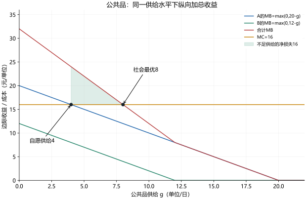

# 31 公共物品、共有资源与集体行动

## 学习目标与先修

先完成16、20、28、30章。本章约4—6小时，按竞争性与排他性分类，推导公共品的社会需求和自愿供给，理解搭便车；再用共有资源模型分析过度投入，并用Python检查分段边际收益和数值求根。

## 分类看消费性质，不看谁付款

**竞争性**指一个人使用会减少别人能使用的数量或质量。**排他性**指能否以合理成本阻止未付费者使用。二者是不同维度：

| 类型 | 竞争性 | 排他性 | 在适用条件下的例子 |
| --- | --- | --- | --- |
| 私人物品 | 有 | 有 | 一份餐食 |
| 俱乐部物品 | 弱或无，未拥堵时 | 有 | 有登录限制的数字服务 |
| 共有资源 | 有 | 难以排他 | 缺少有效准入约束的渔业资源 |
| 纯公共物品 | 无 | 难以排他 | 某些区域的公共安全信号 |

政府提供不自动等于公共品；免费不自动等于非竞争。道路和公园可能拥堵，技术和管理也可能改变排他成本。分类需要说明地点、使用规模与制度，不能只背名称。

## 为什么公共品要纵向加总

私人物品的不同人购买不同单位，在同一价格下把数量相加。公共品不同：同一供给水平g可以同时被多人享用，增加一单位g带来的**各人的边际收益相加**才是社会边际收益，这称为纵向加总。

设A边际收益MBA=max(0,20-g)，B为MBB=max(0,12-g)，每单位公共品成本MC=16。价格与边际收益单位均为元/单位，g是每日供给水平。各人收益以货币表达，暂假定收入效应可忽略、成本可分摊。

在0≤g≤12区间，两人边际收益之和32-2g。社会最优要求合计新增收益等于新增成本：32-2g=16，得g*=8。此时A新增收益12、B为4，合计16，而不是要求每人都愿意单独支付全部16。



## 总收益和净收益核对

本区间内，累计收益按边际曲线下面积计算：BA=20g-g²/2，BB=12g-g²/2。社会净收益：

```text
W(g)=BA+BB-16g=16g-g²
W(8)=64 元/日
```

若g超过12，B的边际收益已经截为0，不能继续用12-g得到负收益并积分；当前程序分段累计到各人饱和点。默认最优8未超过该点，但通用检查仍需覆盖分段。

## 自愿供给为什么可能不足

假设每人可以自己购买公共品供给单位，支付16乘自己的贡献，双方享受总供给。给定对方贡献，A希望总供给达到MBA=16，即gA目标4；B最高边际收益12小于16，不愿单独提供任何正量。

最佳反应使本例自愿均衡为A提供4、B提供0，总g=4。A累计收益72、支付64，净得8；B不付费仍获40，称为**搭便车**。社会净收益W(4)=48，比最优64少16。

这不表示参与者“不理性”，而是各人支付自己贡献的全部成本，却只把自己的受益计入选择。其他偏好、自愿组织、捐赠动机或机制可以改变结果，当前模型没有估计其现实大小。

## 分摊价格与真实报告问题

若按个性化边际受益分摊，在g8处让A每单位付12、B付4，两者合计覆盖16，这是**林达尔价格**的一个理想数值例子。A总付96、B付32，净收益各32。

但B在原自愿结果净得40，在此分摊下只有32。总剩余增加不意味着每人按这套具体付款都更好，仍需讨论分配与可能补偿。更重要的是，个人可能低报受益希望少付款；“知道真实需求后算价格”尚未解决怎样获得信息和执行缴费。

## 另一个问题：共有资源为什么容易过用

共有资源具有竞争性，自己使用会减少别人可得到的资源。设两位使用者分别投入努力e1、e2，总E=e1+e2，每人净收益为 `πi=ei*(8-E)`。它把扣除单位努力成本后的回报简化为随总努力下降的函数，是独立教学例子。

给定对手ej，自己的导数为8-2ei-ej，最佳反应ei=max(0,(8-ej)/2)。对称纳什各e=8/3，总E=16/3约5.333333。合计净收益E(8-E)=128/9约14.222222。

若共同最大化总净收益，导数8-2E=0得E*=4，净收益16。非合作总努力较多，收益反而较少，差额来自未内部化的拥挤或资源损害。该收益结构和古诺有相似数学形式，但这里选择的是资源使用努力，不是原商品市场的销售量。

准入、配额、产权安排、社区规则和监测都可能改变激励，同时各有信息与执行成本。不能只从“公有/私有”的名称推导成功或失败，也不能把共有资源和非竞争公共品的供给不足混作同一个数量问题。

## Python实验：二分法的含义

完整入口[public_goods.py](示例代码/stage5/public_goods.py)。在stage5目录Windows PowerShell执行 `python public_goods.py`，应显示最优g8、自愿g4、净收益64和48；独立资源例努力5.333333对比4。

为支持不同人的分段需求，public_good用**二分法**求社会边际收益与成本的交点：先选0和最大饱和量作边界，取中点；若中点边际收益仍高于成本，就提高下界，否则降低上界，反复缩小区间。单调性和包住交点的区间是这里可用该法的原因。

程序固定迭代80次，结果是浮点近似，不是符号推导。若起点的合计边际收益已不高于成本，直接取零供给边界，不强求正交点。本章手算g8提供独立校验。

## 常见错误

- 按政府或私人付款分类，忽略竞争性与排他性。
- 将公共品像私人物品一样把不同人的数量横向相加。
- 认为社会最优必须让每个人单独愿付全部边际成本。
- 总净收益提高后就断言任何分摊都让人人更好。
- 把共有资源的过度使用与公共品的供给不足混同。

## 练习与参考答案

1. MC改为20，偏好不变，最优和自愿供给？答：32-2g=20得g6，自愿两人单独都不愿提供正量，g0。
2. MC提高到40呢？答：g0处合计边际收益32已低于成本，社会最优也是0。
3. 给定原偏好，在g10时社会边际收益？答：A10+B2=12；不能把两人的最优数量相加作答。
4. 共有资源只剩一个使用者时本模型结果？答：他内部化全部拥挤成本，最优努力4，和社会最优相同；这不是关于所有现实独占制度的普遍结论。

## 完成条件

对四类物品各给有条件的例子，手算公共品纵向加总与自愿反应；解释二分法的前提，并分别说明公共品不足与共有资源过用的激励来源。
