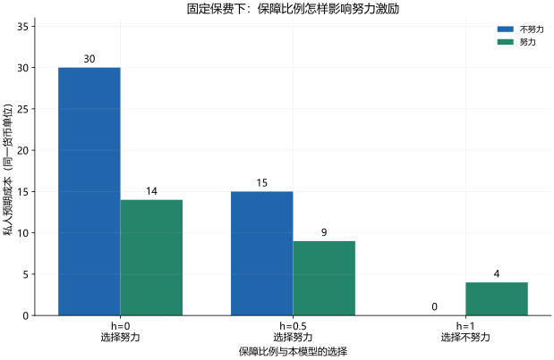

# 32 逆向选择、道德风险与制度

## 学习目标与先修

先完成22章风险、28章最佳反应和31章集体行动。本章约4—6小时，按信息时点区分逆向选择与道德风险，计算两品质市场的参与变化、保障对努力的激励，并理解信号、筛选与委托代理。完成第五阶段实践。

## 信息不完全与信息不对称

**信息不完全**指相关人不知道所有影响选择的事实；**信息不对称**指一方比另一方知道更多。双方都不知道未来天气属于前者，不一定存在后一种差异。

**隐藏类型**是签约前一方已知而另一方难以识别的特征，例如商品质量；**隐藏行动**是合同达成后难以观察或约束的行为，例如预防努力。区分重点是相对合同的信息与激励，而不是看到坏结果后猜谁“品德不好”。

## 两种品质的交易例子

设有很多潜在商品，初始高、低品质各占一半，价格都以同一虚构货币单位计：

| 类型 | 买方知道品质时的价值 | 卖方最低愿收价 |
| --- | --- | --- |
| 高品质 | 200 | 160 |
| 低品质 | 100 | 80 |

卖方知道自己的品质，买方购买前无法分辨，只知道进入交易池的比例。假设买方风险中性、竞争报价等于交易池平均价值，卖方在报价不低于保留价时参加。卖方保留价在本例作为出售的机会成本，不一定是历史生产支出。

若两类都参加，买方愿付0.5×200+0.5×100=150。高品质卖方至少要160，于是退出；剩下低品质，买方知道交易池已经变化，报价重新降为100。低品质保留价80，愿意继续卖，形成此简化过程的稳定结果。

不能一直沿用原先“一半高品质”的概率给剩下商品定价。参与决定改变了质量分布，这种机制称为**逆向选择**；这里低质量更容易留下，不代表所有有信息差的市场必然全部消失。

## 用同一基准比较交易净收益

品质可识别时，两类都存在互利交易：高品质净收益40、低品质20，按最初各占一半计算，每个原始潜在商品平均净收益30。选择后只有原先一半低品质交易，每个原始潜在商品平均净收益为0.5×20=10。

损失20来自本来可以交易的高品质退出；不是说每辆实际售出的低品质净收益只有10，后者仍为20。统计基准“按初始潜在商品”与“按实际成交商品”必须分开。

若高品质保留价降到140，原混合报价150足以让两类都参加；或者高品质初始占比提高到0.75，混合价值175也能支持当前160的高品质保留价。结论依赖参与条件，不能把一个例子当作所有市场的定律。

## 程序的选择过程与适用域

models.py中的lemons从两个类型开始，先按当前参与者的份额加权报价，移除不愿卖的类型，再更新报价，直到参与集合不变或为空。本函数要求高品质的价值与保留价排序都不低于低品质，使这套单向筛除有明确适用条件。

这是两个类型、竞争买方按期望价值报价的教学过程，不是完整的多品质市场均衡算法。若所有类型都退出，price返回None，交易份额0；None表示没有成交报价，不能擅自改成价格0。

## 道德风险：合同改变了行为回报

**道德风险**指在某些行动难以观察或写进合同时，保障、支付或责任安排改变了行为激励。名称不等于道德指责，理性的激励反应也会产生这种现象。

另设一个风险中性的期望成本模型：发生损失时损失100；不努力概率0.3，努力概率0.1；努力花费4。保险赔付比例h在0到1之间，且在选择努力时保费已固定。它**不沿用22章的log财富效用**，目的是单独观察激励，不求最优保险合同。

```text
不努力的私人预期成本 = (1-h)*0.3*100
努力的私人预期成本 = 4+(1-h)*0.1*100
```

| 保障比例h | 不努力成本 | 努力成本 | 私人选择 | 含努力资源成本的社会预期成本 |
| --- | --- | --- | --- | --- |
| 0 | 30 | 14 | 努力 | 14 |
| 0.5 | 15 | 9 | 努力 | 14 |
| 1 | 0 | 4 | 不努力 | 30 |

全保障下个人不再承担损失的财务部分，但努力仍花4，因此在这组假设中不愿努力。社会损失概率则上升，真实预期损失并未消失。保障可能同时有风险分担收益，22章已说明；不能仅凭这个风险中性激励例子断言现实保险整体有害。



## 合同怎样改善激励

努力有利的条件为 `4 <= (1-h)*(0.3-0.1)*100`，即h≤0.8。在恰好0.8时两种选择无差异，程序选择努力作为一个代表，不声称努力严格占优。部分自付、免赔、经验定价、监测等可能改善激励，也可能降低保障、增加管理成本或产生其他扭曲。

如果保险人按“努力”预计全赔付10，却实际得到不努力行为，期望赔付会是30。能预见行为的保险人需要在定价与设计时考虑它；把原低保费固定却假设长期没有亏损，会遗漏参与约束。当前函数只比较固定保费下的努力，不求保险供需和合同同时均衡。

## 信号、筛选与委托代理

**信号**由信息更多的一方选择某个可观察行为，希望传达类型；**筛选**由信息较少的一方设计选择菜单，利用不同类型的自选来揭示差异。例如可执行的质量承诺可能改变低质量模仿的成本，但仅有一个标签不自动可信。

独立信号例：获得某证书带来的工资增量6，高类型取得它成本2，低类型成本8。高类型净收益4，低类型-2，因此“高类型愿意、低类型不模仿”的激励条件成立。若工资增量达到8，低类型也可能愿意模仿，原条件失效。

这里没有证明完整信号均衡：雇主信念、工资形成、未观察到路径的判断与教育本身的生产力作用还需建模。信号并不表示所有教育都只起标签作用，也不表示取得证书一定提高每个人收入。

**委托代理**关注委托人把任务交给代理人，却难以完全观察其行动，双方目标可能不同。设计报酬时要同时考虑参与、努力、风险承担和核验成本。只按一个可量化指标奖励，还可能诱使代理人忽略未被计量的目标。

## Python实验与阶段整合

完整入口[information.py](示例代码/stage5/information.py)。在stage5目录Windows PowerShell执行 `python information.py`，应显示报价150后变为100、剩余low、交易份额0.50；h0和0.5时努力，h1时不努力。

整合入口[policy_lab.py](示例代码/stage5/policy_lab.py)运行：

```powershell
python policy_lab.py
python policy_lab.py --firms 3 --damage-slope 0 --coverage 1
```

第二次古诺Q72/P24，外部性模型中私人数量与社会最优均64、最优税0，隐藏行动模型不努力、社会成本30。三个参数分别改变独立模型，不表示已经联立求出一个现实政策组合。

第五阶段完成后，消费者与生产者、市场结构及市场失灵构成微观实验台v0.2；纯交换部分只是两人两商品的特殊一般均衡。宏观33—60与最终真实数据报告仍未交付。

## 常见错误

- 看到交易失败就断言存在欺诈，或把道德风险当作对个人品德的结论。
- 高品质退出后仍用原质量比例定价，或者混用成交量与原潜在数量的分母。
- 只计算保险赔款转移，忘记行为可能改变真实损失概率。
- 把固定保费下的行动比较当成最优保险合同已求解。
- 检验两条信号激励条件后就宣布存在唯一、稳定、现实有效的均衡。

## 练习与参考答案

1. 高品质保留价140，其他默认，参与结果？答：混合报价150，两类均愿交易，保留原交易池。
2. 默认保留价，高品质占0.75呢？答：混合报价175支持两类参加，交易份额1。
3. h=0.9时努力吗？答：不努力成本3，努力成本5，选择不努力；社会成本30。
4. 信号工资增量变为9，高成本类型会怎样？答：其净收益1，可愿意模仿；当前简单分离激励条件不成立。

## 完成条件

能按信息时点分类，逐轮更新交易池和报价，解释努力选择的成本口径与边界，再完成[第五阶段练习](第五阶段-练习与参考答案.md)和[实践验收](第五阶段-实践说明与验收.md)。
