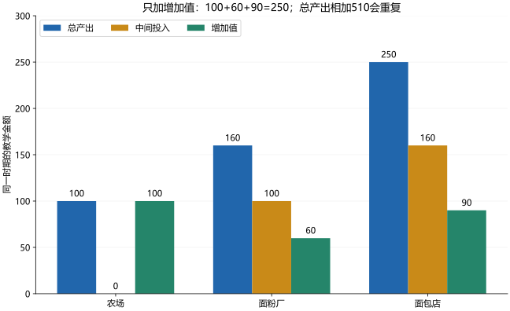

# 33 GDP、生产边界与三种核算

## 学习目标与先修

先完成03章单位与流量、11章CSV及前面的市场分析。本章约4—5小时，定义GDP的主体和时期，区分最终使用与中间投入，用生产、支出和收入三个视角复算同一经济。宏观指标先回答“统计了什么”，不急着解释景气变化的原因。

## GDP衡量什么

**国内生产总值GDP**概括一个经济体常住生产单位在一定时期内生产活动的最终成果，通常以货币计量。它是期间流量，不是某一天的财富存量，也不等于每个居民实际收到的钱。

“国内”主要对应经济领土和常住生产活动，不按企业股东国籍简单划分。外资在本经济体内的常住工厂生产通常计入本经济体GDP；本国企业海外子公司的生产不因股东国籍自动算回国内。跨境所得与国民收入的关系会在37章进一步区分。

**生产边界**规定哪些活动纳入核算。市场货物和服务、部分非市场服务及按制度估算的活动都可能计入，并非只有拿到现金发票才算。自有住房服务是常见估算项目；许多无酬家务不在常规GDP生产范围内。实际统计须按当地制度，不能拿“有用”或“花了钱”直接替代定义。

## 最终品与中间品取决于用途

**中间投入**是在当期生产中消耗掉的货物或服务。**最终使用**是消费、资本形成等最终用途。同一袋面粉卖给家庭直接食用，可作为最终消费；卖给面包厂继续加工，则是中间投入。不是给某种物理商品永久贴一个“中间品”标签。

机器可使用多年，通常计入固定资本形成，不把整台机器购买价当当期中间消耗。旧商品转手本身不是本期新生产，但经纪、维修等本期新服务可能产生增加值。买股票、债券属于金融资产交易，不等于宏观核算的实际投资；相关金融服务另按制度处理。

## 生产法：避免把同一价值重复相加

设一个封闭生产链，同一核算期、同一货币单位，无进口和需要另作的产品税价格转换：

| 环节 | 当期产出价值 | 当期中间投入 | 增加值=产出-中间投入 |
| --- | --- | --- | --- |
| 农场 | 100 | 0 | 100 |
| 磨坊 | 160 | 100 | 60 |
| 烘焙厂 | 250 | 160 | 90 |
| 合计 | 510 | 260 | 250 |

**增加值**衡量这一环节新增加的价值。直接把100、160、250相加得510，会将谷物、面粉的价值重复计入；增加值100+60+90=250才与本期最终产出一致。



真实国民账户还需要统一估价、税补贴及统计范围。例如按基本价格加总增加值时，要按相应制度转换到GDP使用的价格口径。本例先固定这些条件，让你看清重复计算的核心。

## 支出法：卖掉和没卖掉的产品怎样记

设最终面包中居民买了230，剩余20是本期生产后增加的存货。**资本形成或投资I**包括固定资本形成与存货变化；未售出不表示没有生产，存货增加20仍计入本期I。

本阶段统一符号：C为居民最终消费，G为政府最终消费，I为全经济资本形成（包括政府投资），X为出口、M为进口，NX=X-M。于是：

```text
Y = C + I + G + X - M
  = 230 + 20 + 0 + 0 - 0 = 250
```

某些教材把I只记私人投资，将政府投资放进广义政府购买G；也能得到同一总量，但必须整套转换。本课当前G只含政府最终消费，**政府投资已经在I，不得再加到G**。以后行为模型使用不同汇总时会另声明。

进口相减是为剔除已混入消费、投资等支出中的外国生产，不表示进口是“负生产”或必然有害。若农场使用了进口原料20，其增加值变80，整链GDP230；支出端230+20-20也为230。

存货变动须排除仅因持有价格上涨形成的收益。本期卖出旧存货可使存货投资为负，但不代表今年又生产了一遍旧商品。

## 收入法：同一增加值的分配视角

生产创造的增加值会形成劳动报酬、相关生产税净额、固定资本消耗和营业盈余等收入。简化分配为劳动报酬150、折旧20、净营业盈余80，税净额0，合计仍250。它不是在生产法250上再加250，而是从另一侧观察同一生产结果。

“总值”的总表示尚未扣固定资本消耗。若本例折旧20，国内生产净值NDP=250-20=230。不能把GDP250直接称为净新增财富，因为财富还涉及资产价格、毁损等其他变化。

政府现金转移不直接作为当期生产的G；受领人随后购买本期产品时再按最终用途计入，避免把钱的转手重复当生产。统计实践中三种方法资料来源不同，可能出现统计差异；本教学链故意完全闭合。

## Python完整实验

入口[gdp_accounting.py](示例代码/stage6/gdp_accounting.py)与[macro.py](示例代码/stage6/macro.py)、data目录一起保存。Windows PowerShell执行，其他解压位置替换路径：

```powershell
Set-Location 'C:\Users\17597\Desktop\tutorial\content\western-economics\source\示例代码\stage6'
python gdp_accounting.py
```

应显示各环节增加值100、60、90，GDP250、销售额错误合计510；支出法250；进口原料变体两侧都230。程序用相对源文件的路径读CSV，从其他工作目录启动也可定位数据。

修改进口情景时，`[dict(row) for row in rows]`为每条记录建立新字典，避免改掉原始表里的记录。没有覆写CSV，也没有联网获取实时GDP。各示例的单位和来源见[宏观数据字典](宏观指标口径与数据字典.md)。

## GDP与福利还隔着哪些问题

GDP对产出规模有用，却不能单独回答收入分配、闲暇、环境损害、无酬劳动或健康状况。污染治理支出增加可能计入生产，但损害本身不因此消失。需要结合30章完整成本和其他指标判断，不能让一个总量承担全部福利评价。

## 常见错误

- 把每个环节销售额相加，或把三种核算方法再相加。
- 将投资理解成所有资产购买，或让政府投资在G和I重复。
- 认为未售出的本期产品不计GDP，或把存货涨价算新生产。
- 用国籍替代常住生产范围，用流量GDP替代财富存量。
- 把转移支付直接当生产，或将GDP当每个人实际收入。

## 练习与参考答案

1. 链条产出改为120、190、300，对应中间投入0、120、190，GDP？答：120+70+110=300，销售额610会重复计算。
2. 上题最终消费270、存货增加30，支出法？答：270+30=300。
3. 购买新设备50和购买已有股票50都属于I吗？答：新生产设备通常属于固定资本形成；股票购买本身是金融资产交易，不作为相同I。
4. 固定资本消耗25、GDP300，NDP？答：275；仍需区分净产出流量与完整财富变化。

## 完成条件

手工对齐三个核算视角，解释一项最终与中间用途、一项金融交易、一项存货变化；运行后能说清进口相减和政府投资的符号口径。
