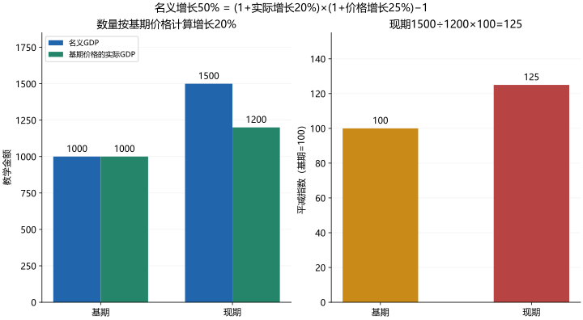

# 34 名义、实际GDP与平减指数

## 学习目标与先修

先完成03、10和33章。本章约4—5小时，用两种商品分开价格与数量影响，计算固定基期实际GDP与隐含平减指数，理解增长率的乘法关系，并区分更换价格权重与仅调整指数参考尺度。

## 名义金额为什么会误导产出比较

**名义GDP**使用各期当时价格计算本期产出价值。即使实际生产没有变化，价格上涨也会使名义量上升。**实际GDP或产出量指标**试图剔除价格影响，比较产出数量的变化。

多种商品不能把“面包件数”和“牛奶盒数”直接相加。价格权重为异质产品提供一种共同计量方式。本章先采用最容易复算的固定基期价格模型，不把它说成所有统计机构唯一的方法。

## 两品、两期的完整表

与33章生产链分开，另设一个只有两种最终品的经济，无中间品和对外交易：

| 商品 | 基期价格p0 | 基期数量q0 | 当期价格p1 | 当期数量q1 |
| --- | --- | --- | --- | --- |
| 面包 | 5 | 100 | 6 | 200 |
| 牛奶 | 10 | 50 | 15 | 20 |

价格单位为元/相应单位，数量均对应同一长度的时期。

```text
基期名义 = 5*100 + 10*50 = 1000
当期名义 = 6*200 + 15*20 = 1500
当期按基期价格的实际量 = 5*200 + 10*20 = 1200
```

名义增长50%，基期价格衡量的产出只增长20%。面包数量翻倍、牛奶减少，结果是经过价格权重加总的变化，不是两种数量增长率的简单平均。



## 隐含GDP平减指数

**GDP平减指数**在这套固定基期模型中为名义GDP除实际GDP，再乘100。本期1500/1200×100=125，基期为100，隐含价格涨幅25%。125是指数水平，不是“涨了125%”。

基期价格实际量主要固定价格、使用当期数量；隐含价格指数因此反映当期产出组合下的价格关系。它不是35章固定消费者购买数量的篮子，两者即使用同一两种商品也可以不同。

如果当前产出数量全部为0，实际量和名义量都为0，名义除实际的平减指数没有定义。配套模块用None表示，不把它硬填成100或0。实际官方指标遇到边界还需遵循相应发布规则，本课只展示数学口径。

## 增长分解必须用乘法

由于N=实际量R×价格指数P/100，同一口径下有：

```text
1+名义增长率 = (1+实际增长率)*(1+隐含价格增长率)
1.50 = 1.20 * 1.25
```

直接20%+25%=45%会遗漏5%的交互项。反过来，已知名义增长50%、价格指数涨25%，实际增长为1.50/1.25-1=20%。只有变动很小时，用增长率相减才是近似。

把所有名义GDP都除以某个CPI也不自动得到官方实际GDP，因为覆盖范围、权重、价格来源和详细计算层级不同。需使用与被缩减总量匹配的价格指标。

## 基期、参考期与链式指标

**价格基期**决定固定价格例子使用哪套价格。若本表改用当期价格衡量两期产出，前期为6×100+15×50=1350，当期1500，对应数量增长约11.11%，与原20%不同，因为价格权重真的变了。

**指数参考期**只是将同一条既定指数重新标成某期=100，相当于整体乘一个常数，不改变该序列的增长率。不要把“换一套权重重新计算”与“同一数量指数换显示尺度”混为一谈。

**链式数量指标**逐期比较相邻时期，再把变化串联，减少长期固定旧权重的问题。不同机构的具体公式不同。美国BEA说明其链式美元分项在参考期以外通常不可直接相加；这和本课固定价格小表的可加性不同，详见[BEA原文](https://www.bea.gov/help/glossary/chained-dollar-estimates)，核验2026-11-13。

本批代码只实现固定基期小表，没有声称重建官方链式Fisher数量指标。读真实数据时要先看计价和参考期说明，也不能由CPI基期推断GDP实际量基期。

## 总量与人均

**人均实际GDP**用实际总量除相同地域和时期的平均人口。若实际总量增20%、人口增10%，人均变化为1.2/1.1-1约9.09%，不是简单增长10%。人均量仍是平均数，不说明每个人都得到同样收入或生活改善。

## Python实验与零分母

入口[price_volume.py](示例代码/stage6/price_volume.py)，使用[goods.csv](示例代码/stage6/data/goods.csv)。在stage6目录Windows PowerShell执行 `python price_volume.py`，预期：名义1000到1500、实际1200、平减指数125，三种增长50%、20%、25%。

共享模块先检查价格、数量与商品标识，拒绝重复商品，避免同一记录重复计入。价格在这份简化市场表中要求为正，数量可为0；基期总量为0无法建立增长比较，明确报错。当期总量为0时平减指数返回None，显示为undefined。

Python中的 `None`与0含义不同。输出前用条件判断是否为None，属于对“没有定义”状态的处理，并非对坏数据静默填补。

## 常见错误

- 把名义增长全部解释为实物产出增加，或直接平均各商品数量增长率。
- 认为所有价格指数权重和覆盖都相同。
- 把重新选价格权重与单纯指数改标混为一谈。
- 用链式分项随意相加、算份额，却不检查该序列可加性。
- 将0/0填成0，或把人均平均量当作每个人收入。

## 练习与参考答案

1. 如果只把两种当期价格改回基期价，数量不变，结果？答：当期名义与实际都1200，平减指数100，名义和实际增长都20%。
2. 如果只保持数量等于基期，使用当期价，结果？答：名义1350、实际1000，平减指数135，实际增长0。
3. 名义增长12%、匹配价格指数涨4%，实际增幅？答：1.12/1.04-1约7.692308%。
4. 将既定指数100、120整体乘0.5，增长改变吗？答：变成50、60，增长仍20%；未换价格权重。

## 完成条件

独立写出三组“价格×数量”加总，复算增长乘法关系；能说明固定基期、参考尺度、链式和人均的不同问题。
