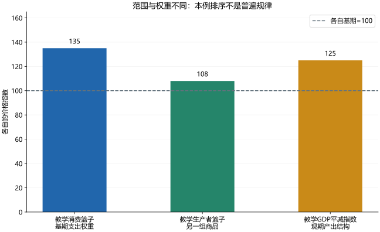

# 35 CPI、PPI、通货膨胀与实际利率

## 学习目标与先修

先完成第34章，会计算增长率和价格乘数量。本章要能解释价格指数的篮子与权重，区分指数水平、同比涨幅和通胀变化，并把名义收入、名义利率换成购买力变化。Python使用第08—10章的列表、字典、函数和格式化输出。全部数值为虚构教学数据，不能解释为中国实际CPI或PPI。

## 1. 价格指数先问“谁买什么”

居民消费价格指数（CPI）描述居民购买消费商品和服务的价格变化；工业生产者出厂价格指数（PPI）观察工业产品第一次出售时的出厂价格变化。工业生产者购进价格指数又是另一项指标。不要把PPI理解为所有生产成本或全部企业售价的统一涨幅。

价格指数需要一个参照：把基期价格水平写成100，再看同一统计范围的价格相对变化。指数135表示相对该基期高35%，不是每一件商品都涨35%，也不意味着本月比上月涨35%。

官方CPI要处理代表规格品、采价、权重、质量变化、商品替换等问题。课堂先把数量固定，构造最简单的基期篮子指数。它帮助理解原理，不是官方完整编制程序。[国家统计局：居民消费价格指数的编制](https://www.stats.gov.cn/zs/tjws/tjzb/202301/t20230101_1903757.html)（核验：2026-11-13）。

## 2. 用同一篮子比较两次购物账单

继续使用第34章两种商品，但这次**固定基期数量**。

| 商品 | 基期价格 | 固定购买量 | 现期价格 | 基期账单 | 现期买原篮子账单 |
| --- | ---: | ---: | ---: | ---: | ---: |
| A | 5 | 100 | 6 | 500 | 600 |
| B | 10 | 50 | 15 | 500 | 750 |
| 合计 | | | | 1000 | 1350 |

固定篮子价格指数 = 1350÷1000×100 = 135；相对基期通胀率 = 135÷100−1 = 35%。现期实际购买量变成多少，不影响这个固定篮子计算。

也可先求价格相对数：A为6÷5=1.2，B为15÷10=1.5。基期支出各500，权重各0.5，因此指数为100×(0.5×1.2+0.5×1.5)=135。权重来自**支出金额占比**，不是100件和50件的数量占比；不同商品“件”的含义也不能随意相加。

这种固定篮子有局限。若B涨价后居民改买A，继续买原篮子可能高估维持同类生活满足所需的支出变化；但质量、新商品等还会造成其他测量问题，不能断言真实指数总有一个固定方向的误差。

## 3. 为什么三个指数可以不同

另造一个生产者篮子：钢材基期6单位、价格10，化工品2单位、价格20；现价分别12和18。基期金额60+40=100，现期原篮子金额72+36=108，所以教学生产者指数为108。

第34章GDP平减指数为125，本章消费篮子为135，生产者篮子为108。三者覆盖对象和权重不同，这个排序只是本例结果。消费价格可包含进口消费品；GDP平减指数关注国内生产的最终产品与服务，也含投资品等。生产者价格向消费价格的传递受到进口、工资、税费、利润、合同和服务价格等影响，不能套一个固定滞后或固定比例。



真实指数还会换基和更新权重。国家统计局说明，自2026年起CPI、PPI以2025年为基期编制，基期轮换伴随调查目录和权数等调整；月度对比的权重也不能机械照搬一张旧基期权重表。阅读报告应核对其当期说明。[国家统计局：2026年价格指数基期轮换解读](https://www.stats.gov.cn/xxgk/jd/sjjd2020/202602/t20260211_1962589.html)（核验：2026-11-13）。本课固定篮子保持不变，是为了可手算复核。

## 4. 通胀下降不等于价格下降

独立设某指数连续三期为100、135、140.4。第二期通胀35%，第三期相对第二期为140.4÷135−1=4%。涨价速度降低了31个百分点，但第三期价格水平仍上升4%。

“通胀率下降”常称通胀放缓；“价格水平下降”对应负的通胀率。若第四期降到137.592，则第四期通胀为−2%，价格仍比最初100高37.592%。比较百分比时写清分母。同比比较上年同期，环比比较上一期，二者不能只看数值大小判断趋势。

## 5. 实际购买力用除法扣除价格变化

存款初值100，名义利率10%，期末110；物价上涨5%，原来100元的篮子变105元。期末可买110÷105份原篮子，因此实际利率为：

```text
1 + 实际利率 = (1 + 名义利率) / (1 + 通胀率)
实际利率 = 1.10 / 1.05 - 1 = 4.761905%
```

“名义利率减通胀率”给5%，只是小幅变动时的近似。预期实际利率用预期通胀，事后实际利率用实现的通胀；存款税费和风险尚未计入此简单例子。物价指数也要匹配研究对象的消费范围。

若名义收入只涨10%，而相同期间消费价格指数涨35%，实际收入变化为1.10÷1.35−1=−18.518519%，不能直接算10%−35%=−25%。正的名义增长可以伴随购买力下降。

## 6. 运行完整程序

在Windows PowerShell进入课程示例目录；若你已有其他位置的副本，替换绝对路径。以下命令使用第05章已经配置的`python`。

```powershell
Set-Location 'C:\Users\17597\Desktop\tutorial\content\western-economics\source\示例代码\stage6'
python inflation.py
```

完整程序是[inflation.py](示例代码/stage6/inflation.py)，共用函数在[macro.py](示例代码/stage6/macro.py)。观察消费篮子135、生产者篮子108、实际利率4.761905%、实际收入−18.518519%。最后的35%和4%来自独立指数序列，不要当成前面两个不同篮子的连续时期。

`fixed_basket_index(rows)`接收记录列表，返回字典；`result["index_base_100"]`读取一个数值。Python百分数用小数存放，0.35代表35%；`:.6%`负责显示，不改变数值。完整程序与需要上下文的函数调用要区别开；不要把一句调用从文件里抽出后直接运行。

## 常见错误

- 指数135写成“物价上涨135%”：指数相对100高35%。
- 把消费支出权重换成商品件数权重：单位不可直接比较。
- 用本例的固定篮子代替官方每月编制流程，或把2025年的旧说明当2026年新权重。
- 通胀从35%降到4%便说物价跌31%：变化是31个百分点，价格仍涨。
- 名义利率10%输入为`10`：程序会把它理解成1000%，应输入`0.10`。

## 练习与参考答案

1. 篮子两种商品基期支出权重分别80%、20%，价格分别上涨10%、下降5%。指数多少？答：100×(0.8×1.1+0.2×0.95)=107，通胀7%。
2. 指数120升到126，再升到127.26，两次涨幅多少？答：5%和1%；通胀放缓4个百分点，第二次没有降价。
3. 工资涨8%、物价涨6%，实际工资变化多少？答：1.08÷1.06−1≈1.886792%。
4. 名义利率3%、通胀5%，实际利率多少？答：1.03÷1.05−1≈−1.904762%；本金名义增加而购买力减少。
5. CPI高于PPI是否证明零售企业利润都提高？答：不能，篮子、行业、权重、其他成本不同，聚合指数不能识别每家企业利润。

## 完成条件

能不看代码复算135和108，说明与平减指数125的差异；能区分指数水平、百分比、百分点；能用精确公式计算实际利率并运行程序。随后进入第36章，学习另一个容易用错分母的指标。
