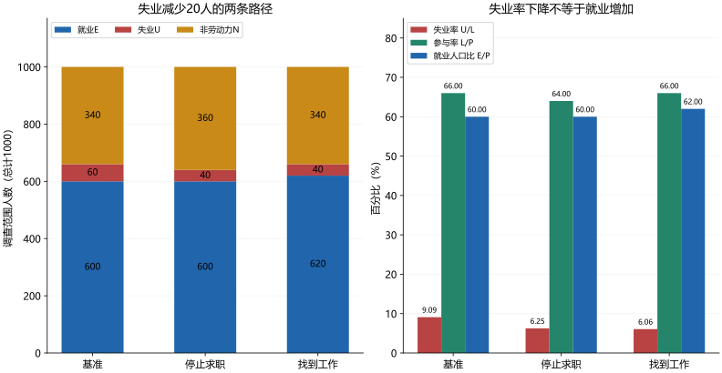

# 36 就业、失业与劳动参与

## 学习目标与先修

先完成第35章，掌握比例、百分比和百分点。本章能把调查范围内的人划分为就业、失业和非劳动力三类，计算三种指标，并解释“失业率下降但没有新增就业”的情形。Python继续用列表循环、函数返回字典；未定义的比率用`None`保存。

## 1. 先确定调查对象和状态

就业不是“收入很高”，失业也不是“现在没有正式工作”。统计需要可操作的规则：参照哪一周、是否工作或暂时离岗、是否积极找工作、能否在规定时间内到岗。学生、退休者也不能仅凭身份自动归类，要看具体统计范围和活动状态。

国家统计局2018年关于城镇调查失业率的说明以16周岁及以上人口为基础，介绍了参考周工作1小时及以上或在职暂未工作、近3个月积极求职及能在2周内开始工作等基本规则，并说明调查与户籍登记口径不同。[国家统计局：城镇调查失业率有关问题解答](https://www.stats.gov.cn/sj/sjjd/202302/t20230202_1896008.html)（原文发布2018-04-17，核验2026-11-13）。这份基础说明不是对所有年份、所有年龄分组口径的替代；使用某期青年失业率等细分指标，还须查该期是否排除在校生、年龄范围及其他说明。

本课虚构一个调查范围明确、人口不变的1000人总体。它不是全国总人口，也不预设为16—59岁的“劳动年龄人口”；将16岁及以上调查范围与某种劳动年龄定义混用，会改变分母。后面的数值没有任何真实地区含义。

在这个总体中：

| 符号 | 名称 | 本例含义 |
| --- | --- | --- |
| E | 就业人口 | 符合所选统计就业规则的人 |
| U | 失业人口 | 没有就业，同时符合求职、可到岗等规则的人 |
| N | 非劳动力人口 | 此调查总体中不属于E或U的人 |
| L | 劳动力人口 | E+U |
| P | 调查范围人口 | E+U+N |

没有工作但不满足求职和可到岗条件的人可能归入N。非劳动力不是失业率分母的一部分；这不代表他们的生活困难不重要，只是指标回答的问题不同。

## 2. 同一组人数，三个不同分母

基准E=600、U=60、N=340，因此L=660、P=1000：

```text
失业率 = U / (E+U) = 60/660 = 9.090909%
劳动参与率 = (E+U) / P = 660/1000 = 66%
就业人口比 = E / P = 600/1000 = 60%
```

失业率回答参与劳动力市场的人中有多少失业；参与率回答总体中多少人进入劳动力市场；就业人口比回答总体中多少人就业。把60÷1000=6%叫失业率，会把一个不同的比例贴上错误名称。

三者有一个可核对的关系：就业人口比 = 劳动参与率×(1−失业率)。基准为0.66×(1−60/660)=0.60。使用小数计算后再格式化，避免先把9.0909%四舍五入成9%造成偏差。

## 3. 失业率下降可以来自不同变化

情景A中20名失业者停止积极求职，其他人状态不变。E仍600，U降40，N升360，L降640。失业率40÷640=6.25%，参与率降64%，就业人口比仍60%。统计上的失业率改善伴随退出劳动力市场，不能描述成“新增20份工作”。

情景B中20名失业者获得工作。E升620，U降40，N仍340，L仍660。失业率40÷660≈6.060606%，参与率仍66%，就业人口比升62%。A与B的失业人数同为40，经济含义不同。



这里A仅表示符合某种退出求职的情景。现实中的状态转移可能同时发生：就业者失去工作、退休、新毕业者开始求职、人口迁移等。单看一个总量变化无法还原每一种流动。就业人数增加也可能由人口扩大带来，要同时看人口比与调查范围。

## 4. 不同“失业”概念回答什么

摩擦性失业强调寻找与匹配需要时间；结构性失业强调技能、地区、行业等错配；周期性失业强调总需求与经济波动。这些是解释机制，不是把统计调查中的每个人简单分到三个互斥标签。

自然失业率不是零失业，也不是直接观察到的固定常数。它与劳动市场结构、政策和估计模型有关。本阶段只测量人数与比率，不从三行数据估计自然失业率，也不据失业率变动立即推断通胀会变化多少。后续短期宏观模型会单独介绍这些关系的条件。

登记失业、调查失业、领取失业保险人数是不同统计制度，不能拼接成一条无断点序列。各国求职期限、年龄、地域等也可能不同，国际比较需先核对元数据。

## 5. 运行和阅读Python结果

在Windows PowerShell执行：

```powershell
Set-Location 'C:\Users\17597\Desktop\tutorial\content\western-economics\source\示例代码\stage6'
python labour.py
```

完整程序[labour.py](示例代码/stage6/labour.py)读取[data/labour.csv](示例代码/stage6/data/labour.csv)。三行依次是`base`、`discouraged`、`job_growth`。记录中的`outside`表示N，不是境外人口。

模块[macro.py](示例代码/stage6/macro.py)先核对E+U+N是否等于记录中的P；不相等时抛出`ValueError`。这可以防止人数录错，但不能验证调查的代表性。`if value is not None`是在检查“有没有定义”，不要换成`if value`：合法的0失业率也会被后者当成假值。

若E=U=0、N=100，则参与率和就业人口比为0，失业率分母为0，应为未定义，而非0%。若P=0，三种比率均无相应有效分母。程序将这些比率保存为`None`，输出`undefined`；综合JSON中对应`null`。缺少分母不是发现零失业。

## 常见错误

- 用总人口替代劳动力人口计算失业率。
- 认为所有无工作的人都是失业者，或所有退休者一律不是就业者。
- 失业率降就断言岗位增加，忽略参与率及人口变化。
- 把一份历史基础定义当成当期所有细分统计的完整口径。
- 用`None`参与百分数格式化，或为了方便把未定义值填成0。

## 练习与参考答案

1. E=720、U=80、N=200，求三个比例。答：失业率10%，参与率80%，就业人口比72%；0.8×0.9=0.72。
2. 上题40名失业者停止求职，求新指标。答：E720、U40、N240，失业率40/760≈5.263158%，参与率76%，就业人口比72%。
3. 改为40人全部就业。答：E760、U40、N200；失业率5%，参与率80%，就业人口比76%。
4. E=0、U=0、N=20，失业率是否0？答：未定义；0÷0没有可用的比率。
5. 某两地分别公布登记失业率和调查失业率，能直接排名吗？答：先核对对象、定义、时间和采集方法，不能把名称相似当成口径一致。

## 完成条件

能画出E、U、N的关系，独立复算三种情景；能解释退出求职与找到工作的差异；会检查分母为零和CSV人数不一致。下一章把视角从人口转向各部门的收入、消费与储蓄。
