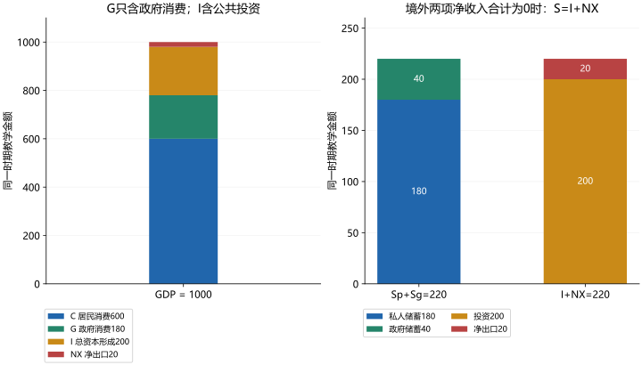

# 37 国民收入、储蓄与部门收支恒等式

## 学习目标与先修

先完成第33—36章，知道GDP、折旧、现价与不变价。本章学习国民收入与可支配收入，推导私人、政府和对外收支的会计联系，用Python检查账目是否一致。最重要的完成标准是能解释：恒等式约束一套已经实现的账目，不能单独预测政策效果。

## 1. 先把符号口径固定

同一时期、同一价格口径、同一统计边界下，支出法GDP为Y=C+G+I+X−M。所有数值都是该时期流量。本课沿用第33章约定：

| 符号 | 本章含义 |
| --- | --- |
| C | 居民最终消费支出 |
| G | 政府最终消费支出 |
| I | 资本形成总额，包括公共与私人投资、存货变化 |
| X、M、NX | 出口、进口、净出口NX=X−M |
| T | 政府收到的净税收，简化为税收减向私人转移支付 |
| S | 总储蓄，尚未扣折旧的“总额”口径 |

一些宏观教材把G定义为政府购买、I仅指私人投资。那也是可以使用的分组，但不能与本章混用。本章公共基础设施投资进入I，不再进入G；政府养老金等转移支付本身不是G。后续模型若改用宽口径政府购买，将明确重新分组。官方支出法的居民消费、政府消费、资本形成分类可见[国家统计局支出法GDP说明](https://www.stats.gov.cn/zs/tjws/zytjzbqs/gnsczz/202412/t20241220_1957806.html)（核验2026-11-13）。

私人部门在这里合并居民与企业；企业未分配收入等包含在合并部门的储蓄中。T把复杂政府收支简化为净税收。本章不是完整政府财政报表，也没有区分每种税和资本转移。

## 2. 从GDP到国民可支配收入

GDP按常住生产单位在经济领土内的生产衡量；国民总收入GNI还加上来自境外的初次收入净额，例如按国民核算归属的劳动报酬和投资收益的净流入。这里用NPI表示该净额：GNI=Y+NPI。

再加来自境外的经常转移净额NCT，得到国民可支配总收入GNDI=Y+NPI+NCT。经常转移与借款、股票买卖等金融交易不同，也不能把所有跨境汇款直接归为同一类别。实际统计需查国际收支及国民核算分类。本章只用这两个净额解释恒等式的扩展。

“总额”包括用于弥补固定资本消耗的部分；扣除相应折旧后得到净额。比较储蓄和投资时，两边应都用总额或都用净额。本课全部采用总额，不把净储蓄和总投资拼在一起。收入、可支配收入和对外账户的分类可核对[国家统计局年鉴指标解释](https://www.stats.gov.cn/sj/ndsj/2021/html/zb03.htm)（核验2026-11-13）；下面的简化部门设定和数字由本课独立编写。

## 3. 从一套能对上的小账本推导

基准取Y=1000、C=600、G=180、I=200、X=90、M=70、T=220，境外两项净收入先为0。

```text
支出合计 = 600+180+200+90-70 = 1000
私人总储蓄 Sp = Y-T-C = 1000-220-600 = 180
政府总储蓄 Sg = T-G = 220-180 = 40
国民总储蓄 S = Sp+Sg = 220
净出口 NX = X-M = 20
S = I+NX = 200+20 = 220
```

私人储蓄不是存款余额，储蓄是收入中未用于最终消费的当期流量，资产余额是存量。政府总储蓄40也不等于全部财政预算盈余：本章G排除公共投资，I包含公共投资；算政府净借贷还要考虑公共投资和资本转移等项目。



在净境外初次收入和净经常转移均为0的简化下：Y−C−G=I+NX。若是封闭经济，还可令X=M=0，得到S=I。事前计划储蓄可能不等于计划投资；事后国民核算中的存货变化计入I，恒等式仍是核算约束。存货意外积压并不表示企业原先就希望如此。

## 4. 境外收入存在时，右边是经常账户

保持GDP支出账不变，另取NPI=10、NCT=−5，故GNDI=1005。本课把这些净收入归入合并私人部门，政府仍按简化T与G处理：

```text
Sp = GNDI-T-C = 1005-220-600 = 185
Sg = T-G = 40
S = GNDI-C-G = 225
CA = NX+NPI+NCT = 20+10-5 = 25
S-I = 225-200 = 25 = CA
```

CA表示经常账户余额，包括货物服务净出口、初次收入净额和经常转移净额。当两项境外净收入合计为0时，CA等于NX；两项各为0是本课基准的简化情况。本例S−I为25而NX为20；把二者始终画等号会漏掉5。

进一步写成(Sp−I)+(T−G)=CA，其中I仍含公共与私人投资，因此第一项不是严格的“私人部门净借贷”。如果要分别讨论私人和政府净借贷，应把投资按部门拆开，再加上资本账户项目等必要调整。这个公式当前只展示代数关系，不赋予错误的部门标签。

## 5. 会计约束不能替代行为模型

保持Y、C、I、X、M不动，单把G从180改成190，支出合计变1010。程序会报告GDP残差Y−支出=−10，并将`consistent`置为`false`。它不会自动把Y改成1010，也不会宣称政府多花10会令产出多10。

实际变化中居民消费、投资、进口、价格、利率、库存和产出可能共同调整。预测需要行为方程、供给约束、时间与政策条件；这些在第39章起逐步构建。类似地，T下降不等于私人消费必定同比例上升；恒等式没有告诉我们边际消费倾向。

外部部门余额与国内收支相连，也不能单凭S−I=CA证明某一种贸易政策必定改变储蓄、投资或福利。推论要与所用机制相匹配。

## 6. 运行完整程序并理解字典展开

在Windows PowerShell执行：

```powershell
Set-Location 'C:\Users\17597\Desktop\tutorial\content\western-economics\source\示例代码\stage6'
python sector_balances.py
```

完整程序[sector_balances.py](示例代码/stage6/sector_balances.py)先读[accounts.json](示例代码/stage6/data/accounts.json)，输出残差0、储蓄180和40，随后输出扩展情景GNDI1005、S225、CA25。

JSON对象载入Python后是字典。需要上下文的调用`national_accounts(**inputs)`把键值展开为同名关键字参数；例如字典`{"y":1000,"c":600}`展开相当于传入`y=1000,c=600`，但完整函数还需要其他参数，两个键的片段不能单独作为本章完整调用。`load_accounts()`检查完整键名集合，少键、多键或拼错都会拒绝。

模块计算两个残差：GDP支出残差，以及S−I−CA。按上述定义两者应相同，账目一致时均接近0。浮点数用很小容差比较，不能把0.0000000000001元一类运算误差当统计经济现象。现实统计差异还涉及独立资料来源和核算调整，本例没有模拟那些误差。

## 常见错误

- 把国民总收入、GDP和居民可支配收入混为一谈。
- G计政府全部购买，同时I又含公共投资，造成重复。
- 将政府总储蓄直接称为完整预算盈余。
- 境外净收入不为0时，仍写S−I=NX。
- 只修改支出一个项目便把残差解释成政策乘数。

## 练习与参考答案

1. 基准只把T改为240，其他不变。答：Sp160、Sg60、S220，GDP账仍一致；这不是预测税收增加后消费会保持600。
2. G改190而所有其他输入不变。答：支出1010、GDP残差−10；S210、S−I−CA=−10。应查输入或构建调整机制，不能静默篡改数据。
3. 基准NPI=−12、NCT=2，求GNDI、S、CA。答：990、210、10，S−I=10。
4. 一个封闭经济总投资80，政府总储蓄−10，账户一致，私人总储蓄多少？答：S=I=80，因此Sp=90；这是事后账目约束。
5. 政府消费180、公共投资30时，能否把G写210、I仍写200？答：不能；若公共投资已在I中，宽口径G改210时必须从I移出30并说明口径变化。

## 完成条件

能从GDP支出恒等式推到简化S=I+NX，再扩展到S−I=CA；能说明G与I的约定，能复算两个残差，并解释为什么它们不能给出政策因果结论。随后学习如何读真实发布中的时间、单位与修订。
