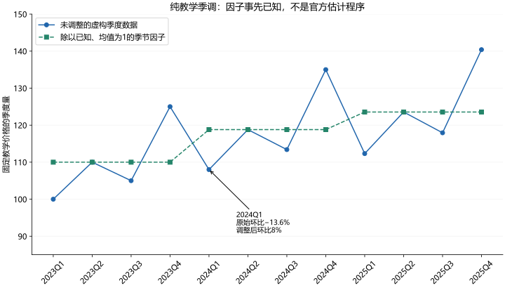
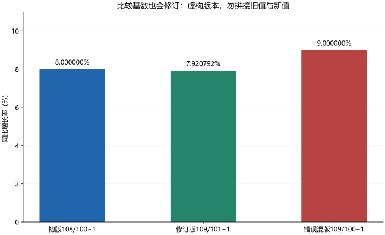

# 38 宏观数据阅读、季度比较与修订实验

## 学习目标与先修

先完成第33—37章，会区分名义与实际、价格水平与增长率。本章建立数据阅读顺序，学会季度同比、环比、年度合计、累计转当季、季节调整与数据版本比较。通过完整Python程序交付宏观核算实验台v0.3，并独立完成一份官方历史公告阅读记录。

## 1. 拿到数字，先记录七件事

在计算前写出指标名称、统计范围、参考时期、单位、价格或基期口径、是否季调、发布版本与日期。还有来源链接及读取日期。元数据是描述数据含义的数据；少一项可能让看似正确的除法变成错误比较。

例如“2024年GDP、亿元、现价、年度、最终核实”与“2024年一季度实际GDP同比、%、不变价”不是同一列。GDP通常是时期流量，季度GDP可合计为全年；期末人口或存款余额是时点存量，不能把四个季度末余额相加当全年余额。增长率也通常不能直接相加或算术平均得到全年增长。

本章两类材料分开保存：[data目录说明](宏观指标口径与数据字典.md)中的数值实验全部人为构造；[官方数据阅读记录](官方数据阅读记录.md)只摘录一份可追溯的历史GDP公告用于练习读口径。真实公告的总量不参与虚构模型计算。

## 2. 同比与环比比较的不是同一个基数

教学GDP序列采用同一固定教学价格口径，单位为“教学计量单位”，未季调：

| 年份 | Q1 | Q2 | Q3 | Q4 | 年合计 |
| --- | ---: | ---: | ---: | ---: | ---: |
| 2023 | 100 | 110 | 105 | 125 | 440 |
| 2024 | 108 | 118.8 | 113.4 | 135 | 475.2 |
| 2025 | 112.32 | 123.552 | 117.936 | 140.4 | 494.208 |

Q是季度。2024Q1同比与2023Q1比较：108÷100−1=8%；环比与2023Q4比较：108÷125−1=−13.6%。同一时点一个正一个负并不矛盾。年增长2024为475.2÷440−1=8%，2025为494.208÷475.2−1=4%。本例每年各季同比刚好相同，是为了方便核验；一般序列全年增长需用年度总量或上一年各季的相应权重计算。

同比也可能受基数效应影响：去年某期异常低，即使本期变化不大，同比也可能很高。环比更接近相邻期变化，却容易混入季节性。不要任意选择较好看的一个比率。

## 3. 季节调整是测量步骤，不是抹掉所有波动

本例故意每年重复乘上四个已知季节系数1、1.1、1.05、1.25，例如2023的基础水平100乘这些系数得到四季数值。系数平均为1.1，先除以1.1使四个系数平均为1，再让原数据除以对应的标准化系数。

```text
Q1标准化季节系数 = 1/1.1
2023Q1已知因子调整值 = 100/(1/1.1) = 110
2024Q1已知因子调整值 = 108/(1/1.1) = 118.8
调整后2024Q1环比 = 118.8/110-1 = 8%
```

调整后2023每季均为110，2024为118.8，2025为123.552，所以每年内部的调整后环比为0，跨年Q1才有8%或4%的水平变化。这个阶梯形变化也是预设数据构造，不是对真实经济的判断。



在这个特殊构造中，标准化后的年度合计与原年度合计相等。一般数据即使平均因子为1，直接相除也不保证年度总量相等；官方方法还可能有年度约束和其他调整。真实季调要估计季节项并处理日历、春节、异常值和修订，本课没有实现这些估计程序。不能把这四个系数套到实际GDP数据上。

有的报告把季调环比按年率表达：若季度环比2%，年化为1.02的4次方减1≈8.243216%。这是假定相同季度增长连续四次的换算，不是已经发生的全年增长，也不是自动形成的预测。

## 4. 累计数先转当季，不要重复相加

另一个需要上下文的概念模型：若同年累计GDP依次100、210、315、440，那么当季GDP为100、110、105、125。第二季度当季=上半年累计−一季度累计，第三季度当季=前三季度累计−上半年累计。

四个累计数相加为1065，重复包含前期产出。模块`cumulative_to_quarters(rows)`在每年Q1重新起算，要求连续季度并检查本教学非负产出序列的累计数不下降。不能把同比百分比相减当当季增长率，也不能把不同修订版本的累计金额直接相减。

## 5. 修订改变历史，比较必须使用同一版本

版本（vintage）表示某次发布日期下已知的一整组数据。另设两组独立教学数据，不与上面的完整季度表混接：

| 虚构发布日期 | 版本 | 2023Q1 | 2024Q1 | 同比 |
| --- | --- | ---: | ---: | ---: |
| 2024-04-30 | initial | 100 | 108 | 8% |
| 2024-07-31 | revised | 101 | 109 | 7.920792% |

修订版同比应为109÷101−1；若把新版109除以旧版100，会得到9%，这不属于表内任一个一致版本。修订增长率下降也不必意味着现期产出被下调，本例现期与基期都上调，但基期相对变化更大。



实际数据库可能覆盖旧值、提供修订表或保存历史快照。研究“当时能够知道什么”时，应保存获取日期和原始版本；研究最新历史序列时，使用一致的当前版本并说明读取日期。

## 6. 阅读一份真实历史公告

国家统计局于2025-12-26发布2024年GDP最终核实公告：2024年现价GDP为1348066亿元，比初步核算减少1018亿元；按不变价格计算增长5.0%，较初步核算持平。[官方公告](https://www.stats.gov.cn/sj/zxfbhjd/202512/t20251226_1962144.html)（核验2026-11-13）。这是该历史公告中的最终核实状态，不表示它是读取日最新一期GDP新闻，也不保证此后所有数据库从未再修订。

现价总量变小而实际增速不变并不矛盾，二者口径和比较对象不同。不能拿现价1348066减一个现价基数，再声称算出了实际5%。如果缺少一致的不变价水平或官方相应指数，就保留官方实际增长率，不伪造可倒推的实际GDP金额。

本课[official_reading.json](示例代码/stage6/data/official_reading.json)保存少量手工摘录字段和来源，不是完整官方数据库快照。原教材与课件不打包复制。阅读步骤、单位换算和限制独立写在[阅读记录](官方数据阅读记录.md)。

## 7. 运行程序与综合实验

在Windows PowerShell中执行：

```powershell
Set-Location 'C:\Users\17597\Desktop\tutorial\content\western-economics\source\示例代码\stage6'
python data_reading.py
python macro_lab.py
python macro_lab.py --scenario discouraged --vintage initial --nominal-rate 0.03 --inflation 0.05
```

前者完整程序[data_reading.py](示例代码/stage6/data_reading.py)输出原始环比−13.6%、同比8%、已知因子调整后环比8%，以及年度合计和两版同比。后者[macro_lab.py](示例代码/stage6/macro_lab.py)输出JSON；参数仅控制指定独立例子，不应联动改变GDP。

`json.dumps(..., allow_nan=False)`拒绝输出不规范的NaN或Infinity；无定义的比率使用`null`。输入`--inflation nan`或`--inflation -1`会得到解释性命令行错误。程序只打印报告，不修改CSV。完成[第六阶段实践](第六阶段-实践说明与验收.md)时按数据字典逐项核对报告，而不是只检查命令能运行。

## 常见错误

- 将季度GDP、累计GDP、增长率和存量按同一种方法相加。
- 用未季调环比直接判断拐点，或把课堂已知因子调整冒称官方季调。
- 混用修订前后的比较基数，得到任何版本都没有的增长率。
- 把2024年历史公告描述为2026年最新数据，或将手工摘录当全量数据下载。
- 因程序输出JSON便宣称预测经济；本实验只核算与测量。

## 练习与参考答案

1. 同年累计数80、170、255、360，当季各多少？答：80、90、85、105，年度360。
2. 原始现季108、上季125、去年同期100，求环比、同比。答：−13.6%、8%；解释各分母。
3. 季调环比1%，年化多少？答：1.01的4次方减1≈4.060401%，不等于全年已增长此幅度。
4. 初版去年200、今年220，新版去年204、今年222，分别同比？答：10%、约8.823529%；混用222/200得11%无一致版本依据。
5. 已有现价年度GDP与实际同比，能否恢复完整不变价季度序列？答：信息不足，不能制造缺失数据。

## 完成条件

能为一个指标补齐元数据，复算同比、环比与累计转当季，解释已知因子调整的局限和修订基数问题；能运行v0.3并完成阶段练习。至此第33—38章正文完成；第39—44章短期收入决定、货币与IS—LM等仍在后续阶段，不在本次交付中冒充已完成。
