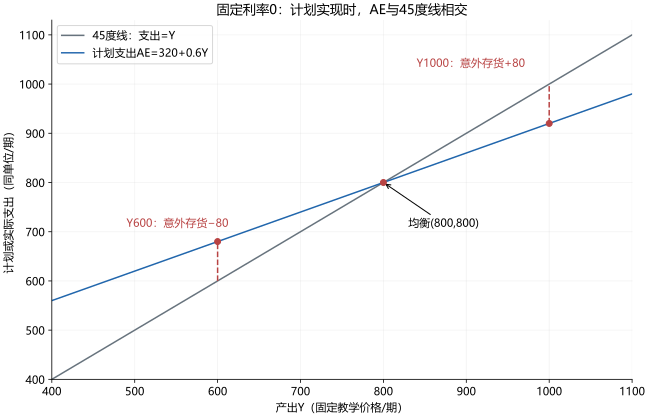

# 39 计划支出、存货与短期收入决定

## 学习目标与先修

先完成第33—38章，尤其是GDP支出核算与储蓄恒等式，并复习第04章联立方程、第09章函数。本章约4—6小时。你将区分事后账目与事前计划，建立消费、税收和计划支出方程，用手算、45度线和Python求短期均衡，并解释意外存货调整。

本阶段所有参数都是人为设置，金额代表同一时期、固定教学价格的产出量或支出量，不能套在真实国家上。先假设价格固定、存在闲置产能、企业能按需求调整产出，不处理工资价格变化、供给瓶颈和长期增长。后续45章才引入总供给。

## 1. 生产了多少，与原来想买多少

设工厂本期生产100件，而居民、企业和政府计划购买90件。剩下10件进入意外存货。按第33章，存货变化属于实际投资，所以事后产出与实际支出仍相等；但企业可能不愿继续积压。

**计划支出AE**是各部门按给定收入、政策和其他条件计划进行的最终支出。**产品市场均衡**要求Y=AE，即没有非计划的存货变化。恒等式与这个均衡条件不能互相替代：

```text
实际投资 = 计划投资 + 非计划存货变化
非计划存货变化 = 当期产出Y - 计划支出AE
事后GDP恒等式总能按实际投资记账；Y=AE只在计划实现时成立。
```

AE>Y时，商店可能减少库存以满足额外销售；存货变化为负。若库存不足，现实可能发生排队、缺货和未满足需求，本课简单调整模型只适用于有相应缓冲的情形，不把计划购买自动当成无限可成交。

## 2. 先解释每条行为方程

消费函数设为C=c0+c(Y−T)。C是居民消费，Y−T是简化可支配收入，c0是自主消费，c是**边际消费倾向MPC**：可支配收入增加1单位，消费增加c单位。它不是平均消费占收入比例，也不是从GDP恒等式推出来的数字。

取c0=100、c=0.75。消费在可支配收入为0时仍为100，可以理解为资产或借款支持的简化支出；本课不追踪这些融资存量，所以不把该函数无限外推到长期。

净税收函数T=t0+tY，取t0=40、t=0.2。t0是固定净税收项，t是随收入增加的比例项；T不是只等于40，也不是只等于20%Y。转移支付可以表现为较低的t0，但这里没有完整税种制度。

按第六阶段约定，G只表示政府最终消费，公共投资J包含在总投资I中。本章利率先固定为0，私人计划投资80、公共投资20，因此I=100；G=150；暂为封闭经济，X=M=0。零利率是为了先隔离支出机制，并非现实利率资料。

## 3. 一步一步整理均衡

先代入税收，再合并Y的系数：

```text
T = 40 + 0.2Y
C = 100 + 0.75(Y - 40 - 0.2Y) = 70 + 0.6Y
AE = C + I + G = 70 + 0.6Y + 100 + 150 = 320 + 0.6Y
Y = AE ⇒ Y = 320 + 0.6Y
0.4Y = 320 ⇒ Y* = 800
```

星号表示本模型的均衡值，不代表最优或充分就业。此时T=200、可支配收入600、C=550、I=100、G=150，合计800。私人储蓄Y−T−C=50，政府总储蓄T−G=50，两者合计100等于投资。政府总储蓄仍未扣公共投资，不能直接当完整预算盈余。

45度线上的每点纵坐标等于横坐标Y；AE线截距320、斜率0.6。两线交点给出800。AE斜率是c(1−t)，不是原始MPC0.75，因为收入增加的一部分进入净税收。



## 4. 不在交点时发生什么

| Y | 净税收T | 消费C | 计划AE | 非计划存货Y−AE |
| --- | ---: | ---: | ---: | ---: |
| 600 | 160 | 430 | 680 | −80 |
| 800 | 200 | 550 | 800 | 0 |
| 1000 | 240 | 670 | 920 | 80 |

Y600时计划多买80，若通过去库存满足，企业可能增加后续生产；Y1000时意外积压80，可能减少后续生产。这是调整方向的解释，还不是对调整速度的估计。

可以额外设一条**教学调整规则**：下一步Y=本步Y+α(AE−Y)。取α=0.5，表示每步只纠正差额的一半。由600开始依次600、640、672、697.6、718.08、734.464……逐渐接近800。步数没有对应真实季度或月份；α也不是估计参数。

误差每步乘1−α×0.4=0.8，因此收敛。若随意把α设得太大，可能振荡或发散；配套函数要求绝对收敛系数小于1。会解静态交点与会提出有效动态规则是两件不同的事。

## 5. 完整Python程序与复算

Windows PowerShell执行，替换为你的副本目录：

```powershell
Set-Location 'C:\Users\17597\Desktop\tutorial\content\western-economics\source\示例代码\stage7'
python keynesian_cross.py
```

完整入口[keynesian_cross.py](示例代码/stage7/keynesian_cross.py)，依赖同目录[short_run.py](示例代码/stage7/short_run.py)。输出三行存货表、均衡800，以及60个教学步后的799.999694左右。最后一点仍有很小误差，不能说浮点数必须与解析答案逐位相同。

`parameters()`返回默认参数字典；`components(y,p=p)`在指定Y下计算各项，`goods_equilibrium(p)`解均衡。它们是完整模块中的函数，不能只复制调用而丢掉导入。`adjustment_path`返回一组字典记录；`path[-1]`表示最后一条，`path[:6]`取前六条。负索引和切片的用途在这里是读取结果，不改变原参数。

默认私人投资后续写成80−1000i，公共投资仍20。本章i=0，所以总投资100；第43章将让i与收入一起决定，不能把本章800直接当联立模型的答案。全部参数与适用区间见[短期模型约定](短期模型方程与符号约定.md)。

## 常见错误

- 从事后Y=C+I+G直接宣布任何产出都是产品市场均衡，漏掉计划与实际投资的区别。
- 把0.75当AE斜率，忘记比例税；把税收误写成只有40。
- 在G和I中重复计公共投资，或把购买股票当本模型I。
- 将交点称为充分就业或社会最优，未检查供给、价格和福利。
- 把60个教学迭代步称为60个真实季度，把自设α当经验估计。

## 练习与参考答案

1. 默认模型Y=700时AE和非计划存货多少？答：AE740，存货−40；实际投资100−40=60，事后支出仍等于700。
2. 在默认参数中仅把c0改120，固定利率不变，均衡多少？答：AE340+0.6Y，Y850；不是只加20。
3. 独立两部门例子C=100+0.75Y、I=100，无税无政府，求均衡。答：Y800、C700、S100；它恰好与主例Y同为800，但消费和部门口径不同，不能混表。
4. 默认模型α=0.5，初始600，第二次调整后的Y？答：第一次640，第二次672，仍未到均衡。
5. 若企业没有库存又遇到AE>Y，能否保证所有计划成交？答：不能，需供给、配给或调整机制；本章简化情景不足以描述它。

## 完成条件

能区分恒等式和计划均衡，独立推得AE320+0.6Y与交点800；能复算三行存货表，运行程序并说明动态规则的局限。下一章保持利率固定，分析支出冲击为什么会被消费反馈放大。
