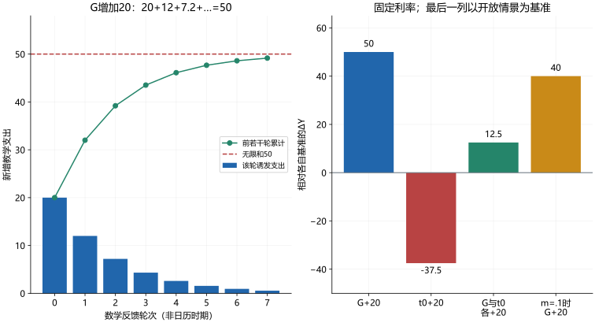

# 40 支出乘数、税收与进口漏出

## 学习目标与先修

先完成第39章，会解Y=A+sY，并复习百分比与增量。本章约4—6小时。你将推导固定利率下的支出和净税收乘数，解释税收、进口为何改变反馈，识别“平衡预算乘数等于1”的条件，并用参数副本复核比较静态。

本章沿用价格固定、闲置产能足够、行为参数不变的教学经济。没有利率反馈、供给约束、预期变化与政策执行时滞。乘数是这套方程的条件结果，不是国家实际财政支出的一条普遍倍数。

## 1. 第一轮增加与后续反馈

政府消费增加20，首先增加计划支出20。新增收入中净税收增加20%，剩下80%；居民再消费其中75%，所以下一轮诱发支出为20×0.8×0.75=12，后续7.2、4.32……

```text
总增量 = 20 + 12 + 7.2 + 4.32 + …
       = 20 / (1 - 0.6) = 50
```

这是等比数列：后项是前项乘0.6，绝对值小于1时无限和收敛。这里的“轮次”是反馈分解，不是已经估计的日历时间路径；它也不要求每家企业按相同步骤同步行动。

更快的推导是两套均衡相减。基准0.4Y=320；G多20后0.4Y'=340，因此0.4ΔY=20，ΔY=50。**支出乘数**为ΔY/ΔG=1/0.4=2.5。基准Y800，新均衡850。



## 2. 一般式把各种漏出放在一起

加入出口X=x0、进口M=m0+mY，m是边际进口倾向。仍使用T=t0+tY、C=c0+c(Y−T)，计划投资固定为I。于是：

```text
AE = c0-c*t0+I+G+x0-m0 + [c(1-t)-m]Y
λ = 1-c(1-t)+m
Y* = [c0-c*t0+I+G+x0-m0] / λ
```

λ用希腊字母lambda读音表示综合漏出系数；程序键名为`leakage`。本章无需学习希腊字母语法，它只是一个代数名称。支出反馈还会流向储蓄、税收和进口，因此λ增加时，同一自主支出增量的产出乘数变小。

默认c0=100、c=.75、t0=40、t=.2、I=100、G150，x0=m0=m=0，λ=.4。若仅把m改成.1，λ=.5，基准Y320/.5=640，支出乘数2；G再多20时Y680，增40。不能把“开放情景的40”与“封闭情景的50”混为同一基准的两个增量。

本章进口方程是独立漏出扩展，未同时建立汇率、国际资本流动或国外需求反馈。进口是境外生产从本国产出核算中扣除；乘数较小不自动说明进口对福利不利。

## 3. 净定额税为什么不是相同乘数

t0增加20并不直接减少政府消费，而是使居民可支配收入先减少20，消费先减少c×20=15，再经反馈放大：

```text
ΔY = -c*Δt0 / λ = -0.75*20/0.4 = -37.5
净定额税乘数 = -c/λ = -1.875
新Y = 762.5
```

这里改变的是t0，比例税率t不变。若改变t，λ本身改变，不能简单把税率增量代入定额税乘数。增加向私人现金转移可表现为减少t0，方向相反；但本模型没有区分不同群体的消费倾向。

**自动稳定器**指收入变动时税收或转移规则自动作出反应，缓和可支配收入与支出变化。本例比例税使AE斜率从无比例税时的.75降为.6。现实制度的具体分段、资格和时滞不在本章参数中；不能把一个比例税函数当成真实税法。

## 4. “平衡预算乘数等于1”要检查什么

若G和t0同时增加20，默认模型ΔY=(1−c)×20/λ=.25×20/.4=12.5，Y812.5。不是20，因为存在比例税反馈。

经典数值1来自更特殊的封闭、固定利率、只有定额税模型：t=0、m=0，λ=1−c，于是ΔY/ΔG=(1−c)/(1−c)=1。保留比例税或进口时，不能继续套1。

还要留意“平衡”的对象：G和t0各增20，实际总税收还会随产出增加t×12.5=2.5，所以实现的ΔT是22.5，而非20。政府总储蓄增2.5，尚未计公共投资与其他财政项目。这组实验准确名称是“G与固定净税收项同增”，不能未经核对称为完整财政预算保持平衡。

若要求本简化政府消费账中的实际ΔT=ΔG=20，且t=.2、m=0，联立可得ΔY=20、Δt0=16。这又是另一个实验，说明政策约束本身也应写进方程。

## 5. 投资、预期和长期边界

固定利率下，自主私人投资、公共投资、出口或自主消费增加1，都先进入自主支出项A，代数乘数同为1/λ。但改变公共投资不意味着G也要增加；本课公共投资已计入I。

当利率随产出上升，私人投资可能被部分挤出，实际模型中的乘数会变化；第43—44章将让它成为内生变量。靠近供给能力、价格变化明显或政策改变预期时，需求增加也不一定主要表现为实际产出增加。这些限制是比较模型的依据，不是通过调整一个乘数就已经处理完毕。

## 6. Python中一次只改一组参数

Windows PowerShell进入stage7执行：

```powershell
Set-Location 'C:\Users\17597\Desktop\tutorial\content\western-economics\source\示例代码\stage7'
python multipliers.py
```

完整程序[multipliers.py](示例代码/stage7/multipliers.py)依次输出G+20的850、t0+20的762.5、两者同增的812.5、进口倾向.1的640。最后一行显示的是相对封闭基准800减少160，不是“G增加20的效果”。改参数前先读情景名称。

`changed=dict(p)`生成参数副本，`changed.update(changes)`只更新指定键。若写`changed=p`，两者引用同一个字典，容易让下个情景继承上个情景的变化。不要通过修改全局默认参数让旧结果悄悄改变。完整公式和参数键见[模型约定](短期模型方程与符号约定.md)。

## 常见错误

- 只看第一轮20，漏掉诱发消费；或把所有轮次看成真实季度预测。
- 税率改变仍使用定额税乘数，把税率0.2与金额20混用。
- 说所有情形平衡预算乘数都为1，或把Δt0当完整ΔT。
- 用进口漏出结论直接作福利评价，忽略开放经济的其他机制。
- 一个字典连续改多项却仍称“其他条件不变”。

## 练习与参考答案

1. 默认G增加12，产出变化多少？答：12/.4=30，新Y830。
2. 默认t0减少8，产出变化多少？答：−.75×(−8)/.4=15，新Y815。
3. 默认另取m=.1，G增12的产出增量？答：12/.5=24，应与该情景自身基准640比较。
4. 保持其他参数但t从.2变.25，基准Y多少？答：λ=1−.75×.75=.4375，Y320/.4375≈731.428571；不能用−1.875乘.05。
5. 默认G与t0各增20，实际ΔT多少？答：20+.2×12.5=22.5。若要求实际ΔT=ΔG=20，需另解Δt0=16、ΔY=20。

## 完成条件

能用两套均衡相减推出支出和净定额税乘数，说明进口和比例税的作用；能解释同增G与t0为何不等于实现的完整预算平衡。下一章先认识货币与银行账本，再让利率进入模型。
