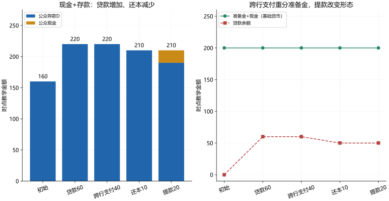

# 41 货币、银行账本与信用创造

## 学习目标与先修

先完成第33章投资与金融交易、第39—40章短期需求模型，并复习资产存量与收入流量。本章约4—6小时。你将区分货币、收入、财富和银行准备金，用资产负债表逐笔解释贷款与存款，并说明简单货币乘数的假设。Python只用字典、列表和函数，不要求财务软件。

本章是虚构的两家银行账本。没有现实国家的准备金率、资本监管条款或实时货币政策数据。模型刻意省略利息、违约、证券、费用和利润，学习重点是各项资产与负债怎样同时变化。

## 1. 货币不是收入，也不是全部财富

货币通常承担交易媒介、计价单位和价值储藏等职能。现金与可用于支付的银行存款可以作为教学货币；房屋、股票和债券也是资产，却不能仅因有价值就全部与货币等同。实际M1、M2等统计分类因地区与时期而异，本课不拿一个简化定义替代现行官方口径。

工资收入是某段时期内获得的流量；某日存款余额是资产存量。同样一个100元存款可以在一段时间内参与多笔支付，不能把GDP每增加100理解成必须新增100现金。第42章的货币需求函数会把交易流量与希望持有的货币存量联系起来。

**银行准备金R**在本教学账本中代表银行持有、可用于结算或转换为公众现金的基础货币资产；真实制度中央行存款与库存现金的统计分类还需分别核对。公众账户中的存款D是商业银行对公众的负债，准备金通常是银行对央行的资产，二者不是同一张账户。

## 2. 一张表先对平

银行持有贷款L：借款人欠银行还本付息，因此贷款是银行资产；银行欠存款人可支付的款项，因此存款是银行负债。**权益E**是资产减负债的剩余，初学时可理解为股东投入等形成的净值。本例最简账本为R+L=D+E。

| 银行 | 准备金R | 贷款L | 存款D | 权益E | 资产=负债+权益 |
| --- | ---: | ---: | ---: | ---: | --- |
| A初始 | 120 | 0 | 100 | 20 | 120=100+20 |
| B初始 | 80 | 0 | 60 | 20 | 80=60+20 |

银行贷款不是给借款人无偿赠送财富。借款人同时获得存款资产和贷款债务；银行同时增加贷款资产和存款负债。能否借到钱、利率、还款压力和风险，需要另外分析。

## 3. 新贷款、支付、还本与提款逐笔看

第一笔：A向客户发放贷款60，直接记入客户的存款。A的R仍120，L变60，D变160，E仍20；两侧均180。教学货币现金+存款从160增到220，而基础货币现金+准备金仍200。

第二笔：借款人从A向B的客户支付40，使用准备金结算。A的R120→80、D160→120；B的R80→120、D60→100。系统总存款仍220，总准备金仍200。收款不在本例中再自动创造一笔贷款，跨行支付只是改变存款与准备金的位置。

第三笔：借款人用A账户里尚余的存款归还本金10。A的L60→50、D120→110，R仍80、E仍20。系统存款从220降210，教学货币减少10。这里讨论的是正常还本；违约损失、利息支付、核销与银行权益变化不是同一个操作。

第四笔：A的某存款人提款20。A的R80→60、D110→90，公众现金增加20。最终系统R180、L50、D190、E40，公众现金20。现金+存款为210，现金+准备金为200。提款改变教学货币构成，没有令这两个合计都减少20。



## 4. 为什么“贷款创造存款”仍有约束

上述记账说明贷款发生时怎样产生匹配存款；它没有证明银行可以无条件无限放贷。贷款涉及借款需求与信用风险、银行资本和流动性、资金与支付结算成本、监管和货币政策环境。单家银行还必须准备对外支付所需的结算资产；本程序在A准备金不足时明确报错，没有偷偷补央行融资。

英格兰银行2014年说明解释了商业银行放贷与存款创造，并指出不能把现代过程简单看作把既有储蓄搬给借款人、或机械放大央行货币。[英格兰银行原文](https://www.bankofengland.co.uk/quarterly-bulletin/2014/q1/money-creation-in-the-modern-economy)（核验2026-11-13）。这份概念资料不被用来宣称所有地区当期的操作制度完全相同。

本例银行权益只有20，却未检查资本充足率；它只是平衡记账。账目两侧相等不等于银行安全，也不等于贷款符合任何实际监管要求。

## 5. 简单货币乘数是一个有条件的比例模型

另外建立一个与上面权益账本**分开的**零权益静态模型。设公众现金Cu与存款D的比值为c，法定准备金与D的比值rr，超额准备金与D的比值e，基础货币B=Cu+R，教学货币M=Cu+D：

```text
Cu=cD，R=(rr+e)D
B=(c+rr+e)D
M=(1+c)D
M/B=(1+c)/(c+rr+e)
```

若B100、rr=.1、c=e=0，则D1000、M1000、R100、贷款900，比例为10。它需要假定相应持有比例成立、没有其他资产负债项目，并有支持该配置的贷款与存款需求。不能把“准备金率10%”直接当成现实新增基础货币必定带来十倍新增贷款的因果规律。

若c=.2、e=.1、rr仍.1，分母.4，D250、现金50、R50、M300，比例3。现金与超额准备金持有行为改变时，比例也改变。它是条件代数关系，不提供现代银行的完整放贷顺序或政策传导机制。三个比率皆为0时没有有限解，不能除以0后声称货币无限多。

## 6. 运行完整Python账本

Windows PowerShell执行：

```powershell
Set-Location 'C:\Users\17597\Desktop\tutorial\content\western-economics\source\示例代码\stage7'
python banking.py
```

完整入口[banking.py](示例代码/stage7/banking.py)，共享函数在[short_run.py](示例代码/stage7/short_run.py)。五个事件名为`initial`、`loan`、`transfer`、`principal_repayment`、`withdrawal`；最后一行账本应为R180、L50、D190、cash20、money210、base200，随后另列两个比例模型结果。

记录每一步时用`dict(a)`复制当时的银行字典。若只把同一个可变字典反复放进列表，后续修改会让历史记录也变成最终状态。函数还逐行核对R+L=D+E。这个校验可发现不平衡记账，但不能发现被模型省略的风险。

函数约定借款人先支付40，再从其尚未花掉的新贷款存款中还本10；因此付款与还本之和不得超过新贷款。提款来自A银行存款总额，金额也不得超过可用结算资产。本例没有模拟银行另借准备金、出售资产或筹集资本。

## 常见错误

- 将存款人资产的名称直接套到银行账上，把银行存款负债写成银行资产。
- 认为贷款创造存款等于创造借款人净财富，忽略同额债务。
- 跨行支付后让系统准备金凭空增加，或把还本与现金提款当同一操作。
- 只因账平就说银行没有流动性或信用风险。
- 把比例模型的10倍当当期真实准备金率与固定政策效果。

## 练习与参考答案

1. A初始R120、D100、E20，发放贷款30后各项？答：R120、L30、D130、E20，资产150=负债权益150。
2. 主例还本10使银行权益减少吗？答：没有，本金对应资产与存款负债同减；违约损失另议。
3. 主例提款前系统存款210，提款20后教学货币？答：存款190+现金20=210；基础货币180+20=200。
4. B100、rr=.2、c=e=0的比例模型？答：D=M500，R100，零权益简化贷款400。它不证明现实一定实现这个配置。
5. 为何不能把本例准备金180与季度GDP700相加？答：前者是时点金融存量，后者是期间产出流量，单位含义不同。

## 完成条件

能逐笔对平两家银行，区分存款与准备金、还本与提款；会推导比例式并主动说明它的前提。下一章把持币需求与利率联系起来，但不会把本例账本直接当作央行货币供给规则。
