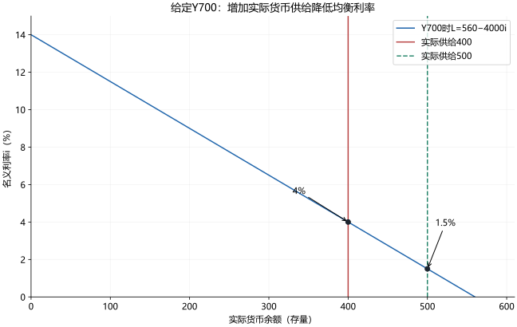

# 42 货币需求、债券价格与货币市场

## 学习目标与先修

先完成第41章，并复习第22章贴现和第35章名义、实际利率。本章约4—5小时。你将区分想持有多少货币与想获得多少收入，计算实际货币余额，用线性函数推导货币市场均衡，并正确标注利率单位。

这里暂把产出Y当作给定。只求货币市场的一个利率，并不表示商品市场同时均衡；第43章才联立二者。所有数值均是教学设定。

## 1. 为什么想持币，又为什么不全持币

**货币需求**在这里指主体希望持有的货币存量。交易支付、应付不确定支出等会产生持币需要；但持币也有机会成本。为建立最简模型，先假设货币不付利息，替代资产是可交易债券，债券利率升高会增加持币的机会成本。

这个设定没有包括付息存款、不同期限和风险、支付便利等现实差异。不能把“利率上升减少货币需求”理解成任何一种存款在任何情况下都一定减少。模型中的货币与替代资产范围必须先定义。

若价格水平P翻倍，同样名义货币M能购买的商品量减半，因此定义**实际货币余额**M/P。M是货币存量，Y是某期产出流量，P是固定价格水平指数的比例尺度；P=1表示选定基准，不是物价1元。

## 2. 先用一张零息债券理解利率

设无违约、一期后支付100、没有中间利息的一期零息债券，现在价格为q。持有一期的收益率i满足q(1+i)=100，因此q=100/(1+i)。

```text
i=4%：q=100/1.04≈96.153846
i=5%：q=100/1.05≈95.238095
```

相同未来支付下，现价越高，收益率越低。此处i是收益率，不是固定票息率；对已经发行的固定支付债券，市场价格变动会改变收益率。多期、含息、违约和再投资风险另有计算，不能用这条一期式直接替代。

在简化资产选择故事里，公众想增加货币持有时可能卖债券，债券价格与收益率会调整。但宏观所有人不能都在总量固定时凭意愿额外获得货币；需要价格、利率或货币供给调整。个人资产买卖与总量均衡不是同一层次。

## 3. 建立线性实际货币需求

设L(Y,i)=kY−hi，取k=.8、h=4000。收入提高带来更多交易需要，利率提高降低所需持币余额。实际供给暂外生固定为Ms/P，均衡为：

```text
Ms/P = kY - h*i
i = (kY - Ms/P) / h
```

**Ms**是名义货币供给存量，避免与第40章进口M混用；程序键`money`表示Ms。k把某期产出流量转换成所需存量，其量纲与所选时期有关；h是每1单位小数利率对应的实际货币需求变动。换成年率、季度率或改用百分数横轴时必须同步改系数。

这里i用小数存放：.04是4%，h×.04=160。若误填4，h×4=16000，是100倍错误。本阶段预期通胀固定为0且无风险溢价，所以投资用的实际利率r等于货币需求用的名义利率i。非零预期通胀时不能直接沿用r=i；本批不估计预期通胀。

## 4. 给定收入时的计算与比较

默认Ms400、P1、Y700：.8×700−4000i=400，所以i=.04，即4%。在同一Y下Ms增加到500，i=(560−500)/4000=.015；在原货币供给下Y增至800，i=(640−400)/4000=.06。

若保持Ms400、Y700，仅让P从1变2，实际供给降到200，货币市场计算i=.09。**这只是独立货币市场情景**：按后续私人投资80−1000i会得到负值，因此不能声称它也满足完整短期模型的有效区间。每个子模型有自己的边界。



固定Y时，需求曲线展示L与i的关系；改变Y会使整条持币需求关系变化。固定Ms/P时，所有能使货币市场均衡的(Y,i)构成**LM关系**：i=.0002Y−.1。LM不是仅有(Y700,i4%)一个点，也不是货币量与利率的供求图本身；两张图横轴不同。

## 5. 线性式不能无限外推

若给定Y500，Ms400、P1，计算i=0；若Ms再增加而照抄直线，会得到负利率。真实某些利率可以为负，本课没有在这里描述其制度；程序只承诺非负利率的普通区间，超出便报错。第44章另建一个明确设下限的分段模型。

极高利率还会令线性L为负，这是持币量模型的无效区间。需要修改函数或引入角点，而不是把所有负值静默改成0后继续假装原方程成立。

另外，固定Ms的LM模型是一种教学政策闭合方式。若政策直接维持某个利率，货币数量可能要配合货币需求调整，模型就要换规则。本课不将“央行必定固定货币数量”当现实当期制度；第44章通过保持利率的比较初步说明差别。

## 6. 运行完整程序

Windows PowerShell执行：

```powershell
Set-Location 'C:\Users\17597\Desktop\tutorial\content\western-economics\source\示例代码\stage7'
python money_market.py
```

完整入口[money_market.py](示例代码/stage7/money_market.py)，共享模块[short_run.py](示例代码/stage7/short_run.py)。四行利率依次4%、6%、1.5%、9%；随后债券价格96.153846与95.238095。

`money_market(y,p)`只检查货币方程，不调用商品支出函数；这样9%的独立货币算例不会被误标为商品均衡。`bond_price(100,.04)`是完整模块中一期函数的调用片段，命令行运行应使用完整入口，而不是只粘贴这一行。

Python用有限小数计算可能产生极小残差；检查方程两边在容差内相等。`:.6%`把.04显示为4.000000%，没有把参数系数改成百分数单位。

## 常见错误

- 把货币需求当成“想赚更多钱”，将持有存量与收入流量混淆。
- 把银行准备金、全部财富或所有金融资产都当作同一种模型货币。
- 利率输入4却沿用小数单位的h4000，或把名义与实际利率无条件画等号。
- 给定Y只解出一个货币利率，就宣布整个经济均衡。
- 让负需求、负投资或超出承诺范围的利率悄悄通过。

## 练习与参考答案

1. 默认Ms400、P1，给定Y750，利率多少？答：(.8×750−400)/4000=.05，即5%。
2. 给定Y700，想在本模型维持i4%，需要多少实际货币？答：560−160=400；若P=2，所需名义Ms800。
3. 一期支付100，价格80，收益率多少？答：100/80−1=25%；不是20%。
4. 默认Y400、Ms400、P1，普通区间函数为何报错？答：隐含i=(320−400)/4000=−2%，超出此函数承诺；需另选合适模型，不填成0冒充清算。
5. LM式i=.0002Y−.1的斜率为何不等于1/4000？答：斜率为k/h=.8/4000，收入变化先通过k影响持币需求。

## 完成条件

能说明L与Ms/P的含义、存量流量和利率单位；能复算四个独立情景并区分货币均衡与联立均衡。下一章用两条方程同时解Y与i。
