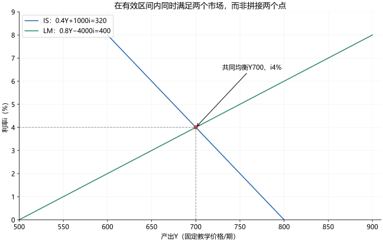

# 43 IS—LM：同时求收入与利率

## 学习目标与先修

先完成第39—42章，会读支出函数、货币需求和小数利率，并复习第04章二元一次方程。本章约4—6小时。你将分别推导IS和LM，用消元法同时求Y与i，检查两个市场残差，并理解联立均衡的范围。代码仍只用标准库，不要求矩阵库。

**IS—LM模型**在这里是短期固定价格的产品市场与货币市场模型。IS表示与投资、储蓄有关的产品均衡关系，LM表示货币市场均衡关系。它没有自动加入劳动市场、供给能力、预期、信用风险或充分就业条件；两条线相交不表示经济各方面都已最优。

## 1. 让私人投资随利率变化

沿用C=100+.75(Y−T)、T=40+.2Y、G150，公共投资J20。私人计划投资改为Ipr=80−1000i，总计划投资I=Ipr+J=100−1000i。利率i是小数，4%时Ipr=40、I=60。

投资通常应看实际融资成本，持币机会成本通常与名义利率有关。本章假设预期通胀为0、没有风险溢价，因此r=i；这个简化必须写在模型前提中，不能悄悄把现实所有利率画等号。投资对产出或预期销售的直接反应尚未加入。

因为私人投资不能为负，本例线性有效区间是0≤i≤.08。程序对明显负私人投资报错，不自动截成0后继续用原来的线性解。公共投资20由政策外生设定，不跟利率机械变化，也不重复放进G。

## 2. IS是所有产品市场均衡点

将消费与投资代入Y=C+I+G：

```text
Y = 70 + .6Y + 100 - 1000i + 150
.4Y + 1000i = 320
Y = 800 - 2500i
i = .32 - .0004Y
```

i0时Y800，i4%时Y700，i8%时Y600。它是一组产品均衡点，不是“i一定4%”。给定其他条件，利率降低提高私人计划投资，再经消费反馈提高均衡产出，所以IS向下倾斜。

如果只改变G、c0、公共投资等自主支出，IS位置变化；如果改变MPC、比例税、投资利率敏感度，斜率也可能变化。不要把沿同一条曲线移动与曲线移动混用。作图横轴Y、纵轴i，同一方程若改画Y对i，斜率数值会取倒数关系，不能只背一个负号。

## 3. LM是所有货币市场均衡点

货币参数Ms400、P1、k.8、h4000，于是：

```text
400 = .8Y - 4000i
i = .0002Y - .1
```

Y500时i0，Y700时i4%，Y800时i6%。收入增加提高交易持币需求；在实际供给固定时，更高利率降低另一部分需求，使总需求回到400，因此LM向上倾斜。给定Y时增加Ms/P会使所需均衡利率下降，LM下移。

第42章给定Y700求4%只是LM上的一个点；第39章i0求Y800只是IS上的一个点。产品均衡点(Y800,i0)的货币需求为640，不等于400；货币均衡点(Y800,i6%)的产品AE740，不等于800。各解一条方程后随意拼接，仍不能保证同时均衡。



## 4. 用消元法完整求一次

两条方程是：.4Y+1000i=320，.8Y−4000i=400。把第一式乘4，与第二式相加，消去i：

```text
1.6Y + 4000i = 1280
 .8Y - 4000i =  400
-----------------------
2.4Y = 1680 ⇒ Y = 700
i = (.8*700-400)/4000 = .04 = 4%
```

回代消费C490、税收T180、私人投资40、公共投资20，产品支出490+40+20+150=700；货币需求.8×700−4000×.04=400。私人储蓄30、政府总储蓄30，合计60等于总投资60。这里储蓄投资一致是产品账目的结果，不是额外拿来决定一个新利率的第三条独立方程。

与第39章i固定0时的Y800相比，现在均衡Y700，因为利率不再预先固定为0。两者政策闭合条件不同，不能以“数字变了”判断前一章算错。

## 5. 一般解与可检查的残差

沿用第40章A和λ，并设投资利率系数b，实际货币供给ms=Ms/P：

```text
λY + bi = A
kY - hi = ms
Y = (A + b*ms/h) / (λ + b*k/h)
i = (kY-ms)/h
```

这是先代入再整理的结果。默认A320、λ.4、b1000、k.8、h4000、ms400，分子420、分母.6，得到700。b=0时投资不随利率变化，Y=A/λ由产品方程决定，货币方程只决定i；不要为了画IS斜率而除以0。

若看到矩阵写法`[[λ,b],[k,-h]]×[Y,i]=[A,ms]`，它只是把两条方程压在一张表里。这里不要求矩阵乘法或逆矩阵软件；消元法已经足够。代码采用上式而不是调用第三方求解器。

定义**残差**为方程两边差值：产品残差Y−AE，货币残差Ms/P−L。两者都应接近0。不能只看程序运行无异常，更不能只验证一个残差。数值满足方程仍不能证明行为函数适合真实经济。

## 6. 运行完整程序

Windows PowerShell执行：

```powershell
Set-Location 'C:\Users\17597\Desktop\tutorial\content\western-economics\source\示例代码\stage7'
python is_lm.py
```

完整入口[is_lm.py](示例代码/stage7/is_lm.py)，依赖[short_run.py](示例代码/stage7/short_run.py)。预期Y700、i4%、C490、私人I40、公共I20、G150，两个残差均在浮点容差内为0。

`is_lm()`使用普通非负利率区间。货币太多使普通线性解隐含负利率时，它会建议使用明确的下限模型；私人投资或消费变负时也拒绝。`max(0,...)`仅处理极小浮点舍入误差，不是把真实负值强行“修好”的角点求解器。

程序的参数、单位、有效区间见[模型约定](短期模型方程与符号约定.md)。换用课件例子时，先核对其利率用百分数还是小数、G是否含公共投资，再转换系数；不能只抄一个斜率。

## 常见错误

- 把IS上一个点与LM上另一个点拼成“均衡”，或只检查产品方程。
- 把IS的负斜率与LM的正斜率当成无条件经验定律，忽略函数设定。
- 名义利率、实际利率与贷款风险成本不加区分。
- 将联立均衡称为充分就业、帕累托最优或一般均衡的完整证明。
- 允许明显负投资却继续解释普通模型结果，或用截断掩盖方程不再满足。

## 练习与参考答案

1. 默认IS在i2%时的Y多少？该点货币需求多少？答：Y750，L600−80=520，不等于400，所以不是联立均衡。
2. 在Y650时LM利率多少？答：(.8×650−400)/4000=.03，即3%；此点产品AE320+.6×650−30=680，残差−30。
3. 默认参数只把G改170，消元求新均衡。答：A340，Y=(340+100)/.6≈733.333333，i≈4.666667%；下一章解释投资挤出。
4. 假定b=0，其他默认，产出与利率？答：Y800，i6%；私人I固定80、公共20，货币变动不会通过本模型的投资渠道改变Y。
5. 两个残差都为0能否证明实际财政乘数？答：不能，只说明给定参数与方程内部一致；真实效果还需识别与数据依据。

## 完成条件

能独立写出IS与LM并用消元法求700和4%，回代两条方程；能解释与固定利率交叉模型的区别，以及负投资、利率边界和模型未覆盖市场。下一章在同一组方程内做政策比较。
