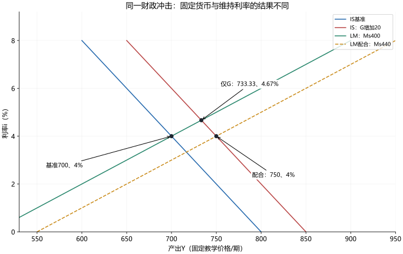
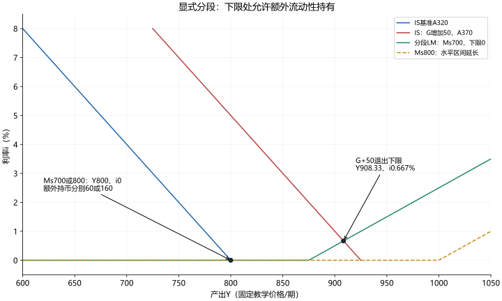

# 44 政策组合、投资挤出与利率下限

## 学习目标与先修

先完成第43章，会独立解IS—LM并检查两个残差。本章约4—7小时。你将比较财政、货币和配合政策，推导普通区间的乘数，另外建立有明示利率下限的分段模型，并交付短期总需求实验台v0.4a。

所有比较都保持价格、预期通胀、风险溢价与行为参数不变。政策变量是模型中的政府消费G和名义货币Ms；本章没有模拟实际央行操作、政府发债融资、债务偿还或中央银行资产负债表，也没有用真实政策数据估计因果效果。

## 1. 先保存普通区间的基准

基准Y700、i4%、C490、总I60（私人40+公共20）、G150。实际货币余额400。普通区间一般解Y=(A+bms/h)/(λ+bk/h)，其中λ=.4、b1000、k.8、h4000，分母为.6。

比较静态要把“保持什么不变”写进名称。政府消费多20而货币不变，与政府消费多20同时货币配合，属于不同实验；不能只说“财政扩张20”便假设二者效果一致。

## 2. 财政扩张与私人投资挤出

仅G150→170，A320→340。新Y440/.6≈733.333333，i=(.8Y−400)/4000≈.046666667。利率提高约0.666667个百分点，总投资100−1000i≈53.333333，较基准减少6.666667；公共投资仍20，变化发生在私人投资。

固定i4%时，第40章式子给ΔY20/.4=50，因此Y750；货币固定时只增加33.333333。机制是G增加推高收入与持币需求，利率上升削弱私人投资，再经消费反馈影响产出。这就是本模型里的**投资挤出**。

产出少增16.666667，不等于投资直接少6.666667，因为投资变化还通过固定利率支出乘数2.5反馈：6.666667×2.5=16.666667。不要把挤出的投资额与产出总差额混为同一个量。



## 3. 货币扩张与维持利率的配合

仅Ms400→500，P仍1，实际余额增100。新Y=(320+125)/.6≈741.666667，i≈2.333333%。私人投资提高，带动需求和产出。这个结果依赖于投资对利率的反应和普通LM区间；不是说任意增加某种货币统计量都会按相同比例提高GDP。

若G多20，又希望i维持4%，产品市场需要Y750。新增交易持币需求kΔY=.8×50=40，因此实际货币供给需增加40；P1时Ms440即可。新均衡Y750、i4%、总I60，私人投资没有因这次比较中的利率变化而减少。

这是一种**配合规则**的演示：让货币数量满足指定利率下的需求。它没有证明实际政策机构能无成本、立即、精确实现这些数值，也不等于已经建模所有财政融资影响。

## 4. 斜率和参数怎样改变效果

普通区间的政府消费乘数为1/(λ+bk/h)，实际货币余额乘数为(b/h)/(λ+bk/h)。默认分别约1.666667和.416667。固定利率支出乘数仍2.5，比较时不能漏掉“固定利率”与“固定货币”条件。

更大的h使LM在(Y,i)图上更平，产出增加时为平衡持币需求所需的利率上升更小；同样财政冲击的投资挤出减弱。更大的b加强投资对利率的反应，也改变政策传导。b=0时本模型货币变动不通过投资改变Y，财政效应回到1/λ。

这些是其他参数固定下的代数比较，不是不同国家政策效果的直接排名。把h设为一个很大的有限数可以得到较平LM，却不等于已经构造严格的利率下限与完全弹性持币区间；后者需要另外说明函数形状。

## 5. 明确建立利率下限分段模型

另设i不能低于人为指定的下限i_floor，默认0。这里0是教学假设，不声称现实所有利率永远非负。保持预期通胀0，零名义利率也就是本例零实际利率。

普通线性解若高于下限，仍按原IS—LM求解；若普通解落到下限以下，则令i等于下限，产品方程决定Y，额外货币余额作为下限处可以被持有的流动性。此时总货币需求分为原线性需求与额外流动性持有，不能仍强说原来的线性LM等式单独成立。

```text
下限区间：i=i_floor
Y=(A-b*i_floor)/λ
额外流动性 = Ms/P - (kY-h*i_floor) ≥ 0
总货币需求 = 线性部分 + 额外流动性 = Ms/P
```

在下限i0、A320时Y800，线性部分kY640。取Ms700，额外流动性60；Ms再增至800，Y仍800，额外流动性160。多出的余额没有通过本例已到下限的利率渠道继续刺激投资。



在Ms700下若G增20，Y850，线性持币需求680，额外流动性20，仍在下限；若G增50，按下限候选值会得到Y925、所需线性余额740，超过供给700，候选无效。应返回普通区间求解：Y≈908.333333、i≈.666667%。不能不检查分段条件，就宣称财政乘数永远等于2.5。

本例接近常见“流动性陷阱”的教学机制，但只展示一种设定。它不能推出资产购买、信贷、预期管理或其他工具在现实都无效；如果预期通胀改变、信用利差改变，模型就需要增加新的关系。

## 6. 完整程序与综合实验台

Windows PowerShell执行：

```powershell
Set-Location 'C:\Users\17597\Desktop\tutorial\content\western-economics\source\示例代码\stage7'
python policy_mix.py
python demand_lab.py --g-change 20
python demand_lab.py --g-change 20 --money-change 40
python demand_lab.py --regime floor --money-change 300
```

完整章内入口[policy_mix.py](示例代码/stage7/policy_mix.py)输出四个普通情景和四个独立下限情景。综合入口[demand_lab.py](示例代码/stage7/demand_lab.py)输出v0.4a JSON；最后一条命令从默认Ms400增加300到700，得到下限Y800与额外流动性60。比较基准仍是默认400的普通均衡，不能把它误读成“从700再增300”。

`--regime ordinary`维持普通区间，若货币增加太多而解出负利率，会明确报错；`--regime floor`才启用额外持币分支。`--floor`只对floor模式有效。输入小数`0.01`表示1%的下限，不是1个货币单位。

JSON报告同时保留`linear_money_gap`和`liquidity_holdings`。下限时前者等于额外流动性，`money_residual`扣除该持有后才为0；这不是隐藏原方程不满足的差额。完整参数归属和验收见[第七阶段实践](第七阶段-实践说明与验收.md)。

## 常见错误

- 比较政策时既改货币又改G，却把全部差异归为某一个变量。
- 将产出少增的16.666667与投资减少6.666667混称“挤出量”。
- 普通解负利率时直接填0，却不检查产品方程与持币分段条件。
- 在下限分支把线性货币差额藏起来，宣称未修改的LM式仍成立。
- 将单一模型渠道失效扩大为所有政策工具无效，或把教学结果称为真实估计。

## 练习与参考答案

1. 普通区间默认G增12，Y与i怎样变化？答：ΔY12/.6=20，Δi=.8×20/4000=.004，即上升.4个百分点；总I减少4。
2. 默认Ms增24、P1，普通区间ΔY？答：24×(.25/.6)=10，Δi=(.8×10−24)/4000=−.004，即下降.4个百分点。
3. G增12且想维持原i4%，所需Ms增量？答：固定i时ΔY30，ΔMs=.8×30=24。
4. 下限i0、Ms650、默认A320，Y与额外持币？答：Y800，额外10；Ms再增10只使额外持有变20。
5. 下限i0、Ms700、G增50，能继续用Y925吗？答：不能，所需线性持币740>700，应回普通分支得到约908.333333与.666667%。

## 完成条件

能复算普通区间三种政策、说明投资挤出与政策配合；能独立检查下限分支和退出条件；能运行综合实验并区分条件模型与经验因果。第39—44章至此完成，AD—AS、通胀预期与债务等第45—50章仍在下一阶段。
