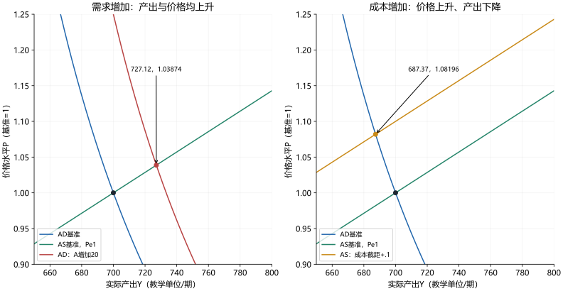

# 45 总需求、短期与长期总供给

## 学习目标与先修

先完成第34章名义实际量、第43—44章IS—LM，复习一次与二次方程。本章约4—6小时。你将从上一阶段推导价格可变时的AD，区分短期与长期供给，计算需求和成本冲击，并检查模型有效区间。

本章纵轴是**价格水平P**，不是通胀率。P1表示基准价格尺度；不同P下的点是同一时期不同条件的比较，不能只凭两点就当成一条实际年度通胀路径。全部数值人为设置。

## 1. 从固定价格走向AD

第43章将价格固定为1：实际货币余额Ms/P=400。现在保持名义Ms400，改变P。沿用普通区间的产品与货币方程：

```text
IS：.4Y+1000i=A，基准A320
LM：.8Y-4000i=400/P
联立：Y=(A+100/P)/.6
```

这条Y与P的关系就是本课的**总需求AD**。P升高使实际余额减少，货币市场需要较高利率，私人投资下降，条件均衡产出减少。它不是将微观所有商品需求简单相加，也不能只用“价格越低越想买”解释宏观曲线。

P1时Y700；如果只在产品市场固定利率，传导就会不同。本章仍用名义货币外生的普通IS—LM闭合，预期通胀0、无风险溢价。原先私人投资80−1000i不能为负，i也必须落在普通函数承诺的非负区间，所以AD曲线并非任意价格都可外推。

## 2. 为什么短期供给可能向上

当部分工资、合同和投入价格调整较慢，需求扩大可能同时推高产出与产品价格。为刻画这一点，另设一个简化关系：

```text
短期AS：P=Pe+s*(Y-Yp)/Yp+z
Pe：预先形成的价格水平参照；Yp：潜在产出
s：正的供给斜率参数；z：成本导致的价格截距变化
```

**潜在产出**是一定技术、资本、劳动和制度条件下可持续供给能力的模型或估计量，不是当天机器的绝对物理极限，也不是统计表中直接读到的永恒常数。本例取Yp700、Pe1、s1、z0，AS变成P=Y/700。

这条AS是教学近似，未从工资谈判或企业定价完整推导。它让“偏离潜在产出需要价格调整”的条件可以算清；不能凭图上正斜率证明现实机制只有一种。

## 3. 两条曲线一起解

基准将Y=700P代入AD：.6×700P=320+100/P。P必须正，因此可同乘P：420P²−320P−100=0。正根P1，对应Y700；另一负根不满足价格尺度含义，应舍去。

**需求冲击**：其他不变，自主需求A增加20到340，可以代表政府消费多20而公共投资不重复计入G。方程变为420P²−340P−100=0，正根约1.038739，Y约727.117565。

若价格仍固定1，第44章会给Y733.333333；现在新增需求部分表现为P上升，产出增加较少。两者只是供给闭合不同，不是同一模型算出互相矛盾的答案。

**成本冲击**：保持A320，让z从0增.1，短期AS上移。新均衡P约1.081963、Y约687.374297，即价格更高、产出更低。成本冲击同时恶化两个目标，不能把任何“价格上涨”都当成需求过热。



## 4. 长期竖直供给是什么条件

在本简化长期比较中，假设工资价格和预期最终调整，技术与潜在产出保持700，因此长期供给画在Y700。若需求A永久340、Ms400，将Y700代入AD：

```text
.6*700 = 340+100/P ⇒ P=1.25
```

要与本AS同时一致，必须使Pe也调整为1.25且z0。不能保留Pe1，又同时宣布在P1.25、Y700已经满足原来的短期AS。这里给的是长期候选比较，不是已经模拟出调整需要几年。

长期供给并非真实世界永不移动：技术、劳动和资本变化会改变Yp，后续增长阶段再研究。本章成本冲击是短期截距变化；不能对持续成本冲击、潜在产出损失机械套用“必定回到原来的价格和产出”。

## 5. 完整Python实验

Windows PowerShell执行，解压到其他位置时替换目录：

```powershell
Set-Location 'C:\Users\17597\Desktop\tutorial\content\western-economics\source\示例代码\stage8'
python ad_as.py
```

完整入口[ad_as.py](示例代码/stage8/ad_as.py)，模块[policy_models.py](示例代码/stage8/policy_models.py)。依次观察基准700/1、需求727.117565/1.038739、成本687.374297/1.081963及长期候选700/1.25。

模块计算正根后回代产品、货币和供给关系；价格正数、利率非负、私人投资非负都要检查。`math.sqrt`是平方根；二次方程虽有数学根，只有满足经济区间的根才可解释。遇到负投资时程序报错，没有把它填0后仍冒称满足原方程。

变量、价格水平与通胀的区分见[第八阶段模型约定](波动政策与债务模型约定.md)。本例名义货币供给仍是外生量；第49章将另建利率规则模型，不能把两套政策闭合直接叠在一起。

## 常见错误

- 把AD当微观需求图，或把P1.038739直接叫“当期通胀1.038739%”。
- 价格变了却仍用Ms400当实际余额，不除P。
- 长期回到潜在产出时保留原Pe，漏掉供给关系也需要调整。
- 成本上升导致价格涨，就用纯需求扩张解释全部现象。
- 将短期AS近似或固定Yp当作已经估计的真实生产能力。

## 练习与参考答案

1. 固定P1时A340的AD产出？答：(340+100)/.6≈733.333333；它不是供给也变化时的最终均衡。
2. 默认AS下P1.1对应Y多少？答：770。此点AD约684.848485，不能只满足AS就宣布均衡。
3. 若Ms从400变500，A320，长期Y700下价格候选？答：125/(420−320)=1.25；需相应调整Pe，且这是给定潜在产出的比较。
4. 为什么不能选择二次方程的负价格根？答：价格尺度必须正，数学求根仍需经济域筛选。

## 完成条件

能从两市场推得AD、回代短期AS，复算三组均衡，并说明长期预期调整的必要性。下一章改用通胀率研究失业和预期，先重新定义纵轴。
