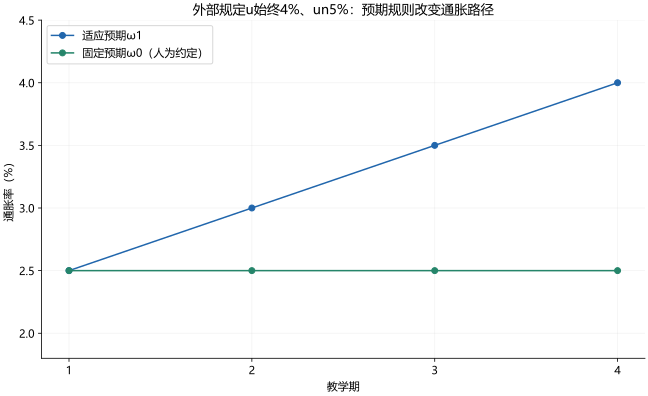

# 46 通胀、失业、预期与菲利普斯关系

## 学习目标与先修

先完成第35章通胀、第36章失业和第45章供给，复习百分比与百分点。本章约4—6小时。你将解释预期修正为何改变短期关系，计算固定与适应预期两种路径，识别降低通胀的条件和成本，并说明公式不能直接当政策菜单。

本章π表示一段时期内价格的增长率，πe表示该期事前预期通胀；二者以小数保存。第45章Pe是预期**价格水平**，不是这里的πe。即使数值都出现1或.02，也不能互换。

## 1. 从短期关系开始

一个常见教学形式是：π=πe−α(u−un)+s。u为失业率，un为作为基准的自然失业率，α>0，s为额外供给或成本通胀冲击。默认πe2%、un5%、α.5、s0。

u比un低1个百分点时，π比预期高.5个百分点：u4%代入得π=.02−.5×(.04−.05)=.025，即2.5%。u6%则π1.5%。负斜率是在预期、基准失业率、冲击和参数不变下的关系。

un不是零失业，也不是直接观察到、政策可以任意选定的固定常数。它与结构、匹配、制度和估计方法有关。本课5%只是参数，不是任何国家当前“正确自然失业率”。α也未用数据估计。

## 2. 为什么不能长期固定在一条曲线上

若实际通胀总高于预期，工资合同与定价可能重新考虑通胀。用最简单的更新规则表示：下一期πe=本期πe+ω(本期π−本期πe)，0≤ω≤1。

ω1表示下一期直接用本期实现通胀作为预期。人为规定失业率连续四期都为4%，初始预期2%，则：

| 期 | 事前预期 | u | 实现通胀 | 下一期预期 |
| --- | ---: | ---: | ---: | ---: |
| 1 | 2% | 4% | 2.5% | 2.5% |
| 2 | 2.5% | 4% | 3% | 3% |
| 3 | 3% | 4% | 3.5% | 3.5% |
| 4 | 3.5% | 4% | 4% | 4% |

失业低于基准的差距相同，却需要不断超出预期的通胀。不能从第一期2.5%便断言可永久以同样通胀换取4%失业。长期若预期与实际一致、冲击0，则这套式子要求u=un；它没有给出永久固定的一条通胀失业交换菜单。



## 3. 固定预期与可信度

若ω0，预期在实验中始终2%，同样u4%会每期得到π2.5%。这展示预期规则的重要性，并未解释“如何让预期永远不变”。现实的预期锚定需要考虑政策信誉、信息、学习与冲击；把ω设0不是证明持续低于自然失业率没有代价。

程序把u路径作为外部输入，没有另解劳动供求、总需求或政策能否实现该失业率。它比较的是条件通胀路径，而非证明某个政策可无约束地选择就业结果。

## 4. 供给冲击与降低通胀

即使u=un5%，若s=.01，π会从预期2%升到3%。物价上升不一定来自低失业或需求过热；能源、供应链等可通过成本渠道影响通胀，但本例不估计实际事件的贡献。

另设初始预期4%，希望本期实现通胀2%，s0、α.5，则.02=.04−.5(u−.05)，解得u=.09，即9%。如果ω1，下一期预期变2%，u回到5%时也能维持2%的模型通胀。这是极简、无政策传导时滞的演算，不是说现实降低通胀只需一个时期。

该例失业差距为4个百分点×1期。它不能直接叫通常按累计产出损失除以通胀下降幅度定义的产出“牺牲率”。从失业差距换成产出损失，还需额外关系与时间单位，不能混用量纲。预期调整速度不同，通胀和就业路径也会不同。

降低通胀率不等于价格下降。通胀从4%降到2%，价格仍上涨；只有通胀为负才是该期价格水平下降。无论模型如何表达预期，都要保留第35章的这个基本区别。

## 5. 运行程序并阅读状态更新

Windows PowerShell执行：

```powershell
Set-Location 'C:\Users\17597\Desktop\tutorial\content\western-economics\source\示例代码\stage8'
python expectations.py
```

完整入口[expectations.py](示例代码/stage8/expectations.py)应输出适应预期2.5%、3%、3.5%、4%，固定预期四次2.5%，单期降通胀候选u9%。这不是读取官方失业序列的结果。

模块先用本期事前预期计算π，再生成`next_expected_inflation`用于下一期。如果先覆盖预期，再把它当本期信息，会改变时间顺序。`zip`将等长的失业率与冲击列表逐项配对，函数先检查长度相等，防止只循环较短列表而悄悄丢数据。

输入失业率与un限定0到1，通胀与预期必须大于−1，避免负的价格增长倍数；无效输入明确拒绝。完整接口见[模型约定](波动政策与债务模型约定.md)。

## 常见错误

- 混用P、Pe、π、πe，或把2%输入成2。
- 将自然失业率当观察到的固定政策目标，或把5%说成真实当期统计。
- 忽略预期变化，只沿第一条短期曲线长期推论。
- 把外部给定的u路径说成程序已经求出的就业均衡。
- 失业百分点期直接命名为产出牺牲率，或将降通胀等同于降价。

## 练习与参考答案

1. πe3%、un5%、u7%、α.5、s0，π多少？答：2%；失业比基准高2个百分点，使通胀低于预期1个百分点。
2. 本期预期2%、实际4%、ω.5，下一期预期？答：3%，不是4%也不是直接加.5个百分点。
3. 默认u=un、s=.015，π多少？答：3.5%；不能仅据高通胀推断u必定低于un。
4. 初始预期3%，目标2%，α.5、un5%、s0，候选u？答：7%，仍需另外解释政策与传导能否实现。

## 完成条件

能正确区分四个价格/通胀符号，逐期更新预期并复算两条路径；能解释短期条件关系与长期推论的区别。下一章再把“冲击出现”和“冲击怎样持续”拆开。
