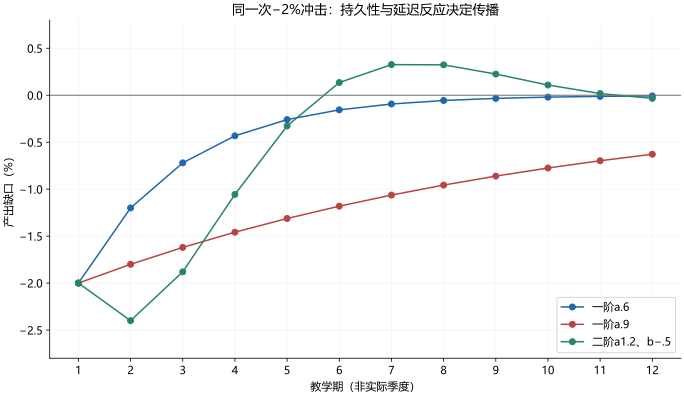

# 47 经济波动：冲击、传播与名义刚性

## 学习目标与先修

先完成第45—46章，并复习第08章列表与循环、第39章调整规则。本章约4—5小时。你将区分产出水平、增长与产出缺口，拆开冲击和传播，比较一次冲击为何产生不同持久性，并用两期滞后构造可复核的阻尼波动。

模型期只是统一的教学时段，没有自动对应真实月或季度。给定的序列不是估计结果，也没有识别任何国家的衰退起止日期。

## 1. 三个容易混淆的指标

实际GDP水平是Y；增长率是本期相对上期的变化；**产出缺口x**是(Y−Yp)/Yp。Yp表示可持续的潜在产出，可能增长、也可能被冲击改变。缺口负不必等于当期负增长：从Y650升到680、Yp仍700，增长约4.615%，缺口仍约−2.857%。

同样，实际产出增长低于趋势、失业变化、工业生产等都可能提供周期信息，但一个数字不足以构造完整周期判定。实践中的衰退识别有具体资料、地域和机构标准；本课不把“两季负增长”、负缺口或单次月度下降作为适用所有情形的统一定义。

周期常用扩张、峰值、收缩和谷底描述活动变化的阶段。它不意味着每次周期长度固定，也不表示所有行业同步。我们先用已知构造理解“为什么会延续”，后续统计阶段再讨论从数据中提取趋势和波动的困难。

## 2. 冲击与传播不是同一件事

冲击是相对模型原先条件的变化，例如需求突然降低、成本突然增加、生产能力受损。传播机制决定影响如何经过库存、合同、消费、信贷、投资或预期延续。相同冲击配上不同机制，可以得到不同幅度和时间路径。

**名义刚性**表示某些名义工资或价格不能立即、无成本地调整；**实际刚性或调整成本**还涉及雇佣、设备和生产组织等。名义刚性可使需求不足在短期表现为数量和就业变化，但并非解释所有周期的唯一机制。供给、金融与政策冲击也可能同时出现。

接下来直接写一个约化传播式，不冒充已完整推导上述所有机制：x_t=a*x_(t−1)+e_t。a是持久性参数，e是外部给定的当期冲击。初始缺口0，仅第一期e=−.02，其后均0。

## 3. 一阶持久性可以手工列出来

| 教学期 | a=.6时缺口 | a=.9时缺口 |
| --- | ---: | ---: |
| 1 | −2% | −2% |
| 2 | −1.2% | −1.8% |
| 3 | −.72% | −1.62% |
| 4 | −.432% | −1.458% |

冲击相同，a.9的影响消退更慢。它不表示每期又发生−2%的新冲击；负效应是滞后项带来的。设Yp700，第一期Y=700×.98=686，第二期a.6时Y691.6。产出在恢复，但缺口尚未关闭。

若反复输入新的负冲击，路径会不同；如果潜在产出也变动，Y的增长不再只由缺口决定。模型参数不是从一张恢复曲线就能唯一倒推出真实原因。

## 4. 加上第二个滞后，才可能出现回摆

设x_t=1.2x_(t−1)−.5x_(t−2)+e_t，初始两期历史缺口都0，同样只有第一期冲击−.02。前几期为−.02、−.024、−.0188、−.01056、−.003272、.0013536……

负冲击后第二期反而更低，后来穿过0，出现幅度逐渐缩小的回摆。这是**阻尼波动**的构造。第二个滞后可抽象表示延迟调整，但不能直接叫作已经验证的库存周期、房地产周期或金融机制。



程序要求常系数二阶规则满足稳定条件：1−a−b>0、1+a−b>0、1+b>0；这里b是第二滞后系数−.5。这些条件保证该线性递推的无冲击部分逐步衰减，不保证真实经济稳定，也不是政策制度优劣的完整判断。

只要知道代码在检查允许范围，初学者便可以先使用；不必现在学特征根。若把a设1、b0，一次冲击不会在本规则下衰减，函数明确拒绝，不假装它仍是稳定恢复实验。

## 5. 运行程序与理解历史变量

Windows PowerShell执行：

```powershell
Set-Location 'C:\Users\17597\Desktop\tutorial\content\western-economics\source\示例代码\stage8'
python cycles.py
```

完整入口[cycles.py](示例代码/stage8/cycles.py)输出三组前八期缺口。模块[policy_models.py](示例代码/stage8/policy_models.py)中的`last`保存上一期，`older`保存上两期；先用二者计算本期，再用`older,last=last,gap`同时更新。

若先把`last`改成本期值，再单独写`older=last`，两个历史位置就会变成同一个值。Python同时赋值先读取右边的旧值，再赋给左边，避免这个错误。每条记录保存冲击、缺口和Y，便于逐项核对。

缺口必须大于−1，才能使Yp(1+x)为正。不同传播规则都使用同一个冲击序列，没有随机抽样，也没有真实数据下载。更改实验时先说明改变的是冲击还是传播系数。

## 常见错误

- 负缺口当负增长，或产出恢复就称已高于潜在水平。
- 每期负效应都说成新冲击，忽略上一期的传播。
- 只因曲线回摆就声称发现了真实经济周期机制。
- 更新历史变量顺序错误，导致两期滞后失去区别。
- 把稳定的数学递推当成现实没有金融或政策风险的证明。

## 练习与参考答案

1. Y从650到680、Yp700，两期缺口？答：约−7.142857%与−2.857143%；后一阶段正增长但仍负缺口。
2. a=.5、初始0、冲击第一期−.04其后0，前三期缺口？答：−4%、−2%、−1%。
3. 第二滞后例第二期为何−.024？答：1.2×(−.02)−.5×0+0，未发生新冲击。
4. a1、b0是否满足稳定检查？答：1−a−b=0，不满足本实验的衰减要求；不是Python偶然算坏。

## 完成条件

能从缺口复原Y，逐项复算两种持久性与一组回摆，并清楚说明冲击、传播和识别的区别。下一章把衰退中的财政自动变化单独记成一份账。
