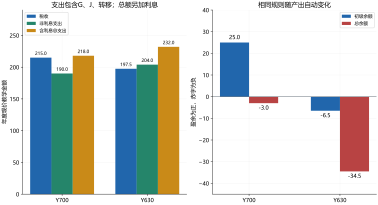

# 48 财政政策、自动稳定器与完整收支口径

## 学习目标与先修

先完成第37章部门账户、第40章乘数、第45章供给。本章约4—6小时。你将区分自动变化和相机抉择，建立含公共投资、转移与利息的简化预算，辨认初级余额与总余额，并解释财政账本为何不能单独给出产出效果。

本章用一个独立的年度**现价教学账本**。价格基准恰为1时金额看起来与前章相似，不表示多个例子已经拼成同一国家的完整模拟。没有使用真实税率、福利资格或当期预算数据。

## 1. 先把政府花钱分类

沿用G只含政府最终消费，J表示公共投资。现金转移TR是政府付给私人部门的支出，本身不直接计入GDP生产；住户收到后购买产品时再按最终用途计入。利息支付是融资成本，也不等于当期G或公共投资。

本章另定义政府税收总额Tax，简化净税收T=Tax−TR。以前用T−G表示政府简化总储蓄；现在把公共投资也列出来，便能得到本模型的**初级余额PB**：

```text
PB = Tax - G - J - TR = (T-G)-J
总余额 = PB - 利息支出
无其他调整时新增借债 = 利息支出-PB
```

初级是“不含利息”的意思。PB正表示初级盈余，负表示初级赤字；这里不是把利息从所有GDP支出中减掉。现实财政还有其他收支、资本转移、资产交易、核算时点和债务范围，本例逐项省略，不能称完整官方预算表。

## 2. 同一规则在正常与衰退产出下记账

设潜在产出700，实际Y由外部给定。税收规则Tax=40+.25Y，转移规则TR=20+.2max(700−Y,0)，G150，J20。`max`选较大者：当Y高于700时本例额外转移为0，避免把福利项算成负支出。

再设期初债务560、名义有效利率5%，当年利息28。对比：

| 项目 | Y700 | Y630 |
| --- | ---: | ---: |
| 税收总额Tax | 215 | 197.5 |
| 转移TR | 20 | 34 |
| 净税收T | 195 | 163.5 |
| G与J | 150、20 | 150、20 |
| 政府总储蓄T−G | 45 | 13.5 |
| 初级余额PB | 25 | −6.5 |
| 总余额PB−28 | −3 | −34.5 |
| 私人可支配收入Y−T | 505 | 466.5 |

产出下降70，税收自动少17.5、转移自动多14，使净税收少31.5。私人可支配收入指标只减少38.5，少于产出降幅；无需先通过一次新的财政决策，这就是本例的**自动稳定器**。表中Y−T是简化收入指标，未将政府债务利息按居民或境外归属再分配，不是完整国民核算的私人可支配收入。



## 3. 自动稳定与主动决策如何分开

若把税收固定在215、转移固定20，其他保持不变，Y从700降630时私人可支配收入会从505降435，减少70。与自动规则下466.5相比，差31.5。这个比较说明收入缓冲的算术来源，不是直接证明GDP增加了31.5。

**相机抉择财政政策**是面对形势主动改变支出、税或转移规则。例如在给定Y630下，政府另把G增加20，PB从−6.5变−26.5，总余额从−34.5变−54.5。账本显示借债需求更大，却没有告诉我们Y会怎样调整。

若要预测产出，需把税收、消费、供给、预期和融资反应写入行为模型。第40章固定利率、第44章IS—LM、第45章AD—AS给出不同条件下的例子；不能在这里固定Y算完财政差额，再把差额直接叫“财政乘数效果”。

## 4. 为什么实际政策有时滞和取舍

识别经济状态需要数据，数据会修订；决策、执行和项目落地也需要时间。固定规则反应快但可能覆盖不全，主动项目可以有针对性却需要设计和实施。公共投资还可能影响未来供给能力，本章只记当期支出，不量化其未来回报。

财政扩张的效果取决于闲置资源、进口、货币配合、利率、支出构成、家庭约束和预期等。衰退时赤字扩大也可能只是自动稳定器运行，不能仅看赤字变大就断言政府主动刺激；改善余额也可能来自景气恢复。

区分周期性与结构性收支需要估计潜在产出和税收敏感度，存在不确定性。本课把潜在700作为输入，不声称已经完成真实结构性余额估计。债务如何积累会在第50章另外推导。

## 5. 完整程序与参数含义

Windows PowerShell执行：

```powershell
Set-Location 'C:\Users\17597\Desktop\tutorial\content\western-economics\source\示例代码\stage8'
python fiscal.py
```

完整入口[fiscal.py](示例代码/stage8/fiscal.py)输出上表两行核心账目。函数`fiscal_budget`接收外部Y；`cyclical_transfer=.2`是本例转移对产出缺口金额的反应系数，不是工资替代率，也不是现实失业保险规则。

利息用期初名义债务乘名义有效利率，不能把当期新债务先加进去又重复计息。`primary_balance`与`overall_balance`均以盈余为正；`new_borrowing_no_other_adjustment`方向相反。读JSON先看符号约定，别把−34.5解释成“新增借债−34.5”。

参阅[模型口径](波动政策与债务模型约定.md)，本账本不含存量流量调整和政府资产出售。第50章将把这些可能产生的差额单列，避免用赤字直接解释所有债务变化。

## 常见错误

- T已经扣转移，又从T−G−J里再减TR一次。
- 把政府总储蓄T−G直接叫初级或总预算盈余，漏掉J和利息。
- 把自动随收入变化的赤字都称为新的主动政策。
- 在Y外生账本中直接读出财政对产出的因果效果。
- 混用盈余正号与借债正号，或重复计息。

## 练习与参考答案

1. 默认Y660，Tax、TR、PB和总余额？答：205、28、7、−21；净税177，政府总储蓄27，再减J20为PB7。
2. 默认正常产出时J再多10、其他不变？答：PB15、总余额−13；不能再把这10同时放入G。
3. 已知PB−8、利息24，无其他调整，新增借债多少？答：32；PB赤字8与利息24相加。
4. 为何不能以“余额从−3降到−34.5”断言主动扩张31.5？答：本例政策规则未变，差异来自给定产出下降触发自动变化。

## 完成条件

能独立对齐Tax、TR、T、G、J、PB和利息，复算两种产出下的账本，说明自动稳定与主动改变的区别，并坚持账目本身不等于产出预测。
