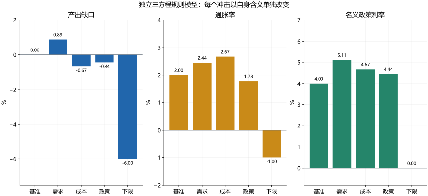

# 49 货币政策、利率规则与传导

## 学习目标与先修

先完成第35章实际利率、第44章利率下限、第46章预期。本章约4—6小时。你将理解工具、传导与目标的区别，建立一个利率规则闭合的三方程模型，比较需求、成本与政策冲击，并检查下限分支。

本章从“名义货币数量给定”转向“政策利率按规则调整”。两者是不同闭合方式；不要在第43章原方程上再强塞一个利率目标，却不改变货币供给条件。所有参数和2%的通胀参照均为教学设定，不是当期政策建议或实际利率预测。

## 1. 政策工具怎样传到经济活动

政策利率可能影响短期市场利率、融资成本、资产价格、汇率、信贷和预期，再影响消费投资与价格。渠道有不同期限与风险，传导也有时滞；中央银行设定的一个利率不等于所有人的贷款利率。

本章只保留最简“实际利率影响需求缺口”渠道：x=d−σ(r−r*)。x=(Y−Yp)/Yp，d为自主需求冲击，r*为模型中性实际利率，σ>0。实际利率高于中性水平时，其他条件不变，需求缺口较小。

为得到线性可手算模型，本章使用r_lin=i−πe的近似。第35章精确Fisher关系仍是(1+i)/(1+πe)−1，两者不可悄悄混用。默认i4%、πe2%时线性r2%，精确值约1.960784%；程序残差针对线性模型核对，不冒充精确关系。

## 2. 三条关系先分别写清

通胀关系改用产出缺口：π=πe+κx+s。它与第46章的失业差距式主题相通，但这里直接用另一个简化斜率κ，并未声称已经估计出失业到产出的一致转换。

名义利率规则设为：

```text
i_rule = r* + π + φπ(π-π*) + φx*x + εi
i = max(i_floor, i_rule)
```

π*为通胀参照，φπ、φx分别表示对偏离的附加反应，εi为外加政策冲击。默认r*2%、πe=π*2%、σ1、κ.5、φπ=.5、φx=.5、下限0。无冲击时x0、π2%、i4%。

本规则形式参考常见泰勒式基准。美联储的[规则说明](https://www.federalreserve.gov/monetarypolicy/policy-rules-and-how-policymakers-use-them.htm)列有多种规则；本课x用比例缺口，文献也常用对数缺口，不能逐项照搬单位。核验2026-11-13，未移植该网页历史经济数值。

在固定x下，π每多1个百分点，本规则i多1.5个百分点，其中1来自π本身、.5来自附加项。这个局部性质不等于已经证明完整动态系统稳定，也不能只背一个系数便推荐实际政策。

## 3. 普通区间如何联立

将通胀与规则代入需求式，可得：

```text
x = [d-σ((1+φπ)s+φπ(πe-π*)+εi)]
    / [1+σ((1+φπ)κ+φx)]
```

默认分母2.25。需求冲击d=.02、其他0，得到x约.008888889、π约2.444444%、i约5.111111%。因为规则对通胀和缺口作出反应，最终产出缺口小于未经抵消的2%，但政策利率升高。

成本通胀冲击s=.01、d0，得到x约−.666667%、π约2.666667%、i约4.666667%。通胀与活动目标出现冲突，不能用同一组“越低越好”的数字评价政策。

政策冲击εi=.01而d=s=0，得到x约−.444444%、π约1.777778%、i约4.444444%。εi是规则截距增加1个百分点，最终利率只比基准高.444444个百分点，因为通胀和缺口也会反馈到规则；不能把外生冲击与最终结果画等号。



## 4. 下限要重新求解，不是改显示值

若d=−.1，普通候选利率为负。令i等于下限0，事前预期仍2%，则r_lin=−2%；需求式给x=−.1−(−.02−.02)=−.06，通胀π=.02+.5×(−.06)=−.01。

把x−6%、π−1%代回未截断规则，得到i_rule=−3.5%，确实低于下限0，所以分支成立。最终利率0不等于真实利率0；预期通胀和实现通胀也不同，不能用本期实际−1%替换原先πe2%而仍称同一事前需求方程。

这里没有实现预期指引、资产购买、信用利差渠道或未来承诺。下限限制了本模型的当期利率工具，不推出现实其他货币政策全部无效。下限0也是模型设定，不是关于全球所有利率永远非负的事实。

## 5. 规则为什么只能是参考

潜在产出、中性利率和预期都难以直接观察；数据会修订，结构和冲击可能改变。规则简洁有助于比较，却不能取代识别、预测和风险判断。美联储关于[使用规则的困难](https://www.federalreserve.gov/monetarypolicy/challenges-associated-with-using-rules-to-make-monetary-policy.htm)讨论了模型不确定性等限制（核验2026-11-13）；本课只采用概念，不声称当前决策机构机械执行某条规则。

把本章与第45章比较时，还要区分纵轴：那里解价格水平P，这里解一段时期的通胀π。默认参数相似并不让两者自动构成一套时序一致的国家预测。

## 6. 完整Python与三项残差

Windows PowerShell执行：

```powershell
Set-Location 'C:\Users\17597\Desktop\tutorial\content\western-economics\source\示例代码\stage8'
python monetary_rule.py
```

完整入口[monetary_rule.py](示例代码/stage8/monetary_rule.py)依次输出基准、需求、成本、政策冲击和下限。共享函数`rule_equilibrium`报告需求、通胀、规则三项残差，以及未截断的`shadow_rule_rate`。

函数先尝试普通解；只有候选低于下限才按固定i重解x和π，并回代检查影子利率仍不高于下限。不能先把负i改0而保留普通解的x和π。详细接口见[模型约定](波动政策与债务模型约定.md)。

## 常见错误

- i−πe近似与精确Fisher关系混用，或把预期通胀换成事后实现值。
- 把政策规则附加冲击1个百分点当最终利率一定增加1个百分点。
- 将比例缺口、对数缺口、百分数单位和小数单位混用。
- 下限只改i显示，不重新求需求与通胀，不检查分支条件。
- 把简单规则当已识别的最优政策或实际当期制度。

## 练习与参考答案

1. 默认条件下d=.009，普通解x、π、i？答：x.004即.4%，π2.2%，i4.5%。
2. x0、π从2%变3%，其他固定，规则i变化多少？答：1.5个百分点；这是局部规则反应，不是完整均衡变化。
3. 下限i0、预期2%，线性实际利率与精确实际利率？答：−2%与1/1.02−1≈−1.960784%，不能混称相等。
4. 只有货币数量Ms能否代入本章直接求政策i？答：信息不足，本章用利率规则闭合，没有保留一条独立固定Ms的LM约束。

## 完成条件

能列出三条方程、解释线性近似和政策单位，复算三类冲击及下限；会检查三项残差，并明确本模型不等于实际政策推荐。
