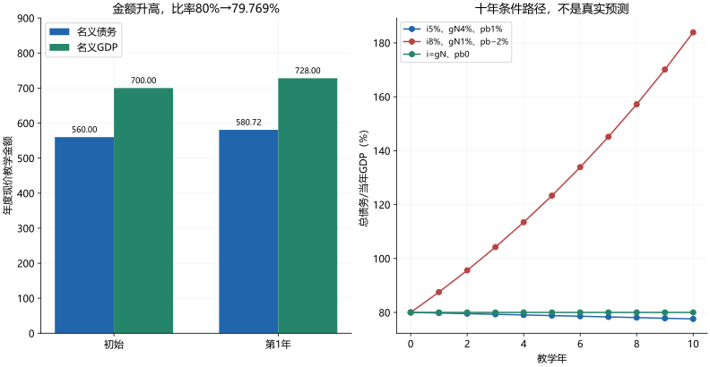
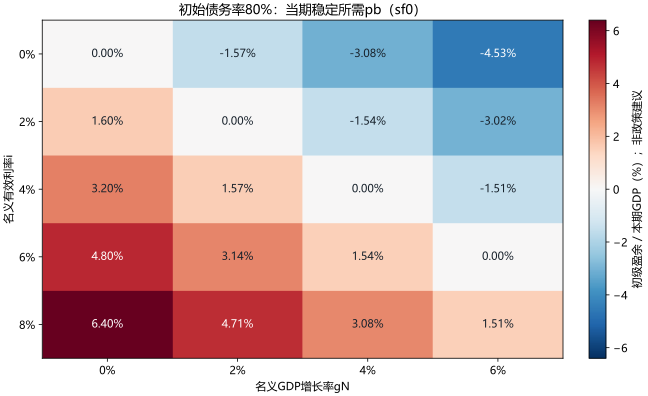

# 50 债务动态、财政约束与敏感性分析

## 学习目标与先修

先完成第34—35章增长和价格、第48章初级收支、第49章利率。本章约4—6小时。你将从名义金额推导债务占GDP比率，正确选择流量分母，计算稳定债务率所需的条件余额，并用多期递推检查利率、增长与收支假设。

这里是独立年度政府总债务模型，全部金额和利率虚构。没有任何国家的真实债务预测、安全评级或投资判断。完成的是基础核算与敏感性实验，全课最终报告仍待后续阶段。

## 1. 先用名义金额记一遍

设B_prev为期初名义总债务，i为对这笔债务适用的名义有效利率，PB为本期初级盈余，SF为其他增加债务的存量流量调整：

```text
B_current = (1+i)*B_prev - PB + SF
```

PB收入大于非利息支出时为正，减少需要借入的资金；初级赤字则PB负。SF可以概括不经本期初级收支却改变债务的因素或统计差异。实际范围需按所用债务定义核对，不能把一切差额都叫“浪费”。

i是债务有效计息成本，不必等于第49章的当期政策利率。存量债务有不同期限、票息和重定价安排；政策利率变化也不意味着全部债务当年立刻按同幅度重新计息。本模型把有效i直接作为输入。

## 2. 比率的关键是本期GDP分母

记名义GDP为N，增长率gN，则N_current=(1+gN)N_prev。将金额式除以本期N：

```text
b_current = [(1+i)/(1+gN)]*b_prev - pb + sf
b_prev = B_prev/N_prev
pb = PB/N_current，sf = SF/N_current
```

旧债比率用上期GDP，新的初级余额与SF比率用本期GDP。若把PB除以上期N，却继续代这个式子，会漏掉一次增长换算。名义债务要配名义GDP；不能直接用实际增长当gN。

这类债务动态分解可参见[IMF主权债务会议论文](https://www.imf.org/-/media/files/news/seminars/2018/091318sovdebt-conference/chapter-6-reducing-debt-short-of-default.pdf)第5个PDF页面的定义与讨论（2018年作者会议稿，不代表IMF正式政策立场；核验2026-11-13）。本课改用直接名义增长写法并独立推导数字，未复制其历史案例或整篇正文。

## 3. 名义债务增加，债务率仍可能下降

取N_prev700、B_prev560，所以b_prev80%；i5%、gN4%、pb1%、sf0。计算：

```text
N_current = 700*1.04 = 728
PB = 1%*728 = 7.28
B_current = 560*1.05-7.28 = 580.72
b_current = 580.72/728 ≈ 79.769231%
```

名义债务增加20.72，但GDP分母也增长，债务占比下降约.230769个百分点。不能只看债务金额上升就判断比率必定恶化，也不能比率下降便说政府偿还了20.72。

第48章“净新增借债”与本例债务变化在SF0、同口径时对应；它不含滚续到期本金所需的总融资规模。实际债务到期集中可能形成再融资压力，即使净债务变化不大，也不能忽略现金与期限安排。



## 4. 稳定债务率需要什么余额

令本期b与上期相同，解得稳定所需初级盈余比率：

```text
pb_stable = [(i-gN)/(1+gN)]*b_prev + sf
```

基准为(.05−.04)/1.04×.8≈.0076923077，即本期GDP的.769231%。实际假定pb1%高于此值，因此该期债务率下降。若pb0，在i>gN时债务率会增加；若i=gN、SF0、pb0，债务率保持不变。

这是给定i、gN、既有债务与SF的当期核算条件，不是说政府必定有能力、应该立即或可以无成本实现该初级盈余。财政调整可能影响增长、融资成本和分配，而本模型把这些关系暂时外生。



压力情景另取i8%、gN1%、pb−2%，得到b≈87.544554%。与基准相比恶化来自更高计息成本、更低增长和初级赤字。这个结果不预测危机会发生在哪个数值，也不包含汇率和外币债务重估。

## 5. 真实增长与通胀不能随便相加

若实际GDP增长gR，匹配的GDP价格涨幅πGDP，名义增长应满足1+gN=(1+gR)(1+πGDP)。例如实际2%、GDP价格2%，名义4.04%，不是精确4%。CPI覆盖不同，不能拿一个居民消费指数直接代GDP平减指数而不说明口径。

提高通胀也不自动解决债务：存量是否固定名义、是否指数化、是否外币、未来融资利率与政策可信度都会影响结果。本课没有为这些渠道建模，不能把通胀参数当无成本减债按钮。

债务可持续性还涉及未来初级收支能力、利率和增长的不确定性、币种期限、资产负债范围及或有负债。没有适用于所有国家和时期的单一安全数字。十年模拟的条件路径也不是十年真实预测；参数若改变，必须重新解释。

## 6. Python递推与账目残差

Windows PowerShell执行：

```powershell
Set-Location 'C:\Users\17597\Desktop\tutorial\content\western-economics\source\示例代码\stage8'
python debt.py
python policy_lab.py --years 10 --interest 0.05 --nominal-growth 0.04 --primary-surplus 0.01
```

完整入口[debt.py](示例代码/stage8/debt.py)输出728、580.72、79.769231%、稳定初级比率.769231%，另列压力情景87.544554%与名义增长4.04%。综合入口[policy_lab.py](示例代码/stage8/policy_lab.py)保存逐年金额与比率。

`debt_step`分解利息增长项、初级收支项与SF；`debt_path`每年先求本期GDP，再把pb转成当期金额。`nominal_budget_residual`检查按金额递推的债务是否等于比率乘本期GDP。年份0只记录初始存量，不假装有当年初级收支。

如果长期大额盈余使总债务解为负，程序报错，因为政府净资产情形超出这个总债务模型。不能填0后继续说原等式仍成立。利率与增长必须大于−100%，年份限定1—100，输入NaN也会拒绝。接口见[模型约定](波动政策与债务模型约定.md)。

## 常见错误

- pb用上期GDP计算，却继续套本期分母公式。
- 用政策利率代债务有效利率，或名义债务配实际增长。
- 初级赤字输入正数，或把SF遗漏后将全部债务变化归因于预算赤字。
- 名义债务增加就断言债务率上升，或把净增量当总融资需求。
- 把稳定所需余额当可实现的政策建议，把条件递推当真实风险预测。

## 练习与参考答案

1. b_prev60%、i=gN3%、pb0、sf0，新比率？答：60%，不是自动加3个百分点。
2. N_prev500、B_prev300、gN5%、i4%、pb2%、sf0，新N、PB、B和比率？答：525、10.5、301.5、约57.428571%；债务金额略升，比率下降。
3. 基准sf另加1%GDP、其他不变，新比率？答：80.769231%，稳定所需pb约1.769231%。
4. 实际增长1%、GDP价格涨3%，名义增长？答：1.01×1.03−1=4.03%。

## 完成条件

能从名义账推到比率，正确处理分母、符号和时间，复算稳定余额与压力情景并检查金额残差。第45—50章基础内容完成；后续51—56章进入开放经济、汇率与长期增长，全课尚未全部完成。
