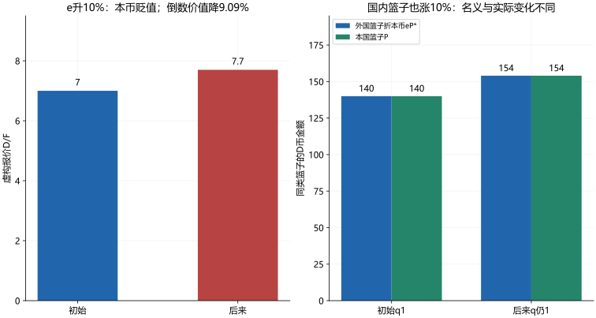

# 51 国际收支、名义汇率与实际汇率

## 学习目标与先修

先完成第33—38章核算、第35章实际量和第50章存量流量。本章约4—6小时。你将区分经常、资本和金融账户，正确读取金融账户方向，计算两种汇率与预期收益关系，并用Python检查账户差额。

本章使用虚构D本币与F外币，7之类数值不是现实人民币或美元汇率。账户与汇率是独立教学例子，不构成真实国际收支表。

## 1. 国际收支不是只有出口进口

**国际收支**记录一段时期内居民与非居民之间的经济交易；居民身份按经济联系与统计居住范围界定，不只看护照。交易流量与某日持有多少对外资产的存量不同，资产价格或汇率重估也不等于新的交易。

经常账户CA包括货物与服务净出口NX、来自境外初次收入净额NPI和经常转移净额NCT：CA=NX+NPI+NCT。出口多于进口不必意味着CA同额顺差；第37章已说明境外收入不能总忽略。

**资本账户KA**主要涉及资本转移和非生产非金融资产等交易，不是日常把一切跨境投资都叫“资本流动”的宽泛说法。股票、债券、贷款和储备等对外金融资产负债交易属于金融账户范围。

## 2. 金融账户必须先约定符号

本课定义FA=对外金融资产净获得−对外负债净发生。FA正表示净贷出方向，可能来自增加对外资产或减少对外负债，不能直接读成“净资本流入”。每一边的“净”也可以为负，例如卖出资产超过买入。

采用这个方向，账户关系为CA+KA−FA+EO=0。EO为净误差与遗漏，作为统计差额单列。这个表示与[IMF BPM6相关定义](https://data.imf.org/-/media/iData/External-Storage/Documents/73FBCD5B6CDE4D289C60B9B0CAA40622/en/2-bpm6.pdf)第2.24、8.3节的净贷出方向一致（2009版手册，核验2026-11-13）；不是说当前所有报表都使用相同格式。阅读实际资料仍需看采用版本、列名与符号。

| 教学项目 | 数值 |
| --- | ---: |
| 出口、进口 | 120、100 |
| NPI、NCT | −5、3 |
| CA=20−5+3 | 18 |
| KA | 2 |
| 资产净获得、负债净发生 | 35、15 |
| FA=35−15 | 20 |
| EO | 0 |

代入18+2−20=0。若其他输入不变，资产净获得实际录成40，FA变25，原账残差−5；所需EO为5。程序会报告这个差额，而不会偷偷把EO从0改成5。算出“需要5”不等于查明统计差异的真实原因。

储备资产交易已经属于对外金融资产，不能又把储备变化额外加到上述等式两次。储备存量的全部变化还可能包含估值因素，本例没有完整存量调节表。

## 3. 先写报价单位，再说升贬值

统一e=每1单位F外币所需的D本币数，单位D/F。e从7到7.7，买同样外币需要更多本币，因此本币贬值。报价上升7.7/7−1=10%。

若换成每1D能买多少F，报价从1/7到1/7.7，变化为7/7.7−1≈−9.090909%。两个百分数不对称，因为分母不同；不能把“汇率上升”脱离报价方向使用。

**实际汇率q=eP*/P**，这里P*为外国同类篮子的F价格，P为本国篮子的D价格。q表示外国篮子折成本币后相对本国篮子的价格。q升高，在本定义下是本国实际贬值；不同教材可能使用倒数，必须先换方向。

初始e7、P*20、P140，q1；后来e7.7、P*仍20、P154，q仍1。本币名义贬值10%，恰好被国内篮子涨价10%抵消，并非实际竞争相对价格也变化10%。真实指数的篮子、质量与权重需要匹配，本例只用同类篮子。实际汇率也不直接等于贸易条件：后者通常比较出口价格与进口价格，覆盖和方向需另行定义。



## 4. 预期汇率与利率平价

在无风险溢价等简化条件下，未抛补利率平价UIP比较预期收益：1+i_dom=(1+i_for)E[e_next]/e。它不是已锁定汇率的无风险套利，实际未来汇率可能与预期不同。

若外币利率4%、e7、预期下期7.14，本币预期贬值2%，则本币利率候选为1.04×1.02−1=6.08%。直接4%+2%=6%只是近似。若使用事先锁定的远期报价，则是另一个抛补收益比较，不能把远期价格与主观预期当同一项。

UIP也不意味着利率高的货币必定赚钱，或任何时候都能从一个等式预测汇率。风险、资本限制、交易成本和预期误差均可能重要。本课只演算一个条件关系。

## 5. 完整Python实验

Windows PowerShell执行，路径换成自己的副本也可：

```powershell
Set-Location 'C:\Users\17597\Desktop\tutorial\content\western-economics\source\示例代码\stage9'
python exchange_accounts.py
```

完整入口[exchange_accounts.py](示例代码/stage9/exchange_accounts.py)，共享模块[open_growth.py](示例代码/stage9/open_growth.py)。应显示报价变动10%、本币外币价值变化−9.090909%、q1、UIP6.08%、CA18/FA20/残差0。

`external_accounts`保留输入EO、所需EO与`consistent`状态，区分“账目前后一致”与“应该查哪项差额”。检查能发现算术不一致，不能替代真实交易分类和资料审核。完整接口见[开放与增长模型约定](开放经济与增长模型约定.md)。

## 常见错误

- 把FA正号直接读成资金净流入，或把资本账户叫所有金融投资之和。
- CA只看净出口，储备在金融资产与额外项目重复计入。
- 忽略报价方向，将两个倒数汇率的变化率简单取相反数。
- 名义贬值自动等于同幅实际贬值，或把UIP当已锁定套利。
- 为让账平而静默更改误差遗漏，再声称找到了真实原因。

## 练习与参考答案

1. e从8降7.2，本币如何变化？答：按D/F报价下降10%，本币升值；本币外币价值增8/7.2−1≈11.111111%。
2. NX10、NPI−3、NCT2、KA1、FA10，EO0，账平吗？答：CA9，9+1−10=0。
3. 基准仅将负债净发生改20，所需EO？答：FA15，所需EO=15−18−2=−5；原输入EO0时残差5。
4. 外币利率3%、预期e升4%，UIP本币候选？答：1.03×1.04−1=7.12%，不是精确7%。

## 完成条件

能先写符号再解释账户，复算CA/FA/EO，正确区分两个报价、实际汇率与预期收益。下一章在更强假设下比较汇率制度，不将本章示例直接当现实政策依据。
