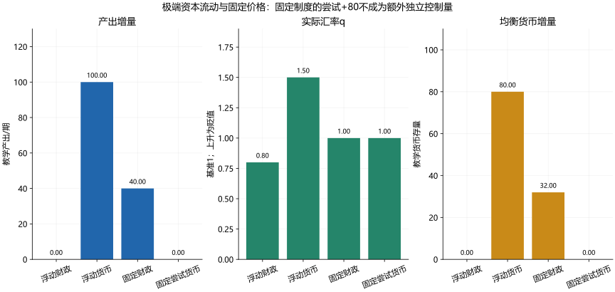

# 52 小型开放经济：浮动与固定汇率

## 学习目标与先修

先完成第43—44章IS—LM、第51章汇率和账户，复习联立方程。本章约4—6小时。你将建立极简蒙代尔—弗莱明式模型，分别求浮动和固定制度下的财政、货币比较，解释政策自主性的约束与结论边界。

这里的**小型开放经济**不能影响外部利率。价格固定、资本完全流动、无风险溢价、预期汇率变化为0，因此本模型设i=i*=4%。它没有同时使用第51章预期贬值2%的独立例子；否则利率平价条件必须重写。

## 1. 先把三个市场条件写出来

消费仍为C70+.6Y，私人投资80−1000i，公共投资20已在总I100−1000i中，政府消费G150。引入净出口：NX=70+100(q−1)−.1Y。

q为以基准1归一化的实际汇率，q上升代表本币实际贬值；价格比固定时与本章名义报价同方向。它不是将第51章篮子金额直接代入货币方程，后者采用价格尺度P1与相应教学货币单位。

净出口对贬值为正、随本国收入增加而减少，是本例额外设定。真实进出口还有数量弹性、合同、币种和调整时滞等，不能说任何贬值都立即改善贸易余额。本章只给NX，没有分别估计每一种出口进口。

```text
产品：.5Y = 390+ΔG-1000i+100(q-1)
货币：Ms = .8Y-4000i   （P固定1）
外部利率条件：i=i*=.04
```

基准Y700、q1、Ms400；C490、I60、G150、NX0，支出合计700。这个开放样本的自主项390包含净出口截距，与第43章封闭样本320不同，不能直接混公式。

## 2. 浮动汇率：给定货币，汇率调整

浮动情景由货币方程和i*先决定Y=(Ms+160)/.8，再用产品方程反解q。Ms400时Y700。

政府消费增加20，产品式自主项从390变410，货币不变仍给Y700，故q=.8。净出口变70−20−70=−20，恰好抵消新增G20。这个极端模型中的抵消发生在净出口，不是把私人投资也说成必然少20。

若政府消费不变，只将Ms增至480，Y800；产品式要求q1.5，NX70+50−80=40。相较基准，实际贬值支持需求，产出增加100。这里的50%汇率变化只是为了便于计算，不能当现实货币扩张的预测弹性。

## 3. 固定汇率：货币供给成为配合量

设可信固定q1、仍i*.04，产品式给Y=(390+ΔG−40)/.5。G多20时Y740；为满足货币市场，Ms必须是.8×740−160=432。也就是说，这组闭合中不能再把Ms400独立固定。

如果G不变、试图单独将Ms设480，同时坚持q1与i4%，产品式仍要求Y700，所需Ms400。程序会列出维持设定所需的相对尝试值反转400−480=−80。它是模型中的货币量条件，未建央行储备或外汇资产负债表，不能直接称“真实储备损失80”。



## 4. 三个目标为什么不能都独立指定

在本极端条件中，固定汇率、资本自由流动和独立货币政策不能同时任意选择。资本流动约束利率，固定汇率再限制汇率调整，货币数量就需要配合。这是通常所说三元悖论的入门机制。

可参考[IMF刊载的Fischer 2001年讲话](https://www.imf.org/en/news/articles/2015/09/28/04/53/sp060101)相关讨论（实际发布2001-06-01，核验2026-11-13，不能从URL中的2015推断年份）。本课只使用概念，不采纳其中当时的国家政策判断作当前结论。

现实还可能有不完全资本流动、管理浮动、资本限制、风险溢价、预期变动与干预。不同程度的取舍不能都压缩成这五行结果；没有一条“所有地方浮动财政无效、固定货币无效”的无条件定律。

本章也未解决通胀、就业与分配的所有目标，固定价格只适于明示的短期比较。开放与封闭模型中政策传导不同，先说明制度和保持不变项，再评价结果。

## 5. 运行程序与检查两项残差

Windows PowerShell执行：

```powershell
Set-Location 'C:\Users\17597\Desktop\tutorial\content\western-economics\source\示例代码\stage9'
python open_economy.py
```

完整入口[open_economy.py](示例代码/stage9/open_economy.py)。依次输出基准700/1、浮动财政700/.8、浮动货币800/1.5、固定财政740/1与Ms432、固定货币尝试下所需Ms400。

`mundell_fleming`保留`requested_money`与`equilibrium_money`。固定制度下前者是尝试输入，后者才满足既定汇率和外部利率；不能让界面只显示一个数掩盖冲突。浮动时`required_reversal_for_peg`为`None`，表示不适用，不是0的另一种拼法。

商品与货币残差均需接近0，q和实际货币量不得为负，私人投资也保持非负。若输入让q不正，程序拒绝，不把它填成小正数继续解释。完整参数范围见[模型约定](开放经济与增长模型约定.md)。

## 常见错误

- 将资本完全流动等条件省略，把结论用到所有现实制度。
- 固定制度同时强行指定汇率、外部利率与独立货币量，造成方程冲突。
- q方向读反，或把净出口抵消都称作私人投资挤出。
- 将所需货币反转当已模拟的央行储备变化。
- i*=4%当真实世界利率，或把第51章预期汇率变化未经改式就拼入本模型。

## 练习与参考答案

1. 浮动制度G多10、Ms400，Y/q/NX？答：700/.9/−10。
2. 固定q1、G多10，Y与所需Ms？答：720和416。
3. 浮动制度Ms440、G不变，Y/q/NX？答：750/1.25/20。
4. 固定制度尝试Ms440、G不变，维持既定条件所需反转？答：400−440=−40；这不是完整外汇干预记账。

## 完成条件

能分别明确哪一个变量外生、哪一个调整，复算五个情景和两项残差，并解释三元约束的条件。下一章转向长期增长，不再用短期需求结果替代长期供给能力。
