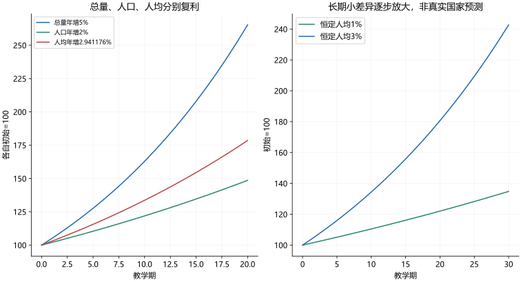

# 53 长期增长：总量、人均与复利

## 学习目标与先修

先完成第03章比例、第34章实际与人均、第50章名义增长，并复习第08章循环。本章约3—5小时。你将把总产出增长分成人口与人均变化，计算复利和精确翻倍时间，建立阅读长期增长数据所需的口径。

本章表格完全虚构，训练“增长事实怎样读取”，不把它称为真实国家历史。短期产出恢复、一次水平上升与长期持续增长也要分开。

## 1. 先决定比较什么

总GDP可回答经济规模，实际人均GDP可用于观察平均产出水平。它们不是同一指标：总量增长较快，可能部分来自人口增加；人均量仍是平均数，不表示每个人收入相同，也不能代替分配、闲暇、环境或健康评价。

跨期比较先看实际量和价格基期，跨地区比较还要处理货币换算、价格差异与人口范围。市场汇率换成同一种货币与购买力平价换算回答不同问题；PPP换算不是把所有国家相对价格假定成完全相同，也不是汇率预测。

读一份真实表时应记下指标名称、单位、参考时期、现价/不变价、币种或购买力口径、人口分母与修订状态。仅有“GDP增长5%”还不足以判断实际人均生活水平增加多少。前38章的数据阅读方法在长期比较中仍适用。

## 2. 总量与人均的精确关系

令Y为实际总产出，N为人口，y=Y/N。若总量增长gY、人口增长n，则：

```text
1+人均增长率 = (1+gY)/(1+n)
```

虚构初始Y1000、N100，人均10。总量每期增长5%、人口增长2%，人均增长1.05/1.02−1≈2.941176%，不是精确3%。当增长很小时，用5%−2%是近似。

如果人口下降，人均量也可能在总量不变时上升；它仍不是自动的福利结论。需要看年龄结构、就业、分配和产出构成。本章允许增长率大于−100%的负值作算术练习，后面的索洛基础例子则另限定非负人口增长，不要混淆接口范围。

## 3. 复利让小差距逐步放大

每期都按新的基数增长，Y_t=Y0(1+gY)^t，N_t=N0(1+n)^t。上例10期后：

| 项目 | 初始 | 第10期 |
| --- | ---: | ---: |
| 实际总产出 | 1000 | 1628.894627 |
| 人口 | 100 | 121.899442 |
| 人均产出 | 10 | 13.362609 |

总量累计增约62.89%，人口约21.90%，人均约33.63%。不能把每期5%乘10当精确累计增长50%，也不能把两个累计百分数直接相减得到精确人均变化。



同样初始水平，长期人均增长1%与3%的差距会逐年扩大；但不能只看两个时期就断言增长率将永远固定。技术、人口、资本、制度与冲击会改变路径，恒定增长只是本例条件。

## 4. 精确翻倍时间与70法

解(1+g)^t=2，得到t=ln2/ln(1+g)。ln是自然对数，可以把它理解成“指数运算的反向问题”；Python用`math.log`与`math.log1p`计算。

增长3%时，精确翻倍时间约23.449772期。常见70法用70除以百分数3，得约23.333期，是小增长率下的便捷估算。增长很大时误差可能更明显，不把估算当精确答案。

零增长不会向上翻倍，负增长也没有这种有限翻倍时间。函数用`None`表示不适用；不能为了方便把它记成0年。这里的t可为小数，是连续求解的“期数”，若只在整期末观察，应取不小于它的整数期才能看到至少翻倍。

## 5. 增长核算与增长原因先分开

算出总量和人均怎样变化，是描述和核算；解释为什么增长，需要技术、资本积累、人力资本或制度等机制。看到投资与增长一起上升，不能直接断言所有增长都由投资导致；预期增长也可能反过来提高投资。

第54章用索洛模型说明资本深化与稳态，第55章再加入技术和增长核算。生产函数是明示假设，不会仅因能画出一条增长曲线就自动验证现实因果。

## 6. 完整Python程序

Windows PowerShell执行：

```powershell
Set-Location 'C:\Users\17597\Desktop\tutorial\content\western-economics\source\示例代码\stage9'
python growth.py
```

完整入口[growth.py](示例代码/stage9/growth.py)，共享[open_growth.py](示例代码/stage9/open_growth.py)。程序列初始和10期后的值，再输出人均2.941176%、翻倍23.449772及零增长的`None`。

`growth_path`返回从0期开始的记录列表，所以10期路径有11条记录。`doubling_time`仅在正增长时求对数比值；不适用情况先判断，避免零分母。`math.log1p(g)`直接计算ln(1+g)，在小g下也适合数值运算。

程序检查人口和产出为正、率大于−1，不能把人口0或−100%增长代入人均公式。完整输入范围见[模型约定](开放经济与增长模型约定.md)。

## 常见错误

- 总量增长直接当人均增长，名义金额直接当实际量。
- 各期增长率简单相加，忽略复利基数。
- 两个累计增长率直接相减，或把70法叫精确公式。
- `None`写成0年，或0期初始记录漏计后误读年份。
- 把描述、条件模型和原因识别混为一谈。

## 练习与参考答案

1. 总产出增4%、人口增1%，人均增幅？答：1.04/1.01−1≈2.970297%。
2. 初始100、每期增长10%，两期后？答：121，累计21%，不是120。
3. 人均每期增长2%，精确翻倍时间？答：ln2/ln1.02≈35.002789期；整期末至少36期才超过翻倍。
4. 总量不变、人口减少2%，人均变化？答：1/.98−1≈2.040816%，不能仅据此评价总体福利。

## 完成条件

能独立计算每期与累计人均变化、翻倍时间，写清价格和人口口径，并说明增长数字尚未回答原因。随后进入资本积累的明确模型。
