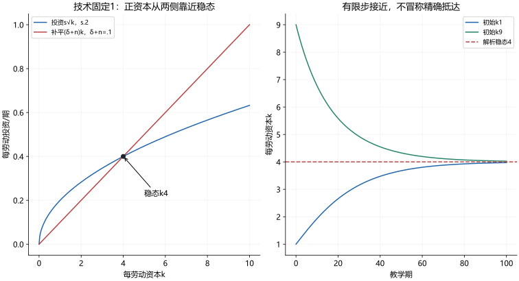
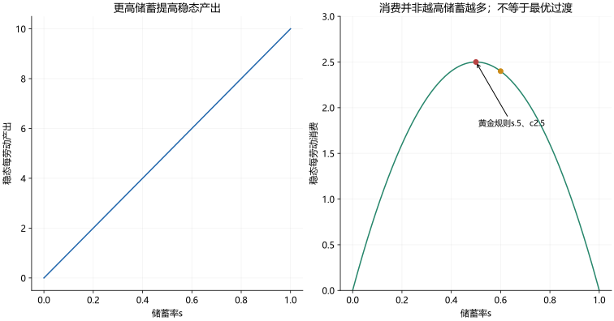

# 54 索洛模型：资本积累、稳态与过渡

## 学习目标与先修

先完成第23章生产函数、第53章复利，复习幂与函数。本章约4—6小时。你将从总资本递推推导人均式，计算稳态，比较储蓄率改变，并区分提高长期水平与提高持续人均增长率。

这是单一产品、封闭、无政府的增长教学模型，投资等于储蓄；价格、税、国际资本流动与周期政策不在本章中。所有参数人为设定，不能直接当国家校准。

## 1. 总量从哪里来

设总资本K、劳动人数L、产出Y，生产函数Y=K^α L^(1−α)，0<α<1，暂不加入技术增长。资本与劳动同时翻倍，产出翻倍，称规模报酬不变；劳动不变时不断增加资本，新增产出递减。

令k=K/L、y=Y/L，便有y=k^α。默认α=.5，即y=√k。储蓄率s表示产出中用于投资的比例；消费c=(1−s)y。折旧率δ表示一期内资本损耗的比例。

总资本K_next=(1−δ)K+sY，劳动L_next=(1+n)L。时序是用本期产出形成投资，再进入下期资本；新增劳动也在下期进入分母。因此：

```text
k_next = [(1-δ)k+s*k^α]/(1+n)
Δk = [s*k^α-(δ+n)k]/(1+n)
```

这是精确离散式。直接把连续时间写法Δk=s f(k)−(δ+n)k原样当本期到下期的差额，会漏掉1+n。很多图用“补平投资”(δ+n)k帮助判断方向，但实际递推仍要按正确时序除分母。

## 2. 默认例子逐步算

取s.2、δ.08、n.02、α.5。初始k1，y1、投资.2，旧资本保留.92，下一期k=1.12/1.02≈1.098039215686。

**稳态**在这里指人均k不再变化，而不是所有总量停止增长。令k_next=k，得到s*k^α=(δ+n)k。正稳态为k*=[s/(δ+n)]^(1/(1−α))。

默认δ+n=.1，k*=(.2/.1)^2=4，y*=2，消费c*=.8×2=1.6。总劳动仍按2%增长，在这个稳态上总K与总Y也可按2%增长；无技术增长时人均长期增长为0。



若k<4且正，投资超过补平项，人均资本增加；k>4时相反。正初始k逐渐接近正稳态。若初始k恰为0，Cobb—Douglas式产出也是0，没有投资启动，在本简化式中是吸收态；不能把“任何初始值都会到4”写成无条件结论。

## 3. 储蓄率提高是水平效应还是增长效应

s改.3，正稳态k9、y3、c2.1；过渡中人均产出可以增长较快，但到新稳态后人均增长仍0。更高储蓄改变长期水平，不在这个固定技术模型里永久提高人均增长率。

s改.6，则k36、y6、c2.4。产出更高不表示稳态消费总更高，因为用于投资的份额也更大。必须先说明评价的是产出、消费、福利还是过渡期代价。

索洛本人关于水平、过渡与长期增长的讨论可从[1987年讲演入口](https://www.nobelprize.org/prizes/economic-sciences/1987/solow/lecture/)继续阅读。该入口本次仅核对到可检索选段，未全文通读；本课公式从上述资本递推独立推导，不冒称复刻讲演模型全部内容。

## 4. 黄金规则只回答一个特定问题

稳态消费c*=f(k*)−(δ+n)k*。若只比较所有稳态中可维持的消费，最大点满足边际产出f'(k)=δ+n。在Cobb—Douglas例子中对应s=α=.5，k25、y5、c2.5。

这个**黄金规则**是稳态消费最大条件，不是已经求出一条考虑代际、折现和过渡损失的最优政策路径。由较低资本走向该状态可能先牺牲消费；由高资本状态调整也涉及时间。模型还没有住户跨期最优化与制度约束。

默认s.6的产出6高于黄金规则5，但消费2.4低于2.5，说明“投资越多越好”不成立为无条件结论。



## 5. 完整Python与有限步误差

Windows PowerShell执行：

```powershell
Set-Location 'C:\Users\17597\Desktop\tutorial\content\western-economics\source\示例代码\stage9'
python solow.py
```

完整入口[solow.py](示例代码/stage9/solow.py)。应显示下一期1.098039215686，第200期约3.999825，并列三种储蓄稳态及黄金规则。200步接近4，不等于有限步已经精确到达；极小浮点差额也不代表经济波动。

模块用`**`表示幂，例如`k**alpha`。`solow_steady`返回解析解和稳态残差；`solow_path`逐期保存状态，先根据旧k计算，再更新劳动与技术。第55章会让技术增长，使“每劳动”和“每有效劳动”不同，本章技术固定1时二者相同。

本课限定非负人口与技术增长、储蓄和折旧在0到1、α严格在0与1之间，且补平系数正。δ=n=0等没有本节有限正稳态的情景明确拒绝，避免套用分母0公式。见[模型约定](开放经济与增长模型约定.md)。

## 常见错误

- 漏掉离散式的1+n，混淆总量与人均递推。
- 稳态解释为所有总量零增长，或储蓄提高解释为永久人均增长提高。
- 产出更高就说稳态消费必定更高，把黄金规则叫完整最优路径。
- 从k0=0声称一定自动收敛到正稳态。
- 200期数值接近解析解，便冒称任何参数都已验证。

## 练习与参考答案

1. 默认k4时投资与补平项？答：.2×2=.4，(.08+.02)×4=.4，所以k_next4。
2. 默认s改.3的稳态消费？答：k9、y3、c.7×3=2.1。
3. 默认k1但误漏分母，会得到多少？答：1.12而非1.098039，人口稀释未处理。
4. s1时是否稳态消费最大？答：消费份额0，不是最大；默认黄金规则s.5。

## 完成条件

能从K/L时序推到精确递推，复算稳态与第一步，解释正初始值和黄金规则的条件。下一章加入技术增长，学习持续人均增长与核算分解。
