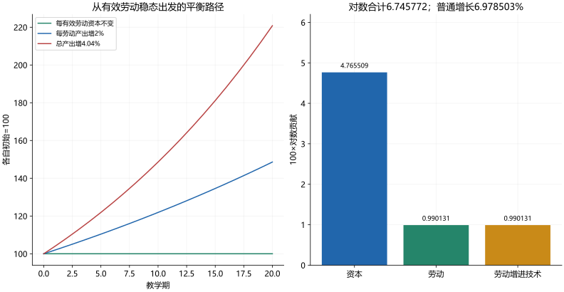

# 55 技术、人力资本、内生增长与增长核算

## 学习目标与先修

先完成第53—54章，复习对数与生产函数。本章约4—6小时。你将区分每人、每劳动和每有效劳动的量，推导含技术的精确稀释项，计算增长核算，并用独立AK示例理解持续增长假设怎样改变。

下面的技术指数A、资本份额和增长率均为自设参数，不是测出的国家生产率。核算贡献与因果贡献也要分开。

## 1. 技术怎样进入生产函数

设Y=K^α(AL)^(1−α)，A是劳动增进技术，AL称**有效劳动**。它将劳动数量与每单位劳动的有效生产能力分开。若A增长，同样人数可以提供更多有效劳动，但不表示每个人真实技能或工时必定按同样比例增加。

定义每有效劳动资本k~=K/(AL)、每有效劳动产出y~=Y/(AL)，仍有y~=k~^α。可是每劳动产出Y/L=A*y~，所以k~不变时，每劳动产出仍会随A增长。

这个A不是另一种常见写法Y=Z K^α L^(1−α)中的全要素生产率Z。两式对应Z=A^(1−α)。例如α.5时A增2%，Z只增加√1.02−1约.995049%；不能看见字母“技术”就把增长率直接互换。

## 2. 两种增长一起稀释资本

设劳动增长n，技术增长gA，总资本仍由本期投资形成下期资本。则：

```text
k~_next = [(1-δ)k~+s*k~^α] / [(1+n)(1+gA)]
精确补平系数θ = (1+n)(1+gA)-(1-δ)
              = δ+n+gA+n*gA
```

默认δ.08、n.02、gA.02，θ=.1204，而非精确.12。正稳态k~*=(s/θ)^(1/(1−α))。取s.2、α.5，得k~约2.759351442、y~约1.661129568、c~约1.328903654。

若恰从每有效劳动稳态出发，A每期增2%，人均劳动产出也增2%；总产出还随劳动增加，增长1.02×1.02−1=4.04%。不能把每有效劳动稳态理解成人均量与总量都静止。



当s提高而gA外生固定，仍主要改变长期水平；长期每劳动产出增长由gA决定。模型把技术来源留在外部，这正是它能解释与尚未解释之处的边界。

## 3. 增长核算：严格相加的是对数变化

对生产函数取自然对数再作两期差，得到：

```text
ΔlnY = αΔlnK+(1-α)ΔlnL+(1-α)ΔlnA
```

在给定函数与α时，这个分解严格成立。若改写TFP形式，最后一项就是ΔlnZ。普通百分比的加权和通常只是近似，不要把它与对数差等同。

自设K增10%、L增2%、A增2%、α.5：资本对数贡献约.047655090，劳动.009901314，技术.009901314，合计ΔlnY约.067457717。将对数变回普通增长率，exp(.067457717)−1约6.978503%。

也可直接用倍数验证：Y_new/Y_old=√1.1×1.02，约1.069785025。近似5%+1%+1%=7%接近却不精确。代码输出的对数贡献没有乘100；显示成百分数前，先说明这是对数变化单位。

现实增长核算中的残差不一定都是纯技术进步，还可能包含劳动质量、人力资本、利用率、规模、测量误差和模型遗漏。核算分解本身没有识别“如果政策多投资1单位会增加多少产出”。

## 4. 人力资本、制度与内生增长

人力资本可理解为知识、技能、经验与健康等生产能力。若另用每人有效技能h，可写Y=K^α(AhL)^(1−α)，但实际如何测量h、怎样避免与A重复解释，需要资料和模型支持。

产权、竞争、金融、教育、组织与政策规则可能影响创新和资源配置。把一切差异都塞进A，再把残差直接称作制度效应，不能构成因果证据。制度与收入还可能相互影响，需独立研究设计。

为看清持续增长依赖什么，另立**AK示例**：Y=aK、人口固定、a为产出/资本系数，资本增长率为s*a−δ。a.2、s.5、δ.05时增长5%；s.6时增长7%。这里没有索洛的资本边际产出递减，所以储蓄变化可以改变持续增长率。

AK的a不是前面的劳动增进A。这只是机制示意，尚无完整研发部门、知识外溢定价或住户最优储蓄。不能据此宣布任何增加储蓄都必定永久提高现实增长。

## 5. 完整Python与状态对照

Windows PowerShell执行：

```powershell
Set-Location 'C:\Users\17597\Desktop\tutorial\content\western-economics\source\示例代码\stage9'
python technology.py
```

完整入口[technology.py](示例代码/stage9/technology.py)。从解析k~稳态出发跑一步，应看到每劳动增长2%、总量4.04%，随后输出严格对数分解与独立AK的5%。

`growth_accounting`用`math.log1p`计算ln(1+增长率)，`math.expm1`把对数变化转成exp(x)−1。`solow_path`每行同时保存A、L、K、Y、每劳动与每有效劳动量，便于检查分母；不要只拿其中一个“output”键便忽略单位。

本阶段没有第三方统计估计，也未从真实增长数据推算技术因果。输入与时序见[模型约定](开放经济与增长模型约定.md)。

## 常见错误

- A与TFP Z混用，或每有效劳动不变就说人均产出不增长。
- 精确离散稀释漏掉n*gA，把.1204写成精确.12。
- 对数贡献直接当普通增长百分点，或把残差全部叫纯技术。
- AK与索洛A混称一套参数，忽略边际产出假设已经改变。
- 增长核算或制度相关性直接当政策因果。

## 练习与参考答案

1. δ.05、n.01、gA.03，精确θ？答：.05+.01+.03+.0003=.0903。
2. 每有效劳动稳态、gA3%、n1%，总量增长？答：1.03×1.01−1=4.03%，每劳动3%。
3. α.5、K增21%、L和A不变，普通Y增长？答：√1.21−1=10%；资本对数贡献为.5ln1.21，不是10.5%。
4. 独立AK中a.2、s.6、δ.05，增长？答：7%，结论依赖线性生产假设。

## 完成条件

能区分A/Z、每劳动/每有效劳动，复算精确θ与对数贡献；能解释索洛与AK的差异以及核算和因果的边界。下一章用同样方式比较宏观模型的假设。
