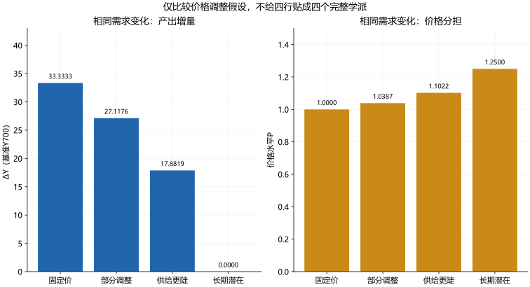

# 56 宏观流派：用假设、机制与证据比较

## 学习目标与先修

先完成第39—55章，并复习第02章模型与因果。本章约4—7小时。你将把宏观分歧整理为可检查的问题，认识几条主要研究路线，比较同一需求变化在不同价格调整条件下的结果，避免把一个图或标签当成整个学派。

本章是入门地图，不是完整思想史或全部现代宏观模型的实现。不同研究者、年代和具体模型内部也有分歧，不能由流派名称直接推出一项政策结论。

## 1. 先问五个问题

一个模型先说明：研究短期波动还是长期增长？价格工资怎样调整？预期怎样形成？什么冲击驱动经济？政策改变哪些规则、通过什么渠道传导？

第43章固定价格、预期通胀0、货币量外生；第49章利率规则与通胀关系；第54章封闭增长与资本递减。它们回答的问题不同，不能仅因某个模型没写货币，就说它主张现实货币完全不重要。

**理性预期**也不是人人知道未来、从不犯错。它强调在给定信息与模型条件下形成相容的预测，不能靠同样信息持续利用系统性预测偏差。第46章的机械适应规则是另一种假设；是否合理取决于问题与证据。

## 2. 几条主要路线怎样区分

| 路线 | 常见关注与建模问题 | 使用时要检查 |
| --- | --- | --- |
| 凯恩斯及综合路线 | 有效需求、就业、短期名义调整和政策组合；IS—LM/AD—AS是部分教材工具 | 价格与供给条件、预期和融资是否明确；不能把全部思想压成一条乘数 |
| 货币主义 | 货币、名义活动、政策规则、时滞及短期与长期区别 | 货币需求、预期与制度是否稳定，不把简单货币增速规则当当前普遍操作 |
| 新古典宏观 | 预期、跨期选择、政策制度变化与结构模型 | 信息、市场与政策可预见性条件；“理性”不自动证明所有政策无效 |
| 实际经济周期研究 | 实际冲击、跨期选择与资源配置，常以价格灵活的动态一般均衡为基准 | 冲击是否可信、模型是否解释数量与共动；不因此否认现实名义摩擦 |
| 新凯恩斯研究 | 动态选择与预期，结合名义价格/工资刚性等机制研究政策 | 刚性、竞争、金融和政策规则设定；不是简单回到旧固定系数模型 |

这里“新古典宏观”与第54章“新古典增长模型”并非相同标签；同一生产技术可被不同波动模型采用。现代模型也经常结合不同路线的工具。

Friedman的[1968年论文](https://www.aeaweb.org/aer/top20/58.1.1-17.pdf)讨论货币政策能力、预期与自然率问题；Galí的[2010年研究稿导论](https://www.federalreserve.gov/events/conferences/irfmp2010/papers/jg_wu_feb2010.pdf)说明新凯恩斯框架如何结合动态选择与名义刚性。这里选读相关段落，不把历史主张或作者研究稿当现行机构政策，也没有通读其全部配套文献。核验2026-11-13。

## 3. 为什么政策改变后旧系数可能不稳定

**卢卡斯批评**提醒我们：如果政策规则改变，人们对未来的预期与决策也可能改变，旧环境下估计出的约化关系未必保持不变。这个提醒不等于“任何经验研究都没用”，也不等于只要给模型取个结构名称就已解决问题。

例如，用短暂收入变化下的消费系数预测永久税制改革，可能遗漏预期与跨期反应；用某个制度下的汇率弹性预测另一制度，也可能失效。模型需要说清哪些参数、信息与规则被认为可保持。

Taylor在[1980年稳定政策研究](https://web.stanford.edu/~johntayl/Onlinepaperscombinedbyyear/1980/Recent_Development_in_the_Theory_of_Stabilization_Policy.pdf)讨论了相关预期与政策评估问题。我们只核对相关段落，不声称本课已实现完整理性预期求解器，也不声称阅读了Lucas原始论文全文。

## 4. 一个可算的假设比较

沿用第45章需求Y=(340+100/P)/.6，即相对基准自主需求增加20；原潜在700、价格参照1。只改变短期供给斜率：P=1+s(Y−700)/700。

| 比较条件 | Y | P |
| --- | ---: | ---: |
| 价格固定，s0 | 733.333333 | 1 |
| 部分调整，s1 | 727.117565 | 1.038739 |
| 供给更陡，s4 | 717.881857 | 1.102182 |
| 长期潜在固定700，允许预期调整 | 700 | 1.25 |

相同需求变化，价格调整条件不同，产出与价格分担不同。最后一行不是保留原Pe1的同一短期AS，而是长期供给与相应预期调整的另一个条件比较。



这些行不叫“凯恩斯模型、货币主义模型、RBC模型、新凯恩斯模型”。单改AS斜率没有实现各自的预期、最优化、冲击过程和政策规则，所以只能说明一个假设的影响，不能评判哪个学派已被证实。

## 5. 运行程序并组织自己的判断

Windows PowerShell执行：

```powershell
Set-Location 'C:\Users\17597\Desktop\tutorial\content\western-economics\source\示例代码\stage9'
python model_comparison.py
```

完整入口[model_comparison.py](示例代码/stage9/model_comparison.py)给出上表四行，短期回代AD与AS残差；长期分支AS残差用`None`，因为没有伪装成原短期关系。程序依然是标准库，并未模拟完整现代DSGE体系。

写比较报告时按“问题、共同条件、改变假设、方程、结果、证据与限制”组织。同一现实事件可能同时有需求、供给、金融和预期变化，不能只找一张最顺眼的图。数据拟合好也不自动识别机制，结论能否跨政策环境使用还要单独检查。

## 常见错误

- 一个学派配一个万能结论，把内部差异和适用时期删掉。
- 理性预期当完美预知，或认为政策制度变了旧参数仍必定可用。
- 将索洛式增长与新古典宏观完全等同。
- 只改AS斜率便声称实现并验证了整个学派。
- 把历史作者观点当当前机构立场，或把模型比较当现实因果识别。

## 练习与参考答案

1. 为什么s0与s1的Y不同不代表计算矛盾？答：共同需求相同，但价格调整条件不同。
2. 表中长期P1.25、Y700能否满足原Pe1、s1的短期AS？答：不能，原式在Y700只给P1，必须说明预期或供给条件变化。
3. 理性预期是否排除预测误差？答：不排除，关键是信息与模型条件下的相容性及系统性可利用误差，不是完美预知。
4. 为什么高拟合度不能单独证明财政因果？答：可能有共同冲击、预期、反向关系与制度变化，需要识别而不只拟合。

## 完成条件

能用五个问题描述一个模型，比较共同条件和改变的假设，复算四行结果并给出限制。第51—56章基础完成；第57—60章科学计算、统计与最终独立复现仍待编写。
