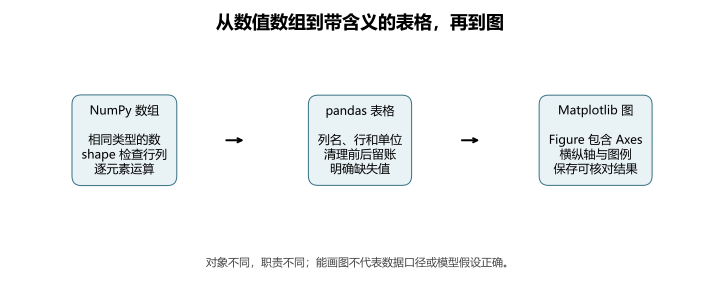

# 57 科学计算起步：环境、数组、表格与绘图

## 学习目标与先修

先完成05—12章Python，再复习第11章CSV和第38章资料口径。本章约5—7小时。你将知道第三方库装到哪里，使用NumPy数组和pandas表格，检查缺失与重复，并用Matplotlib生成有单位的图。前56章程序仍可只用标准库；本章才引入第三方依赖。

**库**是一组可以导入的功能；**环境**是某个解释器及它能找到的包；**依赖**是程序运行所需的其他包。电脑上有多个Python时，一个解释器安装成功不代表另一个也能导入。先确认路径，比反复输入安装命令更有效。

## 1. 建立可辨认的环境

本课第十阶段实际验证为Windows、Python3.13.9、NumPy2.3.5、pandas2.3.3、Matplotlib3.10.6，来自维护者已有Anaconda环境；**未在新机器重新执行pip安装**。下面是读者的新环境步骤，版本来自实际运行记录，不宣称它们是最新版本。

在Windows PowerShell、课程根目录执行。`py -3.13`要求已有Python3.13；找不到时先按第05章与Python官方安装说明配置该版本。下面不用激活脚本，因此不需要修改PowerShell执行策略：

```powershell
Set-Location 'C:\Users\17597\Desktop\tutorial\content\western-economics'
py -3.13 -m venv .venv-economics
& '.\.venv-economics\Scripts\python.exe' -m pip install -r '.\source\示例代码\stage10\requirements.txt'
& '.\.venv-economics\Scripts\python.exe' -m pip check
& '.\.venv-economics\Scripts\python.exe' -c "import sys,numpy,pandas,matplotlib; print(sys.executable); print(numpy.__version__,pandas.__version__,matplotlib.__version__)"
& '.\.venv-economics\Scripts\python.exe' -B '.\source\示例代码\stage10\arrays_tables.py'
```

PowerShell的`&`调用引号里的程序路径；`-m pip`让这一解释器运行自己的安装工具；`-r`逐行读取依赖文件。不要在Python的`>>>`提示符后输入这些终端命令。安装通常需要网络，离线学习ZIP不含这些包。`pip check`查已安装依赖关系，不替代运行例程。

[requirements.txt](示例代码/stage10/requirements.txt)固定三个直接依赖，不是锁住所有间接依赖和操作系统的完整锁文件。`venv`也不是复制整个Python安装；移动电脑时重新建环境，不直接搬`.venv`。如果已有可用环境，先打印版本再选择是否使用，不要为本课覆盖其他项目的环境。

官方依据：[venv](https://docs.python.org/3.13/library/venv.html)、[NumPy安装](https://numpy.org/install/)、[pandas安装](https://pandas.pydata.org/docs/getting_started/install.html)、[Matplotlib安装](https://matplotlib.org/stable/install/index.html)，核验2026-11-13。官方也提供其他工具路线；本课延续已学的解释器与pip，不同时要求掌握多套包管理器。文档的stable版本可能高于本课实际环境。

## 2. 数组不是普通列表的另一种拼写

下面是可独立运行的Python小程序，可保存为自己副本的`array_start.py`；需在已装依赖的环境执行：

```python
import numpy as np

prices = np.array([2, 3, 4], dtype=float)
quantities = np.array([10, 8, 6], dtype=float)
revenues = prices * quantities
print(prices.shape, prices.dtype)
print(revenues)
print(revenues.sum())
```

`import numpy as np`给模块一个短名称。`np.array`创建数组；`dtype=float`明确使用浮点数。数组通常把同类数放在一起，本例`shape`为`(3,)`，表示一维3个元素，逗号是单元素元组的语法，不表示缺了一列。`dtype`显示`float64`是本次实际环境采用的数值类型。

数组相乘按对应位置计算，输出20、24、24，总收入68。普通列表`[2,3,4]*2`会重复列表，不是将每个数乘2；数组乘标量2才是4、6、8。这种将一个标量应用到各元素的规则是**广播**的简单情形，不能由此假定任意不同形状都能相乘。

`np.column_stack([prices, quantities])`把两个一维数组作为列，得到3行2列，`shape`为`(3,2)`。`matrix[:,0]`取全部行的第0列；`matrix[0,:]`取第0行。索引仍从0开始。回归前检查行是否代表同一观察单位，比只看数组长度更重要。

`*`为逐元素乘法，`@`是矩阵乘法，规则不同。到第58章，设计矩阵一行对应一户、每列对应一个解释变量，`X @ beta`才表示每户按系数求预测值；不能把`X*beta`结果未加总就叫预测。

## 3. 表格为数值增加列名与观察单位

**DataFrame**是带行列标签的二维表；其中一列通常是**Series**。列名不是数学单位，仍需独立数据字典。本课[原始CSV](示例代码/stage10/data/households_raw.csv)记录虚构一期家庭，收入和消费单位都是教学币/期，背景为0或1。它不是现实调查，也不是时间序列。

以下是需要上下文的片段：假设已`import pandas as pd`，并令`path`指向自己的原始CSV。

```python
raw = pd.read_csv(path, dtype=str, keep_default_na=False)
print(raw.head())
print(raw.columns)
print(raw["income"])
selected = raw.loc[raw["background"] == "1", ["id", "income"]]
```

先按字符串读取，便于知道原文件究竟写了什么；`keep_default_na=False`避免自动把很多文本记号都解释成缺失。`head()`只是查看前几行，不能证明所有行都正确。`raw["income"]`选一列；`.loc[行条件,列清单]`同时选行和列。这里背景仍是字符串，所以条件是`"1"`；转换后才用数字1比较。

本例故意放10行：8份有效家庭、1份H03精确重复、1份H09收入缺失。重复不是新样本，缺失不是收入0。完整清理函数见[lab.py](示例代码/stage10/lab.py)：

1. 核对四个列名与ID格式，去除首尾空格。
2. 删除完全相同的重复行；同一ID内容冲突则报错，不能任意保留或平均。
3. 只把空白与`NA`当规定的缺失记号，严格转数值；拼错文字、无穷和不合法数值报错。
4. 记录缺失ID并删除缺失行，留下8户，按ID排序，返回处理账本。

完整程序输出`10→去重后9→去缺失后8`、缺失ID H09、平均收入45。`pd.to_numeric(..., errors="raise")`意味着不认识的数字应先查原因；如果一律使用`coerce`再删缺失，可能把拼写错误悄悄当作数据缺失。

删除缺失也可能改变真实样本组成。本例只是明确规则的教学练习，不证明现实中“删掉所有缺失”总合理；没有观测到的家庭为什么缺失，是另一项调查问题。



## 4. 图对象与保存结果

**Figure**是整张画布，**Axes**是画布上的一个绘图区；Axes不只是横轴。`fig, ax = plt.subplots()`同时返回它们，逗号是解包赋值。下面是完整的最小绘图程序，写到自己的`draw_start.py`并运行，会覆盖自己`my-results/revenue.png`同名图：

```python
from pathlib import Path
import matplotlib
matplotlib.use("Agg")
import matplotlib.pyplot as plt

output = Path("my-results")
output.mkdir(exist_ok=True)
fig, ax = plt.subplots(layout="constrained")
ax.plot([2, 3, 4], [20, 24, 24], marker="o")
ax.set(xlabel="Price (teaching currency / item)",
       ylabel="Revenue (teaching currency / period)",
       title="Synthetic price-quantity example")
fig.savefig(output / "revenue.png", dpi=150)
plt.close(fig)
```

`Agg`后端用于生成文件，不弹窗；必须在导入`pyplot`前设置。程序没有调用`show()`，所以终端没有弹图也可能正常完成，检查输出文件。`close`释放图对象。相对路径按当前工作目录解释，完整项目第59章则让输入位置由脚本自身定位。

图中三组价格数量都是虚构配对，不能把连线叫已估计的现实收入函数。点、线、直方图或柱形图都应说明单位、对象、时期与来源；柱形比较通常以0为起点。项目生成图使用英文轴标签，避免依赖某一台电脑的中文字体；本课中文说明仍在正文和图注中。

## 常见错误

- 用另一个Python的pip安装后，仍在旧解释器运行；先看`sys.executable`。
- 把终端命令输入`>>>`，或把提示符也复制进程序。
- 将列表重复与数组乘法混同，忽略`shape`造成错列相乘。
- 把缺失当0、冲突ID随意去重、把错误数值全部静默变缺失。
- 认为画出图就验证了数据口径、统计结论或因果。

## 练习与参考答案

1. `np.array([1,2,3])*2`与`[1,2,3]*2`？答：前者数值2/4/6，后者列表重复两遍。
2. 5行3列的数组shape是什么？答：`(5,3)`；取第1列用`a[:,1]`，这是第2个自然顺序的列。
3. 为什么H09不能填收入0？答：未知与真正无收入不同，填0会改变均值、斜率和经济含义。
4. 清理后收入总和360、8户，均值？答：45；若输出不是8行，先查处理账本，不先改答案。
5. 保存图后没有弹窗是否失败？答：本例Agg写文件，不弹窗，检查文件与退出码。

## 完成条件

能打印解释器和三个库版本，运行完整[arrays_tables.py](示例代码/stage10/arrays_tables.py)，解释68与45，画出有单位的自制图，区分数组、Series、DataFrame和Axes。安装环境若尚未成功，先处理这个问题，再进入统计；不要靠网页中已有图片冒充本机运行。
