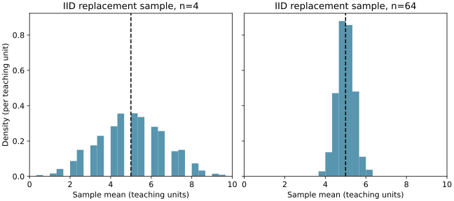
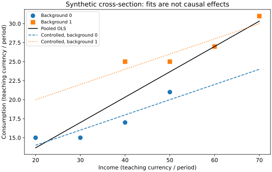

# 58 统计、抽样、回归与因果边界

## 学习目标与先修

先完成第57章和第02章因果，复习均值、平方和函数。本章约6—8小时。你将手算描述统计、区分标准差与标准误、认识抽样和重抽样，计算含截距的最小二乘，并用已知构造样本解释遗漏变量。不是完整计量经济学或显著性检验课程。

全部数来自虚构家庭数据。即使使用“收入”“消费”，也没有因此获得现实住户调查代表性；更不能把一个横截面斜率直接称作宏观边际消费倾向。

## 1. 均值、中位数与离散程度

清理后的消费为15、15、17、21、25、25、27、31。均值是总和176除8，得22；中位数是排序后中间两个21与25的平均，得23。均值对极大值较敏感，中位数描述另一种中心，不能只凭它们谁更大判定资料正确。

**样本方差**先算每个值相对均值的差，平方后相加，再除n−1。本例差为−7、−7、−5、−1、3、3、5、9，平方和248，所以样本方差248/7≈35.428571；样本标准差取平方根，约5.952190，单位恢复为教学币/期。方差单位是原单位的平方。

分母n−1来自用同一样本估计均值后的自由度调整，在独立同分布抽样等条件下用于估计总体方差；并非所有“描述一张表”都必须使用这个分母。若将已知六个数视作完整有限人口并计算它自己的离散度，分母就是人口个数n。

NumPy默认`np.std`使用`ddof=0`，本课样本标准差明确写`ddof=1`，不能因一个默认不同就以为两套软件矛盾。[官方std说明](https://numpy.org/doc/stable/reference/generated/numpy.std.html)核验2026-11-13。完整函数`descriptive`同时标出n、均值、中位数、样本方差和标准差。

**标准误**描述估计量在重复抽样中的变化，**标准差**描述观察值的离散。独立同分布、有限方差等条件下，样本均值标准误可估为s/√n，本例约2.104417。8户的s为5.952190，不能拿它直接冒充均值的标准误。样本依赖、复杂抽样或非随机缺失时不能机械套用。

## 2. 总体、样本与重复抽样

**总体**是目标对象集合，**样本**是实际观察的部分，**抽样框**是能被抽到的名单。只访问能上网的人，可能漏掉其他人；样本再大也不会自动修正这种覆盖偏差。

为把概念变成可复算问题，本例另造有限人口0、2、4、6、8、10，均值5、人口方差35/3。每次等概率、有放回、独立抽n个，再求均值，重复2000次。单次可能抽到同一个数多次，那是本试验“有放回”的规则，不是CSV重复错误。

在这个已知试验中，样本均值的理论方差是总体方差除n：n4时35/12≈2.916667，n64时35/192≈.182292。样本量增加16倍，理论标准误缩为1/4，不是1/16。实际2000次模拟方差会接近而不会必定精确相同。



`rng=np.random.default_rng(seed)`创建随机数生成器；种子让同一环境下的操作可重复。`rng.choice(population,size=(2000,n),replace=True)`产生2000行，每行一次样本；`.mean(axis=1)`沿每行的列求均值。`axis=0`会得到各列跨试验的均值，回答另一个问题。`seed`固定不代表结果没有随机模型，也不保证所有未来NumPy版本逐字节相同，参见[Generator文档](https://numpy.org/doc/stable/reference/random/generator.html)。

## 3. bootstrap是重抽样，不是制造新调查

不知道真实总体时，一种方法是把现有n行当作经验分布，有放回重抽n行，重复计算统计量，观察变化。这里示范消费均值的**bootstrap**，不是复制出更多独立受访者。

本例取重抽均值的2.5%与97.5%分位点，使用线性插值`np.quantile(...,method="linear")`。固定本课环境和种子，演示区间约18.243750—25.756250。区间不是观察值的95%范围，也不是说“固定总体均值有95%概率在这个已算区间里”。

只有在抽样和估计条件适合时，才能讨论区间方法的覆盖性质；本课8户是人为构造样本，没有真实随机调查机制，所以明确称“iid重抽样演示区间”。涉及同一住户多期、村庄聚类或时间序列时，按单行独立重抽往往不合适。本课没有实现这些更复杂方案，也没有输出p值。

## 4. 相关：同向变化不等于机制

收入x均值45，消费y均值22。记Sxx=Σ(x−均值x)²=1800，Syy=248，Sxy=Σ(x−均值x)(y−均值y)=600。**相关系数**r=Sxy/√(Sxx Syy)，约.898027，无单位，位于−1与1之间。

换货币单位不改变r，却会改变回归系数的数值单位。相关0也不能排除非线性关系；相关高也可能来自共同背景、反向作用或选择样本。在本例中高背景组收入总体较高、消费也较高，混合起来的正相关不只是收入那一条机制。

## 5. 简单最小二乘先手算

设拟合式ŷ=a+bx。残差e=y−ŷ，是这一观察值与拟合值之差；不能将它自动解释为某个真实外生经济冲击。**最小二乘OLS**选a、b，使残差平方和SSE最小。含截距、x有变化时：

```text
b = Sxy/Sxx = 600/1800 = 1/3
a = 平均y-b*平均x = 22-45/3 = 7
```

所以收入增加1教学币，拟合消费增加1/3教学币。它是该样本的拟合斜率，不是“提高任何家庭收入1必然导致消费增加1/3”的因果保证。

代入8行，SSE48。**R²**=1−SSE/Syy=25/31≈.806452，描述含截距样本内拟合相对常数均值的改善，不是“解释了80.65%的因果”。如果y恒定，Syy为0，本课返回`None`，不硬填0或1。

RMSE=√(SSE/n)=√6≈2.449490；用于通常同方差误差尺度估计的残差标准差为√[SSE/(n−p)]，p含截距，简单式p2，所以√8≈2.828427。两者分母和用途不同，不能都只写“误差”不解释。

OLS的目标与线性参数模型可查[NIST说明](https://www.itl.nist.gov/div898/handbook/pmd/section1/pmd141.htm)，核验2026-11-13；本课数字和演算为独立构造。

## 6. 背景变量怎样改变答案

数据其实按y=10+.2x+6z+u构造。z是教学背景0/1，8个噪声为1、−1、−1、1、1、−1、−1、1，恰好与截距、x、z正交。加入z拟合后，截距10、收入斜率.2、背景系数6，SSE8、R²30/31。

简单式没包含z，而x与z共同变化，便将一部分背景差异算进收入斜率。这里Sxz=Σ(x−45)(z−.5)=40，所以简单斜率=.2+6×40/1800=1/3。这是可手查的遗漏变量示例，不是对现实偏差方向的无条件判断；若相关方向改变，偏差也可能变向。



现实中不知道完整构造，不能认为“控制一个变量就一定恢复真实因果”。控制变量可能测错、遗漏，甚至位于因果链中不该机械控制。是否能解释为因果，需要实验、可信准实验或其他识别设计和条件；“多加几列”和高R²不自动提供这些证据。

## 7. 从一元手算到矩阵程序

多变量时，把一列全1放进设计矩阵X表示截距，再放income、background，8户便是8行3列；系数beta有3项。预测为`X @ beta`。本课用`np.linalg.lstsq(X,y,rcond=None)`求数值解，不直接求`(X.T@X)`的逆，以免把额外的数值问题当成统计结论。

**秩**可以初步理解为有多少列提供独立的信息。如果income所有值相同，它与全1列重复，截距和斜率无法唯一分开。本课拒绝秩不足、观察数不大于参数数或非有限数据。[lstsq文档](https://numpy.org/doc/stable/reference/generated/numpy.linalg.lstsq.html)说明最小二乘和返回秩；即使数值库能给出某个最小范数解，教学程序也不把不唯一系数当作已识别。

程序回代`X.T @ residual`应接近0，残差和也接近0，检验求解与列组织。这个正交性来自OLS运算，不能用它证明真实误差外生。浮点量约10的负12次方不必强制等于机器表示的0。

在课程根目录PowerShell使用第57章环境运行完整入口：

```powershell
Set-Location 'C:\Users\17597\Desktop\tutorial\content\western-economics'
& '.\.venv-economics\Scripts\python.exe' -B '.\source\示例代码\stage10\statistics_demo.py'
```

完整[statistics_demo.py](示例代码/stage10/statistics_demo.py)调用[lab.py](示例代码/stage10/lab.py)，只打印JSON，不写输出文件。先核对n8、均值22、简单1/3、控制.2、SSE48/8，再看抽样和bootstrap字段。不要只找一行“成功”就忽略统计口径。

## 常见错误

- 标准差当标准误，n与n−1的方差混用，或忽略抽样独立条件。
- bootstrap重复行当数据污染，或把虚构样本区间当真实调查置信区间。
- 回归残差正交便声称真实误差外生，R²高便声称因果已确认。
- 控制变量越多越好，把横截面收入斜率直接用作宏观消费参数。
- 秩不足仍解释唯一系数，或把浮点近似误差当经济冲击。

## 练习与参考答案

1. [1,3]均值、样本方差与总体自身方差？答：2、2、1，分母分别n−1和n。
2. iid抽样n从4增64，理论标准误缩多少？答：1/4；覆盖偏差不会自动同时缩小。
3. 本例简单式x50时拟合y？答：7+50/3≈23.666667；真实某户可在拟合线上下。
4. 控制式x50、z0与z1的预测？答：20与26；这里6来自已知构造，不是已识别现实背景干预效应。
5. 简单式自由度、RMSE和残差标准差？答：8−2=6，√6与√8。
6. 为什么增R²不足以证明模型更适合预测政策？答：样本内加入变量通常会改善拟合，但可能过拟合、改变条件或仍有内生性，需要独立验证与识别。

## 完成条件

能手算均值、方差、相关和简单OLS，解释控制式、残差与秩，指出本样本至少三项不能外推现实的原因。接着用完整项目把定义、数据、图和限制写成他人能复现的报告。
