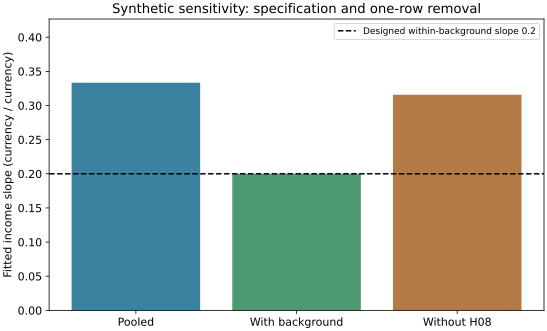

# 59 经济学实验台：从数据到完整报告

## 学习目标与先修

先完成前九阶段与57—58章，至少亲自运行过一个市场模型、一个核算模型和统计例程。本章约5—7小时。你将完成一个范围明确的小项目：保存输入与处理记录，比较模型和敏感性，生成表、图、报告与复现清单。全部文件已提供，不要求开发服务器或网页应用。

此前的阶段例程继续保留。本章v1.0选择一个小问题深入完成，不强行把微观、银行、汇率、增长的独立接口拼成国家预测器。**综合**体现为经济问题、数据、计算与证据链完整，不是一次运行的模块越多越好。

## 1. 先把问题缩到可回答

问题是：“同一组合成家庭资料里，收入—消费斜率为何随背景控制变化？能不能把这条斜率直接用来预测税制改革？”研究对象为一期虚构家庭，单位教学币/期，没有现实国家或年份，更没有真实政策试验。

第58章得到简单式斜率1/3，控制背景后.2。本项目把这两个结果转成报告，进一步删除收入最高的H08做敏感性检查，并在拟合式中统一改变收入作条件代入。它展示规格、样本选择和外推的作用，不声称发现真实减税效果。

为什么不直接套第39章消费函数？那里是明确假设的总量行为模型；这里是8个家庭的横截面拟合。两者对象、时间与识别不同。即使字母都叫收入和消费，也不能把回归系数未经判断移进宏观乘数。

## 2. 项目已经包含哪些文件

独立项目位于[stage10运行说明](示例代码/stage10/运行说明.md)所在目录，核心文件如下：

| 文件 | 职责 |
| --- | --- |
| arrays_tables.py | 数组与清理账本入门，只打印 |
| statistics_demo.py | 描述、回归与抽样JSON，只打印 |
| lab.py | 完整清理、分析、绘图和报告函数 |
| report_project.py | 解析终端参数，调用完整项目 |
| reproduce.py | 复制必要项目文件、换目录两次运行并比散列 |
| data/households_raw.csv | 原始虚构样本，不覆盖 |
| data/metadata.json、config.json | 数据字典与默认种子、重复次数、收入改变量 |
| requirements.txt | 实际验证的三个直接依赖版本 |

程序用`Path(__file__).resolve().parent`找到自身目录，输入再由`HERE / "data"`定位。因此从其他工作目录执行也能找到输入。输出由`--output`显式指定；相对输出路径仍以当前终端目录解释。区分这两种路径，是可复现程序的基本要求。

`report_project.py`中`argparse`把`--income-change 10`等终端文本解析为数值，`type=float`不自动限制经济范围，因此共享函数还检查有限值与−20到20。随机种子为0到2³²−2的整数，重复次数100到20000。参数不合法在写文件前拒绝，不先生成半份“成功”结果。

## 3. 先预测，再运行完整项目

在Windows PowerShell、课程根目录执行，使用第57章环境。选择尚不存在的目标目录；例程拒绝覆盖，重复实验换一个新名称：

```powershell
Set-Location 'C:\Users\17597\Desktop\tutorial\content\western-economics'
& '.\.venv-economics\Scripts\python.exe' -B '.\source\示例代码\stage10\report_project.py' --output '.\my-results\stage10-base'
& '.\.venv-economics\Scripts\python.exe' -B '.\source\示例代码\stage10\report_project.py' --output '.\my-results\stage10-negative' --income-change -10 --seed 7 --replications 1000
```

第一条应打印版本1.0、来源synthetic_teaching_data、`outputs:10`。这是清单中列出的10份输出，另加`run-manifest.json`自身，目录里共11个文件。不是每份文件都单独计为新例程。

运行前写下：清理8行，均值收入45/消费22；简单收入斜率1/3、控制.2；SSE48/8；删H08后斜率6/19≈.315789。默认收入+10的条件拟合变化分别10/3和2，有1行超过原样本收入上限70。

第二条改变收入代入方向、种子与模拟次数，不改变清理样本或OLS系数。消费条件变化变为−10/3和−2；新种子只改抽样演示。不能因为改动了三个参数，就假定每一个输出字段都应该不同。

## 4. 逐份检查输出，而不是只看退出码

| 输出 | 你要检查什么 |
| --- | --- |
| clean.csv | 8行按ID排序，H03一次、H09不在，单位未改变 |
| coefficients.csv | 三个模型、七项系数；每行明确模型与项 |
| summary.json | 清理账本、统计量、SSE/R²、自由度、残差和条件变化 |
| regression.svg/png | 同一观察值、背景分组与拟合线，轴有单位 |
| sampling.svg/png | 有放回有限人口的均值分布，横轴范围一致 |
| sensitivity.svg/png | 三种规格的收入斜率，柱从0开始 |
| report.md | 问题、来源、方法、结果、限制与复现步骤 |
| run-manifest.json | 输入/程序/配置SHA-256、版本和其余10份输出散列 |

**序列化**是把内存对象变成可保存的文本，例如字典写JSON。程序用`allow_nan=False`，避免把非标准JSON的NaN写成看似正常结果；真正不适用的R²等用`None`，写为`null`。CSV用于表，JSON保留层次，两者不能互相替代所有用途。

参考完整结果见[报告](最终实践参考结果/report.md)、[汇总](最终实践参考结果/summary.json)、[系数表](最终实践参考结果/coefficients.csv)与[输入输出清单](最终实践参考结果/run-manifest.json)。这是维护者实际生成的参考，不是你已经完成作业的证明。

## 5. 两种敏感性回答不同问题

加入background后斜率由.333333降.2，是模型规格变化。删H08后简单斜率约.315789，是样本变化。前者并非自动正确、后者也不是发现了坏数据；本例所有8户都属于有效构造样本，删行只为观察结果对单个观察的敏感程度。



检查不能只找让答案好看的删法。事先说明为什么比较、保留原结果、报告变化方向和大小；真实研究还需看影响诊断、数据错误和研究设计，不可把“不符合预期”当作删除理由。

收入统一+10的另一组代入，也不等于税制改革的反事实。消费还可能因预期、财富、价格和政策规则变化；本例只是保持所拟合式其他部分不变。`outside_income_support:1`只检查原样本整体收入区间，**不代表已排除分组内外推或其他支持问题**。

图上控制线延伸在统一横轴范围里，是便于比较斜率；某一组在某些收入没有观察值，延长线不是新增证据。写结论时要区分“数据中看到”“模型条件推出”“现实还需什么证据”。

## 6. 数值残差与输入散列各证明什么

简单式`residual_sum`约10的负13次方，`normal_equation_max_abs`约10的负12次方，接近0。它们检验OLS结果是否满足相应数值条件，不检验变量是否外生。SSE不是0也不是错误，因为数据设计有噪声和遗漏背景。

**SHA-256散列**把文件字节转换成固定长度标识，内容改变通常会得到不同标识。它能检测“这次是否用了同一份输入”，不能证明这份输入是真的、分类正确或得到授权。清单不记录自己的散列，避免自我引用；ZIP另有包级检查。

固定种子、固定SVG日期设置和图中标识让同一环境下文件可比较，但不同操作系统、字体、库或数值计算库可能改变图或末位浮点。跨环境复现先比较定义与关键数值，再解释字节差异，不把图文件散列不同直接判作经济结果不同。

## 7. 自己写一份报告

先用[读者模板](最终实践-读者报告模板.md)填问题与假设，再看参考报告。至少保留一项纸笔复算，说明两种敏感性，并区分模拟区间与真实调查推断。结论建议写成：“在这组明示构造数据和给定拟合规格下……；若用到真实税制问题，还需要……”。

不要只复制自动生成文本后改标题。你应能指出每个主要结论对应哪个输入、哪条公式、哪个输出字段，能说明一个反例怎样改变判断。毕业作品可以继续研究其他小问题，但须提供同样的证据链，不能因为引用了多个宏观术语就略去复算。

## 常见错误

- 项目目录很大就称综合完成，却没有明确问题、单位与独立复算。
- 从其他cwd运行找不到输入，用硬编码个人绝对路径修补。
- 重复运行覆盖旧结果，改参数后仍沿用旧报告。
- 把残差近0当外生性检验，把散列一致当数据真实。
- 用横截面斜率直接预测减税或宏观乘数，忽略外推。

## 练习与参考答案

1. 为什么打印10份输出，目录却有11份？答：清单列其余10份，不自我散列，清单自身为第11份。
2. 删除H08后的斜率是否必须接近.2？答：不必须，它仍是未控制背景的简单式，实际为6/19。
3. `--income-change -10`会改变OLS吗？答：不会，训练样本未改，只改变条件代入；种子影响模拟，不影响确定性OLS。
4. 一份错误数据每次散列一致，能否算数据真实？答：不能，只说明字节相同，需要来源和分类核验。
5. 为什么最终项目没有接实时API？答：本项目研究给定样本与证据链，冻结输入使其可重建；实时资料需另记版本、修订和使用范围。

## 完成条件

能从新输出目录生成11份文件，手查系数与残差，解释两种敏感性和一项外推，写出自己的完整报告。下一章把“在自己电脑运行一次”推进到新目录复现与反例验收。
