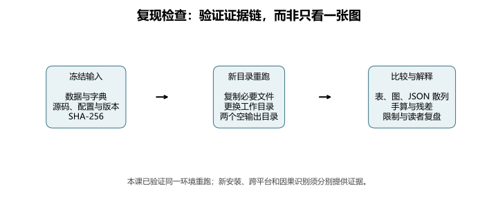

# 60 独立复现、反例与学习复盘

## 学习目标与先修

先完成第59章自己的基准输出与初稿。本章约4—6小时。你将复制必要项目文件，在不同工作目录重建结果，比较证据，验证失败条件，并完成全课复盘。课程正文交付完成和个人学会是两件事：维护者测试提供参考，读者仍须独立解释与改造。

**可复现**在本章先指相同输入、程序和给定环境可以重建结果。用独立数据重复研究是更广的工作；新电脑全新安装、不同系统数值一致与真实因果可信，也要分别验证，不能由一次脚本成功全部推定。

## 1. 把“我这里能跑”拆成证据

第59章输入按脚本位置定位，输出按命令指定。若程序暗中依赖当前cwd、作者电脑的绝对数据路径或旧输出，它可能在原目录正常，在副本就失败。检查这些问题，需要让程序失去那些偶然便利。

完整[reproduce.py](示例代码/stage10/reproduce.py)只复制stage10的五份Python、requirements与data。它不复制虚拟环境，不搬现有结果，不依赖其他阶段模块；在新临时目录中用同一个解释器调用项目两次，分别写入两个全新输出目录，然后比较11份文件散列。

它会复用当前环境已有的NumPy/pandas/Matplotlib，所以结果只能叫“同环境新目录复现”，不能写成“全新安装验证通过”。下载包保留依赖说明，但不携带Python及第三方二进制包。



## 2. 执行并读懂复现记录

Windows PowerShell、课程根目录执行，目标名称换成尚不存在的目录：

```powershell
Set-Location 'C:\Users\17597\Desktop\tutorial\content\western-economics'
& '.\.venv-economics\Scripts\python.exe' -B '.\source\示例代码\stage10\reproduce.py' --output '.\my-results\stage10-reproduction'
Get-Content -LiteralPath '.\my-results\stage10-reproduction\reproduction.json' -Encoding utf8
```

应输出`successful:true`、`runs:2`、`matchingArtifacts:11`。记录中两个子进程退出码均0，每份文件散列相同。脚本结束后清理自己创建的临时副本，保留`reproduction.json`作为证据；因此不会留下两套结果供你继续编辑，自己的正文报告仍在第59章输出目录。

程序使用`subprocess.run`启动子进程，参数以列表传递，而不是拼成一长串终端命令；`sys.executable`保证使用当前解释器。`cwd=temp`显式换目录；`capture_output=True`保存标准输出与错误。非0退出码代表程序失败，需要先读错误，不能只因某份PNG已经存在就判通过。

运行时设独立Matplotlib缓存目录，避免依赖作者的字体缓存位置。临时路径由程序创建，并检查解析后的父目录；不会让用户输入的任意路径参与递归清理。`--output`若已存在则拒绝，不删除读者旧作业。

## 3. 如何处理“不同”

先比输入和源码散列、配置、库版本，再比关键数值，最后比渲染文件。若种子或重复次数不同，模拟结果应变化；若收入改变量不同，条件预测应变化；若只换cwd，确定性结果不应变化。

| 发现 | 优先检查 | 能得出的结论 |
| --- | --- | --- |
| 清理行数不同 | 原CSV、缺失记号、去重规则 | 输入或处理可能不同 |
| OLS系数不同 | 行选择、设计矩阵、单位、秩 | 规格或数据可能改变 |
| 抽样末位不同 | NumPy版本、种子、调用顺序 | 未必是经济公式错 |
| 图散列不同、数值相同 | 字体、后端、图形库、元数据 | 可能是渲染差异 |
| 所有散列相同 | 仍核对定义、来源与推导 | 字节一致不证明因果正确 |

同一环境本课采取严格字节比较，是可明确验收的目标；跨系统则需要预先定义数值容差与图的视觉要求。不要事后不断放宽容差直到“通过”，也不要把正常浮点近似强改成0掩盖真实差额。

## 4. 给程序正确的反例

先保留原数据和输出，只在自己的副本试错。下面终端命令故意传坏参数，**预期失败是练习成功的一部分**：

```powershell
& '.\.venv-economics\Scripts\python.exe' -B '.\source\示例代码\stage10\report_project.py' --output '.\my-results\invalid-count' --replications 0
& '.\.venv-economics\Scripts\python.exe' -B '.\source\示例代码\stage10\report_project.py' --output '.\my-results\invalid-nan' --income-change nan
```

第一条预计退出2、提示重复次数范围；第二条预计退出2、拒绝非有限数。程序在创建目标目录前检查，不应写出一份带NaN的“正常报告”。保留实际错误文字，解释它保护了哪一个计算条件。

再在副本CSV把重复H03的一份消费改成999，清理应拒绝冲突ID，而不是随意取第一行或平均。把全部收入改相同值，带截距简单回归应因设计矩阵秩不足拒绝；这不是让电脑“再努力算一次”能解决的统计识别问题。

此外，能运行的反例同样重要：改变背景与收入的配对方向，遗漏变量偏差方向可能改变；把消费数乘100，斜率与误差单位改变，但相关系数不变。对真实新数据则需重新核验字典与处理规则，不直接把本课的ID与数值范围强套上去。

## 5. 读者毕业验收

按[第十阶段实践](第十阶段-实践说明与验收.md)和[报告模板](最终实践-读者报告模板.md)交付个人作品。至少有基准与替代参数输出、两种规格敏感性、手算、复现记录、一个拒绝输入，以及自己写的限制说明。

建议向另一个人解释：为什么经济模型必须先有假设；为什么GDP、价格与人均量需要口径；为什么税负不只看法定缴税者；为什么IS—LM、汇率制度和索洛回答不同时间与制度问题；为什么相关、拟合、核算与因果是不同证据。每个问题选课程中的一个具体数例，不只背定义。

如果解释卡住，返回相应阶段的练习，不必从头重看全部60章。问题集中在Python路径时回05/11，单位与增长回03/34/53，条件模型回43/52/54，统计证据回58。把错题写成“原判断—反例—修正—可复算证据”，比只记“粗心”更有用。

## 6. 全课完成后怎样继续

后续可分别深入微观最优化、动态宏观、概率统计、计量识别和真实数据处理。现在不需要同时加入所有高级工具。先在一个清晰问题上掌握研究设计，再决定需要回归、实验、时间序列还是结构模型。

本课已覆盖60章入门正文和一个完整、范围有限的报告项目；没有因此完成全部经济学、现实预测或任何读者个人毕业验收。维护者实际验证见[第十阶段记录](验证/第十阶段验证记录.md)，当前课程状态与历史批次分开保存；网站构建由整合任务统一执行。

## 常见错误

- 把同一电脑新目录复跑称作新安装或所有系统验证。
- 只看图或退出码，不比输入、参数与关键数值。
- 错误输入被拒绝就认为测试失败，反而让NaN进入正式报告。
- 覆盖原数据试错后忘记来源，或为一致而手工改生成结果。
- 教程正文完成便把自己的练习也标为通过。

## 练习与参考答案

1. 相同输入、代码与环境，只换cwd，哪些结果应保持？答：本项目全部11份输出应相同；路径未写入结果。
2. 两台电脑图散列不同是否足以判公式错？答：不足，先比数据、版本和关键数值，再查字体与渲染。
3. 全部income相同为何拒绝OLS？答：它与截距列不独立，截距和收入斜率无法唯一分开。
4. 真实非随机调查样本有很多行，能否仅凭数量将bootstrap当有效调查区间？答：不能，覆盖、选择、依赖与抽样设计仍需处理。
5. 最终一句结论应包含什么？答：对象与条件、结果与证据、尚未支持的解释及下一步所需验证。

## 完成条件

从新目录复现成功，能独立解释散列、残差与因果的不同，完成反例与个人报告，并按评分表验收。保留你的实际命令、版本与错误记录；这是完成本课主线的可检查证据。
