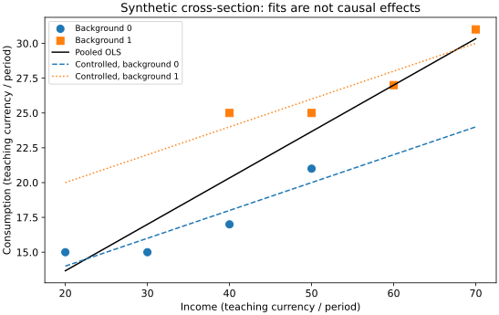
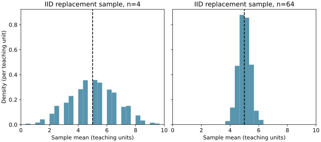
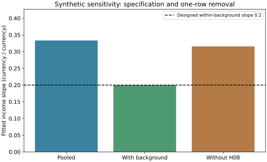

# 最终实践参考报告：收入与消费的拟合为何改变

## 问题与证据范围

同一组虚构横截面中，收入—消费斜率为何随背景控制而变化？本报告使用synthetic_households_v1，共一期、无真实地域或住户；收入与消费均为教学币/期。数据不是概率抽样，结论不外推真实总体，也不把横截面斜率称作宏观边际消费倾向。

## 数据与处理

原始10行先删除1行精确重复H03，再删除收入缺失的H09，保留8行，按ID排序。缺失未填0或均值；同一ID冲突、无穷、非数字与域错误拒绝。数据由10+.2income+6background+已知噪声构造，background非随机政策。输入和程序SHA-256、版本、参数见run-manifest.json；数据字典随原程序data/metadata.json提供。

## 方法与独立演算

带截距最小二乘最小化残差平方和，比较简单式、加入background及删H08后的简单式。手算income均值45、consumption均值22，Sxx1800、Sxy600，故简单斜率600/1800=1/3，截距22−45/3=7。设计噪声与收入和背景正交，控制式应恢复10、.2、6；这来自数据构造，不代表现实控制变量即可消除偏差。

## 结果、敏感性与图表

简单斜率0.333333，控制后0.200000，删H08后0.315789。简单/控制SSE分别48.000000/8.000000；R²分别0.806452/0.967742。普通方程最大残差分别4.3e-12/5.14e-12，反映数值求解检查，不是因果检验。

在各拟合式中让收入统一改变10.00、其余保持不变，预测消费改变量为3.333333和2.000000。有1行超出原收入区间。这是条件代入和外推提示，不是识别出的税制改革效应。不能将两条斜率直接代入宏观乘数预测。

## 不确定性与限制

固定种子20261113、2000次重复，有限人口抽样演示独立同分布有放回时均值方差随n下降；bootstrap区间仅是对8行经验分布的iid重抽样演示，不是真实调查置信区间。增加样本量不能消除覆盖偏差、遗漏因素或制度变化。

构造样本让我们知道机制；真实资料未必记录全部混杂因素。横截面收入可能内生，测量也可能出错；拟合、删除一行或提高R²不能独立证明因果。本项目未进行工具变量、实验或动态宏观估计。

## 复现与读者任务

在stage10目录执行python report_project.py --output my-results/base；目标目录必须尚不存在。再执行python reproduce.py --output my-results/reproduction，从新临时副本、不同cwd运行两次比较输出散列。实际维护者结果见课程验证记录。此参考报告由完整程序生成，不代替读者自己的参数比较、解释和毕业验收。
